# Paris Devs / Sistema de gestão financeira.

**Grupo:** Grupo 9 / Erick da Silva Victorino, Felipe Barbosa do Patrocínio, Giovanni Angel Alipaz Chambi, Josué Alvarez Avendano, Kayke Rodrigues da Silva, Nicolly de Souza Olsak e Samara da Silva Freitas Farias

**Turma:** ADS A / 3º Semestre

**Destino deste arquivo:** Figma ou Google Stitch

Cliente Paris 6, grupo de restaurantes com vários CNPJs e várias contas bancárias. A plataforma é um website interno: o administrador convida os usuários e não há cadastro público. O analista conecta os bancos, confere a conciliação e revisa a classificação. O gestor acompanha, no mesmo dia, receita, despesa, caixa e DRE gerencial do CNPJ ou do grupo.

## Problema

O fechamento financeiro leva cerca de 45 dias e depende de planilhas. Extratos de bancos diferentes, classificação manual, duplicidade e transferência interna tratada como receita ou despesa atrasam a decisão e distorcem o resultado.

## Proposta de valor

Reduzir o fechamento de cerca de 45 dias para uma visão diária de caixa e de resultado, com conciliação e classificação rastreáveis.

## Público-alvo

Gestores e sócios do grupo Paris 6; analistas e contadores da operação financeira; administradores de acesso, CNPJ, banco e plano de contas; auditores em leitura.

## Plataforma

- Plataforma principal: Web responsivo
- Dispositivo de referência: Desktop, 1440×900 px. Telas de consulta (dashboard, DRE, fluxo de caixa e alertas) também em 390×844 px.
- Front-end: React, TypeScript, Vite, Tailwind CSS e shadcn/ui. Gráficos em Recharts.
- Referências visuais: Conta Azul e Omie, pela rotina financeira de empresa; Nubank, pela leitura rápida de saldo e resultado. A cor da interface é bege e cinza quente, própria deste sistema.

A referência de layout é o desktop. As telas marcadas na planilha como consulta também têm medida de 390×844 px. A planilha não define um grid de colunas nem breakpoints intermediários.

## Persona

As personas abaixo são as linhas preenchidas na aba Persona. Implicações de design saem só desses campos.

### P01 — Marcelo Santos

- Idade: 45
- Ocupação: Empreendedor / Dono de Restaurante
- Contexto / rotina: não informado na planilha
- Familiaridade digital: Intermediário
- Dispositivo mais usado: Desktop
- Acessibilidade: não informada na planilha

**Objetivo:** Visualizar melhor as receitas, despesas e lucros diarios para tomar decisões mais assertivas.

**Dores:**

• Dificuldade para visualizar rapidamente a situação financeira do restaurante;
• Processos contábeis muito manuais e demorados;
• DRE pouco visual, dificultando a interpretação dos resultados;
• Necessidade de tomar decisões com mais agilidade, principalmente sobre custos;
• Dificuldade em identificar onde pode reduzir gastos ou melhorar a receita.

**Frase / traços:**

• Apaixonado por gastronomia;
• Criativo e Inovador;
• Comunicativo e influente;
• Empreendedor;
• Orientado a resultados.

### P02 — Gabriela Veríssimo

- Idade: 26
- Ocupação: Contadora
- Contexto / rotina: não informado na planilha
- Familiaridade digital: Intermediário
- Dispositivo mais usado: Desktop
- Acessibilidade: não informada na planilha

**Objetivo:** Otimizar o meu tempo, para apoiar melhor a  equipe e trazer mais resultados

**Dores:**

• Algumas notas fiscais estão disponíveis apenas de forma física;
• Muito tempo gasto para realizar conciliação de notas;
• A plataforma utilizada para construção de CMVs é de difícil manuseio;
•As informações bancárias que precisa não estão disponíveis de forma rápida;
• Pouca facilidade em acompanhar a evolução dos resultados financeiro ao longo dos dias.

**Frase / traços:**

• Dinâmica;
• Organizada;
• Pontual;
• Objetiva;
• Estratégica.

### Implicações de design

- Marcelo Santos usa desktop e precisa ver receita, despesa e lucro no dia. Dashboard, fluxo de caixa, DRE e alertas usam o estilo Valor / KPI (Inter 600, 28 px) e cabem também em 390×844 px, porque a identificação trata essas telas como consulta.
- A DRE dele é pouco visual hoje. DRE-01 mostra o demonstrativo em linhas nomeadas, com o aviso de que a visão é gerencial.
- Gabriela Veríssimo usa desktop e gasta tempo em conciliação, nota e extrato. Extratos, conciliação, classificação, documentos e plano de contas ficam como Somente desktop, em tabela e formulário, não em cartão de celular.
- As duas personas são de familiaridade intermediária. Botões levam verbo (Direto) e o erro diz o que falhou (Preciso), sem jargão de sistema.
- Notas e extrato não dividem a mesma lista: DOC-01 é a central de documentos e EXT-01 é o extrato.
- Administrador e auditor aparecem no público-alvo e nas user stories, e não têm linha na aba Persona.

## Design Tokens

### Cores

Contraste medido entre o HEX e a cor de texto registrada na mesma linha. O mínimo usado na planilha é 4,5:1.

| Token | Papel | HEX | RGB | Texto sobre a cor | Contraste | WCAG AA | Onde é usada |
|---|---|---|---|---|---|---|---|
| `cor-fundo` | Fundo / superfície | #F3EFE6 | 243, 239, 230 | #2C2925 | 12.6:1 | Sim | Fundo da página, atrás de cards e tabelas. |
| `cor-superficie` | Fundo / superfície | #FBF8F3 | 251, 248, 243 | #2C2925 | 13.7:1 | Sim | Cards, linhas de tabela e área principal. |
| `cor-menu` | Fundo / superfície | #E7E1D4 | 231, 225, 212 | #2C2925 | 11.1:1 | Sim | Menu lateral e barra de contexto. |
| `cor-primaria` | Ação principal (primária) | #3E3934 | 62, 57, 52 | #FFFFFF | 11.4:1 | Sim | Botão Entrar, Salvar, Confirmar e Sincronizar. |
| `cor-primaria-escura` | Ação principal (primária) | #2A2623 | 42, 38, 35 | #FFFFFF | 15.0:1 | Sim | Estado hover e pressionado do botão principal. |
| `cor-secundaria` | Ação secundária | #E3DCD0 | 227, 220, 208 | #2C2925 | 10.6:1 | Sim | Botão Cancelar, filtros e ações ao lado da principal. |
| `cor-texto` | Texto principal | #2C2925 | 44, 41, 37 | #F3EFE6 | 12.6:1 | Sim | Títulos, valores e rótulos sobre cor-fundo e cor-superficie. |
| `cor-texto-secundario` | Texto secundário | #5C564E | 92, 86, 78 | #F3EFE6 | 6.3:1 | Sim | Apoio, metadado e descrição sobre o fundo bege. |
| `cor-borda` | Borda / divisória | #9C9486 | 156, 148, 134 | #2C2925 | 4.8:1 | Sim | Contorno de campo, divisão de tabela e borda de card. |
| `cor-sucesso` | Sucesso | #1B5E3B | 27, 94, 59 | #FFFFFF | 7.7:1 | Sim | Status Conciliado, salvo e convite enviado. |
| `cor-alerta` | Alerta | #F6E7C8 | 246, 231, 200 | #6B4308 | 7.1:1 | Sim | Faixa de sugestão para aprovação e aviso de atenção. |
| `cor-erro` | Erro | #8E2F2F | 142, 47, 47 | #FFFFFF | 8.1:1 | Sim | Credencial inválida, divergência e duplicidade. |
| `cor-informacao` | Informação | #3A4C63 | 58, 76, 99 | #FFFFFF | 8.8:1 | Sim | Grupo Informação dos alertas e status em leitura. |
| `cor-destaque` | Destaque | #EFE6D4 | 239, 230, 212 | #2C2925 | 11.7:1 | Sim | Item selecionado no menu e linha em foco. |

Não há token para branco. Onde a paleta registra `#FFFFFF`, o texto usa esse valor sobre `cor-primaria`, `cor-primaria-escura`, `cor-sucesso`, `cor-erro` e `cor-informacao`.

### Tipografia

Família: Inter.

| Elemento | Peso | Tamanho | Altura de linha | Observação |
|---|---|---|---|---|
| Título H1 | 600 | 28 px | 1.2 | Uma vez por tela. Nome da página, como Extratos ou DRE gerencial. |
| Título H2 | 600 | 22 px | 1.3 | Seção dentro da página, como Alertas ou Pendências. |
| Título H3 | 600 | 18 px | 1.4 | Título de card e de bloco. |
| Corpo | 400 | 16 px | 1.5 | Texto de interface. Mínimo de 16 px no parágrafo. |
| Rótulo | 500 | 14 px | 1.4 | Label de campo, coluna de tabela e filtro. Não descer de 14 px. |
| Botão | 600 | 14 px | 1.2 | Altura mínima de 40 px. Largura acompanha o rótulo, com 16 px nas laterais. |
| Valor / KPI | 600 | 28 px | 1.2 | Números de receita, saldo e resultado. Usar algarismos tabulares. |
| Apoio | 400 | 14 px | 1.4 | Data, status e texto secundário. Não usar 12 px em texto de leitura. |

### Espaçamento e raio

| Token | Valor | Uso na planilha |
|---|---|---|
| `espaco-4` | 4 px | Unidade base da escala. |
| `espaco-8` | 8 px | Entre ícone e rótulo, e entre campos empilhados apertados. |
| `espaco-16` | 16 px | Padding interno de campo e distância padrão entre elementos. |
| `espaco-24` | 24 px | Entre seções. Card usa raio de 12 px; campo e botão usam raio de 8 px. |
| `raio-8` | 8 px | Campo e botão, conforme a observação de Espaço 24. |
| `raio-12` | 12 px | Card, conforme a observação de Espaço 24. |

A escala parte de 4 px. Sombra não foi definida na planilha.

## Tom de Voz

Cinco atributos. O texto de interface fica em português do Brasil. Cada atributo vale para a aplicação indicada e não vaza para outro tipo de frase.

| Atributo | Na prática | Escrever | Evitar | Aplicação |
|---|---|---|---|---|
| Direto | O botão diz a ação, com um verbo, sem frase de cortesia. | Sincronizar. Conciliar manualmente. Reclassificar. | Clique aqui para prosseguir com a operação desejada. | Textos de botão (CTA) |
| Preciso | O erro diz o que falhou e o que falta. Não usa ironia nem emoji. | E-mail ou senha incorretos. Informe o motivo da alteração. As faixas não podem se sobrepor. | Ops! Algo deu errado. Tente de novo mais tarde. | Mensagens de erro |
| Profissional | O título nomeia a tela ou o número. O aviso financeiro usa a frase da regra, sem diminutivo. | DRE gerencial. Movimentação interna — não contabilizar como receita/despesa. | Olha só como foi o seu dinheirinho hoje! | Títulos e cabeçalhos |
| Confiável | A confirmação diz o que foi gravado e, quando houver trilha, diz que a auditoria recebeu o registro. | Convite enviado. Classificação salva. O motivo entrou na auditoria. | Prontinho! Pode relaxar que deu tudo certo. | Mensagens de sucesso |
| Claro | A tela vazia diz por que não há dado e qual é o próximo passo, em uma frase. | O extrato ainda não foi importado. Nenhuma pendência em aberto. Cadastre ao menos dois CNPJs para comparar. | Nada por aqui ainda. Que tal começar uma nova jornada? | Estados vazios |

Regras que saem dessa tabela:

- Botão é um verbo: Sincronizar, Conciliar manualmente, Reclassificar, Entrar, Salvar, Confirmar, Cancelar, Convidar.
- Erro nomeia a falha: credencial, motivo vazio, faixa sobreposta, arquivo, CNPJ, par incompatível.
- Título é o nome da tela ou da regra. A transferência interna usa a frase da planilha: "Movimentação interna — não contabilizar como receita/despesa."
- Sucesso diz o que foi gravado. Quando há trilha, diz que o motivo entrou na auditoria.
- Estado vazio diz por que não há dado. Exemplos da aba Conteúdo: "O extrato ainda não foi importado.", "Nenhuma pendência em aberto.", "Cadastre ao menos dois CNPJs para comparar."
- A planilha não definiu tom para placeholder, notificação, e-mail nem texto legal.

## Componentes

Peças que se repetem nas abas Telas do Software, Conteúdo das Páginas, Paleta e Tipografia. Estado que a planilha não descreve fica em Lacunas do briefing.

### Botão

- Anatomia: rótulo no estilo Botão (Inter 600, 14 px, altura de linha 1.2), padding lateral `espaco-16`, altura mínima 40 px, raio `raio-8`.
- Principal: fundo `cor-primaria`, texto `#FFFFFF`. Hover: fundo `cor-primaria-escura`, texto `#FFFFFF`.
- Secundário: fundo `cor-secundaria`, texto `cor-texto`. É o caso de Cancelar e de filtros ao lado da ação principal.
- Padrão: rótulo visível, área clicável com a altura mínima.
- Carregando: o rótulo da própria tela troca para o gerúndio já escrito no conteúdo, como "Sincronizando" ou "Enviando". Não há outro rótulo de espera na planilha.
- Erro: o botão permanece; a mensagem usa `cor-erro` e o texto da coluna Texto final.

### Campo de formulário

- Anatomia: rótulo no estilo Rótulo (Inter 500, 14 px) acima do campo; valor no estilo Corpo (Inter 400, 16 px); borda `cor-borda`; fundo `cor-superficie`; texto `cor-texto`; padding `espaco-16`; raio `raio-8`.
- A distância entre campos empilhados apertados é `espaco-8`.
- Erro: frase abaixo do campo, em `cor-erro`, copiada da tela. Exemplos: "E-mail ou senha incorretos.", "Informe o motivo da alteração.", "CNPJ inválido."
- Campos de data de vencimento e de competência permanecem separados nas telas FIN-03 e FIN-07.

### Card

- Anatomia: fundo `cor-superficie`, raio `raio-12`, título no estilo Título H3, valor no estilo Valor / KPI, apoio no estilo Apoio com `cor-texto-secundario`.
- A distância entre o card e a seção seguinte é `espaco-24`. O padding interno do card não foi especificado; a distância padrão entre elementos é `espaco-16`.
- Usos: KPI do dashboard, resumo de conciliação, resumo de classificação, alerta resumido e visão do grupo.

### Barra de contexto

- Anatomia: fundo `cor-menu`, texto `cor-texto`, três seletores na ordem escrita em DASH-01: grupo, empresa, período.
- Textos de partida: "Grupo Paris 6", "Todas as empresas" e "Período".
- A empresa alterna grupo inteiro, um CNPJ ou uma filial/unidade. A barra não é tela. Fica no topo das telas autenticadas, conforme a nota da aba Telas do Software.
- Modal e drawer abrem sobre a página e não substituem a barra da página de baixo.

### Navegação lateral

- Anatomia: fundo `cor-menu`, item no estilo Rótulo, item selecionado com fundo `cor-destaque` e texto `cor-texto`.
- Itens ligados pelo dashboard, na ordem da coluna Próxima(s) tela(s) de DASH-01: Pendências, Extratos, Conciliação, Central de IA, Plano de contas, Contas a pagar, Contas a receber, Fluxo de caixa, DRE, Analytics, Alertas e Configurações.
- Documentos entra pelo mesmo menu porque DOC-01 declara DASH-01 como tela anterior. A planilha não fixa a ordem desse item em relação aos demais.
- Quem não é administrador vê o menu de configurações reduzido a perfil e segurança, como em CONF-01.

### Tabela

- Cabeçalho no estilo Rótulo. Célula no estilo Corpo. Divisão com `cor-borda`. Fundo da linha `cor-superficie` sobre a página `cor-fundo`.
- Estado sem linha: a frase de vazio da própria tela, em `cor-texto`, no tom Claro.
- Usos: extrato, pendência de conciliação, fila de revisão, documentos, CNPJs, usuários, contas e logs.

### Modal

- Abre sobre a página pai indicada na coluna Arquivo do wireframe.
- Título no estilo Título H2. Ações no rodapé do modal: botão principal e, quando a copy tiver, Cancelar como botão secundário.
- Largura, scrim e fechamento por tecla não foram especificados.

### Drawer

- Painel sobre a página pai, com título no estilo Título H2 e lista ou ficha no corpo.
- Largura e lado da abertura não foram especificados.
- Usos: histórico, detalhe de alerta, detalhe do dia, detalhe de categoria e detalhe do log.

### Mensagem de erro e estado vazio

- Erro: texto em `cor-erro`, estilo Corpo. Sem emoji e sem "ops".
- Vazio: texto em `cor-texto`, estilo Corpo, dizendo a condição. Sem convite genérico para "começar uma jornada".
- Sucesso: texto em `cor-sucesso` quando for status (Conciliado, Convite enviado, salvo). A frase segue o atributo Confiável.
- Alerta de atenção: fundo `cor-alerta` e texto `#6B4308`, como na paleta.

## Telas

Cada tela segue a ordem da aba Telas do Software. O layout lista os componentes de cima para baixo como estão na planilha. Não há imagem de wireframe anexada; o arquivo citado é só o nome previsto.

Páginas usam arquivo próprio, nomeado pelo ID (ex.: wireframe-AUTH-01.png). Modal, drawer, aba e estado reutilizam o wireframe da tela pai, como indicado na coluna Arquivo do wireframe. A barra de contexto (grupo, empresa ou filial e período) fica no topo das telas autenticadas e não é uma tela separada.

## AUTH-01 — Login

- **Módulo:** Autenticação
- **ID:** AUTH-01
- **Objetivo:** Autenticar com e-mail e senha. O acesso de novas pessoas entra por convite do administrador.
- **Perfil de acesso:** Não autenticado
- **Prioridade:** Alta
- **Responsividade:** Mobile, tablet e desktop
- **Wireframe:** wireframe-AUTH-01.png

### Layout

De cima para baixo, sem menu lateral:

1. Logo
2. e-mail
3. senha
4. botão Entrar
5. Entrar com SSO
6. Esqueci minha senha
7. mensagem de erro.

Superfície de página: `cor-fundo`. Blocos e tabelas: `cor-superficie`, borda `cor-borda`. Título da tela no estilo Título H1, uma vez. Seções no estilo Título H2, com `espaco-24` entre elas.

Comportamento: formulário centralizado sobre `cor-fundo`, sem menu lateral. A tela vale na referência 1440×900 px e em 390×844 px.

### Texto

- **Página / seção:** Login
- **Bloco:** Formulário de acesso
- **Tipo:** Formulário
- **Origem do dado:** Entrada do usuário

Texto final:

> Título: 'Entrar' | Campo: 'E-mail' | Campo: 'Senha' | Botão: 'Entrar' | Link: 'Esqueci minha senha' | Botão: 'Entrar com SSO' | Erro: 'E-mail ou senha incorretos.'

**Ação:** Entrar abre AUTH-03. Esqueci minha senha abre AUTH-02. Entrar com SSO abre AUTH-05.

**Observação da planilha:** Sem link de cadastro público.

### Estados

- Padrão
- carregando
- credencial inválida
- campos obrigatórios vazios.

Carregando usa o texto já existente da tela, sem frase nova. Erro e vazio usam as frases da seção Texto quando elas existem.

### Navegação

- **De onde vem:** Nenhuma (entrada do sistema)
- **Para onde vai:** AUTH-03 - Código de verificação / MFA; AUTH-05 - SSO; AUTH-02 - Recuperação de senha

### Requisitos e user stories

- **RF01 — Autenticar usuário** (Alta). O sistema deve autenticar o usuário com e-mail e senha e impedir o uso da plataforma sem sessão válida.
- **RF04 — Entrar com SSO** (Média). O sistema deve oferecer autenticação corporativa e devolver o usuário ao fluxo interno.

- **US01** (Acesso, Alta, 3 pts). Como Gabriela Veríssimo, eu quero entrar com e-mail e senha, para que eu acesse a operação financeira sem criar uma conta por conta própria.
- **US04** (Acesso, Média, 5 pts). Como Administrador da organização, eu quero entrar pelo provedor corporativo, para que a equipe use o acesso da empresa em vez de uma senha solta.

## AUTH-02 — Recuperação de senha

- **Módulo:** Autenticação
- **ID:** AUTH-02
- **Objetivo:** Pedir o envio do código de redefinição para o e-mail informado.
- **Perfil de acesso:** Não autenticado
- **Prioridade:** Alta
- **Responsividade:** Mobile, tablet e desktop
- **Wireframe:** wireframe-AUTH-02.png

### Layout

De cima para baixo, sem menu lateral:

1. E-mail
2. botão Enviar código
3. link Voltar para login.

Superfície de página: `cor-fundo`. Blocos e tabelas: `cor-superficie`, borda `cor-borda`. Título da tela no estilo Título H1, uma vez. Seções no estilo Título H2, com `espaco-24` entre elas.

Comportamento: formulário centralizado sobre `cor-fundo`, sem menu lateral. A tela vale na referência 1440×900 px e em 390×844 px.

### Texto

- **Página / seção:** Recuperação de senha
- **Bloco:** Pedido de código
- **Tipo:** Formulário
- **Origem do dado:** Entrada do usuário

Texto final:

> Título: 'Recuperar senha' | Texto: 'Informe o e-mail da sua conta. Vamos enviar um código de verificação.' | Campo: 'E-mail' | Botão: 'Enviar código' | Link: 'Voltar para login' | Erro: 'Não encontramos uma conta com este e-mail.' | Sucesso: 'Código enviado. Verifique sua caixa de entrada.'

**Ação:** Enviar código abre AUTH-03. Voltar para login abre AUTH-01.

**Observação da planilha:** O código só sai para e-mail já cadastrado.

### Estados

- Padrão
- enviando
- e-mail não encontrado
- código enviado.

Carregando usa o texto já existente da tela, sem frase nova. Erro e vazio usam as frases da seção Texto quando elas existem.

### Navegação

- **De onde vem:** AUTH-01 - Login
- **Para onde vai:** AUTH-03 - Código de verificação / MFA; AUTH-01 - Login

### Requisitos e user stories

- **RF02 — Recuperar senha** (Alta). O sistema deve enviar um código ao e-mail cadastrado e concluir a troca de senha.

- **US02** (Acesso, Alta, 2 pts). Como Gabriela Veríssimo, eu quero receber um código no meu e-mail e redefinir a senha, para que eu volte a entrar sem pedir senha para outra pessoa.

## AUTH-03 — Código de verificação / MFA

- **Módulo:** Autenticação
- **ID:** AUTH-03
- **Objetivo:** Confirmar o segundo fator depois do login ou da recuperação de senha.
- **Perfil de acesso:** Não autenticado, com a senha já validada
- **Prioridade:** Alta
- **Responsividade:** Mobile, tablet e desktop
- **Wireframe:** wireframe-AUTH-03.png

### Layout

De cima para baixo, sem menu lateral:

1. Código de 6 dígitos
2. opção Authenticator
3. Reenviar código
4. Trocar método
5. Lembrar dispositivo.

Superfície de página: `cor-fundo`. Blocos e tabelas: `cor-superficie`, borda `cor-borda`. Título da tela no estilo Título H1, uma vez. Seções no estilo Título H2, com `espaco-24` entre elas.

Comportamento: formulário centralizado sobre `cor-fundo`, sem menu lateral. A tela vale na referência 1440×900 px e em 390×844 px.

### Texto

- **Página / seção:** Código de verificação / MFA
- **Bloco:** Confirmação do código
- **Tipo:** Formulário
- **Origem do dado:** Entrada do usuário

Texto final:

> Título: 'Verificação em duas etapas' | Texto: 'Digite o código de 6 dígitos.' | Campo: 'Código' | Botão: 'Confirmar' | Link: 'Reenviar código' | Link: 'Trocar método' | Opção: 'Lembrar este dispositivo' | Erro: 'Código inválido. Tente novamente.'

**Ação:** Código válido no primeiro acesso abre AUTH-04. Nos demais, abre EMP-01.

**Observação da planilha:** Authenticator é um dos métodos.

### Estados

- Padrão
- código inválido
- código reenviado
- dispositivo lembrado.

Carregando usa o texto já existente da tela, sem frase nova. Erro e vazio usam as frases da seção Texto quando elas existem.

### Navegação

- **De onde vem:** AUTH-01 - Login; AUTH-02 - Recuperação de senha
- **Para onde vai:** AUTH-04 - Configuração do Authenticator; EMP-01 - Seleção de organização

### Requisitos e user stories

- **RF02 — Recuperar senha** (Alta). O sistema deve enviar um código ao e-mail cadastrado e concluir a troca de senha.
- **RF03 — Validar o segundo fator** (Alta). O sistema deve exigir um código de 6 dígitos ou o authenticator depois da senha e permitir configurar o authenticator no primeiro acesso.

- **US02** (Acesso, Alta, 2 pts). Como Gabriela Veríssimo, eu quero receber um código no meu e-mail e redefinir a senha, para que eu volte a entrar sem pedir senha para outra pessoa.
- **US03** (Acesso, Alta, 5 pts). Como Gabriela Veríssimo, eu quero confirmar um código de 6 dígitos ou o authenticator, para que a conta da operação não abra só com a senha.

## AUTH-04 — Configuração do Authenticator

- **Módulo:** Autenticação
- **ID:** AUTH-04
- **Objetivo:** No primeiro acesso, vincular o aplicativo autenticador ao usuário.
- **Perfil de acesso:** Usuário no primeiro acesso
- **Prioridade:** Alta
- **Responsividade:** Mobile, tablet e desktop
- **Wireframe:** wireframe-AUTH-04.png

### Layout

De cima para baixo, sem menu lateral:

1. QR Code
2. chave manual
3. campo do código
4. botão Confirmar dispositivo.

Superfície de página: `cor-fundo`. Blocos e tabelas: `cor-superficie`, borda `cor-borda`. Título da tela no estilo Título H1, uma vez. Seções no estilo Título H2, com `espaco-24` entre elas.

Comportamento: formulário centralizado sobre `cor-fundo`, sem menu lateral. A tela vale na referência 1440×900 px e em 390×844 px.

### Texto

- **Página / seção:** Configuração do Authenticator
- **Bloco:** Vínculo do aplicativo
- **Tipo:** Formulário
- **Origem do dado:** Entrada do usuário

Texto final:

> Título: 'Configurar authenticator' | Texto: 'Escaneie o QR Code ou copie a chave manual e informe o código gerado no aplicativo.' | Campo: 'Código do aplicativo' | Botão: 'Confirmar dispositivo' | Erro: 'O código do aplicativo não confere.'

**Ação:** Confirmar dispositivo abre EMP-01.

**Observação da planilha:** Uso no primeiro acesso.

### Estados

- Padrão
- código do aplicativo inválido
- dispositivo confirmado.

Carregando usa o texto já existente da tela, sem frase nova. Erro e vazio usam as frases da seção Texto quando elas existem.

### Navegação

- **De onde vem:** AUTH-03 - Código de verificação / MFA
- **Para onde vai:** EMP-01 - Seleção de organização

### Requisitos e user stories

- **RF03 — Validar o segundo fator** (Alta). O sistema deve exigir um código de 6 dígitos ou o authenticator depois da senha e permitir configurar o authenticator no primeiro acesso.

- **US03** (Acesso, Alta, 5 pts). Como Gabriela Veríssimo, eu quero confirmar um código de 6 dígitos ou o authenticator, para que a conta da operação não abra só com a senha.

## AUTH-05 — SSO

- **Módulo:** Autenticação
- **ID:** AUTH-05
- **Objetivo:** Intermediar a autenticação corporativa e devolver o usuário ao sistema.
- **Perfil de acesso:** Não autenticado
- **Prioridade:** Média
- **Responsividade:** Mobile, tablet e desktop
- **Wireframe:** wireframe-AUTH-05.png

### Layout

De cima para baixo, sem menu lateral:

1. Provedor corporativo
2. redirecionamento
3. retorno de sucesso ou falha.

Superfície de página: `cor-fundo`. Blocos e tabelas: `cor-superficie`, borda `cor-borda`. Título da tela no estilo Título H1, uma vez. Seções no estilo Título H2, com `espaco-24` entre elas.

Comportamento: formulário centralizado sobre `cor-fundo`, sem menu lateral. A tela vale na referência 1440×900 px e em 390×844 px.

### Texto

- **Página / seção:** SSO
- **Bloco:** Retorno do provedor
- **Tipo:** Parágrafo
- **Origem do dado:** API externa

Texto final:

> Título: 'Entrar com SSO' | Texto em andamento: 'Redirecionando para o provedor corporativo.' | Sucesso: 'Autenticação concluída.' | Erro: 'Não foi possível concluir o acesso pelo provedor.'

**Ação:** Sucesso abre EMP-01 ou AUTH-03. Falha volta a AUTH-01.

**Observação da planilha:** Fluxo intermediário, sem formulário de senha local.

### Estados

- Redirecionando
- retorno autorizado
- provedor indisponível
- acesso negado pelo provedor.

Carregando usa o texto já existente da tela, sem frase nova. Erro e vazio usam as frases da seção Texto quando elas existem.

### Navegação

- **De onde vem:** AUTH-01 - Login
- **Para onde vai:** AUTH-03 - Código de verificação / MFA; EMP-01 - Seleção de organização

### Requisitos e user stories

- **RF04 — Entrar com SSO** (Média). O sistema deve oferecer autenticação corporativa e devolver o usuário ao fluxo interno.

- **US04** (Acesso, Média, 5 pts). Como Administrador da organização, eu quero entrar pelo provedor corporativo, para que a equipe use o acesso da empresa em vez de uma senha solta.

## AUTH-06 — Senha alterada (estado)

- **Módulo:** Autenticação
- **ID:** AUTH-06
- **Objetivo:** Confirmar que a redefinição de senha terminou.
- **Perfil de acesso:** Não autenticado
- **Prioridade:** Média
- **Responsividade:** Mobile, tablet e desktop
- **Wireframe:** wireframe-AUTH-02.png (estado)

### Layout

De cima para baixo, sem menu lateral:

1. Mensagem de sucesso
2. botão Ir para o login.

Superfície de página: `cor-fundo`. Blocos e tabelas: `cor-superficie`, borda `cor-borda`. Título da tela no estilo Título H1, uma vez. Seções no estilo Título H2, com `espaco-24` entre elas.

Comportamento: formulário centralizado sobre `cor-fundo`, sem menu lateral. A tela vale na referência 1440×900 px e em 390×844 px.

### Texto

- **Página / seção:** Senha alterada
- **Bloco:** Confirmação
- **Tipo:** Parágrafo
- **Origem do dado:** Estático

Texto final:

> Título: 'Senha alterada' | Texto: 'Sua senha foi redefinida. Use a nova senha para entrar.' | Botão: 'Ir para o login'

**Ação:** O botão abre AUTH-01.

**Observação da planilha:** Estado de sucesso da recuperação.

### Estados

- Sucesso.

Carregando usa o texto já existente da tela, sem frase nova. Erro e vazio usam as frases da seção Texto quando elas existem.

### Navegação

- **De onde vem:** AUTH-02 - Recuperação de senha
- **Para onde vai:** AUTH-01 - Login

### Requisitos e user stories

- **RF02 — Recuperar senha** (Alta). O sistema deve enviar um código ao e-mail cadastrado e concluir a troca de senha.

- **US02** (Acesso, Alta, 2 pts). Como Gabriela Veríssimo, eu quero receber um código no meu e-mail e redefinir a senha, para que eu volte a entrar sem pedir senha para outra pessoa.

## AUTH-07 — Sessão expirada

- **Módulo:** Autenticação
- **ID:** AUTH-07
- **Objetivo:** Informar que a sessão encerrou e pedir um novo login.
- **Perfil de acesso:** Sessão encerrada
- **Prioridade:** Alta
- **Responsividade:** Mobile, tablet e desktop
- **Wireframe:** wireframe-AUTH-07.png

### Layout

De cima para baixo, sem menu lateral:

1. Texto: Sua sessão expirou. Faça login novamente.
2. botão Entrar.

Superfície de página: `cor-fundo`. Blocos e tabelas: `cor-superficie`, borda `cor-borda`. Título da tela no estilo Título H1, uma vez. Seções no estilo Título H2, com `espaco-24` entre elas.

Comportamento: formulário centralizado sobre `cor-fundo`, sem menu lateral. A tela vale na referência 1440×900 px e em 390×844 px.

### Texto

- **Página / seção:** Sessão expirada
- **Bloco:** Aviso de sessão
- **Tipo:** Mensagem de erro
- **Origem do dado:** Estático

Texto final:

> Título: 'Sessão expirada' | Texto: 'Sua sessão expirou. Faça login novamente.' | Botão: 'Entrar'

**Ação:** Entrar abre AUTH-01.

**Observação da planilha:** Interrompe qualquer tela autenticada.

### Estados

- Sessão expirada.

Carregando usa o texto já existente da tela, sem frase nova. Erro e vazio usam as frases da seção Texto quando elas existem.

### Navegação

- **De onde vem:** Qualquer tela autenticada
- **Para onde vai:** AUTH-01 - Login

### Requisitos e user stories

- **RF01 — Autenticar usuário** (Alta). O sistema deve autenticar o usuário com e-mail e senha e impedir o uso da plataforma sem sessão válida.

- **US01** (Acesso, Alta, 3 pts). Como Gabriela Veríssimo, eu quero entrar com e-mail e senha, para que eu acesse a operação financeira sem criar uma conta por conta própria.

## EMP-01 — Seleção de organização

- **Módulo:** Contexto empresarial
- **ID:** EMP-01
- **Objetivo:** Escolher o grupo e o recorte inicial: grupo inteiro, um CNPJ ou uma filial/unidade.
- **Perfil de acesso:** Administrador, analista, gestor e auditor
- **Prioridade:** Alta
- **Responsividade:** Mobile, tablet e desktop
- **Wireframe:** wireframe-EMP-01.png

### Layout

Topo da página autenticada: barra de contexto (`cor-menu`) com grupo, empresa e período.

Em seguida, na ordem dos componentes principais:

1. Grupo Paris 6
2. empresas do grupo
3. opção Todas as empresas
4. filial ou unidade, quando houver.

Superfície de página: `cor-fundo`. Blocos e tabelas: `cor-superficie`, borda `cor-borda`. Título da tela no estilo Título H1, uma vez. Seções no estilo Título H2, com `espaco-24` entre elas.

Comportamento: referência 1440×900 px, com menu lateral e conteúdo. A planilha também marca esta tela para 390×844 px. Nesse tamanho, o que acontece com o menu não está descrito. Cards empilham; tabela, quando a copy tiver colunas, mantém essas colunas.

### Texto

- **Página / seção:** Seleção de organização
- **Bloco:** Escolha do recorte
- **Tipo:** Lista
- **Origem do dado:** Banco de dados

Texto final:

> Título: 'Escolha o contexto' | Grupo: 'Grupo Paris 6' | Opção: 'Todas as empresas' | Itens: razão social de cada CNPJ | Opção, quando houver: 'Filial / unidade' | Botão: 'Continuar' | Vazio: 'Nenhuma empresa vinculada à sua conta.'

**Ação:** Continuar abre DASH-01 no recorte escolhido.

**Observação da planilha:** Primeira escolha depois do MFA. A barra superior repete essa troca depois.

### Estados

- Padrão
- carregando
- usuário com uma única empresa
- nenhuma empresa vinculada.

Carregando usa o texto já existente da tela, sem frase nova. Erro e vazio usam as frases da seção Texto quando elas existem.

### Navegação

- **De onde vem:** AUTH-03 - Código de verificação / MFA; AUTH-04 - Configuração do Authenticator; AUTH-05 - SSO
- **Para onde vai:** DASH-01 - Dashboard principal

### Requisitos e user stories

- **RF05 — Selecionar o contexto financeiro** (Alta). O sistema deve deixar o usuário escolher grupo inteiro, um CNPJ ou uma filial/unidade, além do período, e aplicar esse recorte nas telas autenticadas.

- **US05** (Contexto, Alta, 5 pts). Como Marcelo Santos, eu quero escolher o grupo inteiro, um CNPJ ou uma unidade, e o período, para que eu veja o número da empresa certa sem misturar as casas.

## EMP-02 — Visão consolidada

- **Módulo:** Contexto empresarial
- **ID:** EMP-02
- **Objetivo:** Resumir o grupo: receita, despesas, resultado, caixa, CNPJs e alertas.
- **Perfil de acesso:** Gestor, administrador, analista e auditor
- **Prioridade:** Alta
- **Responsividade:** Mobile, tablet e desktop
- **Wireframe:** wireframe-EMP-02.png

### Layout

Topo da página autenticada: barra de contexto (`cor-menu`) com grupo, empresa e período.

Em seguida, na ordem dos componentes principais:

1. Barra de contexto (grupo, todas as empresas, período)
2. totais de receita, despesas, resultado e caixa
3. lista de CNPJs
4. alertas do grupo.

Superfície de página: `cor-fundo`. Blocos e tabelas: `cor-superficie`, borda `cor-borda`. Título da tela no estilo Título H1, uma vez. Seções no estilo Título H2, com `espaco-24` entre elas.

Comportamento: referência 1440×900 px, com menu lateral e conteúdo. A planilha também marca esta tela para 390×844 px. Nesse tamanho, o que acontece com o menu não está descrito. Cards empilham; tabela, quando a copy tiver colunas, mantém essas colunas.

### Texto

- **Página / seção:** Visão consolidada
- **Bloco:** Resumo do grupo
- **Tipo:** Card
- **Origem do dado:** Calculado

Texto final:

> Título: 'Visão do grupo' | Cards: 'Receita' | 'Despesas' | 'Resultado' | 'Caixa' | Seção: 'CNPJs' | Seção: 'Alertas' | Vazio: 'Ainda não há movimento neste período.'

**Ação:** Um CNPJ abre DASH-03. Alertas abrem ALT-01. Comparar abre EMP-05.

**Observação da planilha:** Recorte Todas as empresas.

### Estados

- Padrão
- carregando
- grupo com um único CNPJ
- período sem dados.

Carregando usa o texto já existente da tela, sem frase nova. Erro e vazio usam as frases da seção Texto quando elas existem.

### Navegação

- **De onde vem:** EMP-01 - Seleção de organização; barra de contexto em Todas as empresas
- **Para onde vai:** DASH-02 - Dashboard consolidado; EMP-05 - Comparação entre CNPJs; ALT-01 - Central de alertas

### Requisitos e user stories

- **RF05 — Selecionar o contexto financeiro** (Alta). O sistema deve deixar o usuário escolher grupo inteiro, um CNPJ ou uma filial/unidade, além do período, e aplicar esse recorte nas telas autenticadas.

- **US05** (Contexto, Alta, 5 pts). Como Marcelo Santos, eu quero escolher o grupo inteiro, um CNPJ ou uma unidade, e o período, para que eu veja o número da empresa certa sem misturar as casas.

## EMP-03 — Seleção de CNPJ

- **Módulo:** Contexto empresarial
- **ID:** EMP-03
- **Objetivo:** Listar as empresas do grupo para trocar o contexto da barra superior.
- **Perfil de acesso:** Administrador, analista, gestor e auditor
- **Prioridade:** Alta
- **Responsividade:** Somente desktop
- **Wireframe:** wireframe-EMP-03.png

### Layout

Topo da página autenticada: barra de contexto (`cor-menu`) com grupo, empresa e período.

Em seguida, na ordem dos componentes principais:

1. Tabela com empresa, CNPJ, status e contas
2. busca
3. ação Selecionar.

Superfície de página: `cor-fundo`. Blocos e tabelas: `cor-superficie`, borda `cor-borda`. Título da tela no estilo Título H1, uma vez. Seções no estilo Título H2, com `espaco-24` entre elas.

Comportamento: somente desktop, na referência 1440×900 px. A planilha não pede versão em 390×844 px para esta tela.

### Texto

- **Página / seção:** Seleção de CNPJ
- **Bloco:** Tabela de empresas
- **Tipo:** Tabela
- **Origem do dado:** Banco de dados

Texto final:

> Título: 'Empresas' | Colunas: 'Empresa' | 'CNPJ' | 'Status' | 'Contas' | Busca: 'Buscar empresa' | Ação: 'Selecionar' | Vazio: 'Nenhuma empresa encontrada.'

**Ação:** Selecionar aplica o CNPJ na barra e abre DASH-03. A conta abre EMP-04.

**Observação da planilha:** A mesma lista alimenta o seletor do topo.

### Estados

- Padrão
- carregando
- busca sem resultado.

Carregando usa o texto já existente da tela, sem frase nova. Erro e vazio usam as frases da seção Texto quando elas existem.

### Navegação

- **De onde vem:** Barra de contexto; EMP-01 - Seleção de organização
- **Para onde vai:** DASH-03 - Dashboard por CNPJ; EMP-04 - Seleção de conta bancária

### Requisitos e user stories

- **RF05 — Selecionar o contexto financeiro** (Alta). O sistema deve deixar o usuário escolher grupo inteiro, um CNPJ ou uma filial/unidade, além do período, e aplicar esse recorte nas telas autenticadas.

- **US05** (Contexto, Alta, 5 pts). Como Marcelo Santos, eu quero escolher o grupo inteiro, um CNPJ ou uma unidade, e o período, para que eu veja o número da empresa certa sem misturar as casas.

## EMP-04 — Seleção de conta bancária (drawer)

- **Módulo:** Contexto empresarial
- **ID:** EMP-04
- **Objetivo:** Escolher banco e conta quando o trabalho é no nível da conta do CNPJ.
- **Perfil de acesso:** Analista e administrador
- **Prioridade:** Média
- **Responsividade:** Somente desktop
- **Wireframe:** wireframe-EMP-03.png (drawer)

### Layout

Peça sobre a página pai. A barra de contexto permanece na página de baixo e não entra neste painel.

De cima para baixo:

1. Contas do CNPJ selecionado
2. banco
3. status da conexão
4. ação Selecionar conta.

Superfície de página: `cor-fundo`. Blocos e tabelas: `cor-superficie`, borda `cor-borda`. Título da tela no estilo Título H1, uma vez. Seções no estilo Título H2, com `espaco-24` entre elas.

Comportamento: somente desktop, na referência 1440×900 px. A planilha não pede versão em 390×844 px para esta tela.

### Texto

- **Página / seção:** Seleção de conta bancária
- **Bloco:** Contas do CNPJ
- **Tipo:** Lista
- **Origem do dado:** Banco de dados

Texto final:

> Título: 'Contas bancárias' | Itens: banco, conta e status | Ação: 'Selecionar conta' | Vazio: 'Este CNPJ ainda não tem conta conectada.' | Link: 'Conectar banco'

**Ação:** Selecionar conta abre EXT-01. Conectar banco abre CONF-14.

**Observação da planilha:** Drawer usado quando o trabalho é por conta.

### Estados

- Padrão
- CNPJ sem conta conectada
- conta desconectada.

Carregando usa o texto já existente da tela, sem frase nova. Erro e vazio usam as frases da seção Texto quando elas existem.

### Navegação

- **De onde vem:** EMP-03 - Seleção de CNPJ; EXT-01 - Lista de transações
- **Para onde vai:** EXT-01 - Lista de transações; CONC-01 - Central de conciliação

### Requisitos e user stories

- **RF09 — Conectar e sincronizar contas** (Alta). O sistema deve conectar contas por Open Finance, mostrar o status e a última sincronização e importar o extrato.

- **US09** (Bancos, Alta, 8 pts). Como Administrador da organização, eu quero conectar uma conta por Open Finance e sincronizar o extrato, para que a equipe deixe de baixar arquivo de banco na mão.

## EMP-05 — Comparação entre CNPJs

- **Módulo:** Contexto empresarial
- **ID:** EMP-05
- **Objetivo:** Comparar indicadores entre CNPJs. Transferência entre empresas do grupo fica fora da soma de receita e despesa.
- **Perfil de acesso:** Gestor, analista e administrador
- **Prioridade:** Alta
- **Responsividade:** Mobile, tablet e desktop
- **Wireframe:** wireframe-EMP-05.png

### Layout

Topo da página autenticada: barra de contexto (`cor-menu`) com grupo, empresa e período.

Em seguida, na ordem dos componentes principais:

1. Barra de contexto
2. CNPJs comparados
3. receita, despesa, resultado e margem lado a lado.

Superfície de página: `cor-fundo`. Blocos e tabelas: `cor-superficie`, borda `cor-borda`. Título da tela no estilo Título H1, uma vez. Seções no estilo Título H2, com `espaco-24` entre elas.

Comportamento: referência 1440×900 px, com menu lateral e conteúdo. A planilha também marca esta tela para 390×844 px. Nesse tamanho, o que acontece com o menu não está descrito. Cards empilham; tabela, quando a copy tiver colunas, mantém essas colunas.

### Texto

- **Página / seção:** Comparação entre CNPJs
- **Bloco:** Indicadores lado a lado
- **Tipo:** Tabela
- **Origem do dado:** Calculado

Texto final:

> Título: 'Comparar empresas' | Colunas: 'CNPJ' | 'Receita' | 'Despesa' | 'Resultado' | 'Margem' | Vazio: 'Cadastre ao menos dois CNPJs para comparar.'

**Ação:** Uma linha abre DRE-02. A visão analítica abre ANA-03.

**Observação da planilha:** Transferência entre CNPJs do grupo fica fora da soma.

### Estados

- Padrão
- menos de dois CNPJs
- carregando.

Carregando usa o texto já existente da tela, sem frase nova. Erro e vazio usam as frases da seção Texto quando elas existem.

### Navegação

- **De onde vem:** EMP-02 - Visão consolidada; ANA-03 - Comparação entre CNPJs
- **Para onde vai:** DRE-02 - DRE por CNPJ; ANA-03 - Comparação entre CNPJs

### Requisitos e user stories

- **RF06 — Comparar CNPJs** (Alta). O sistema deve comparar receita, despesa, resultado e margem entre os CNPJs do grupo.

- **US06** (Contexto, Alta, 5 pts). Como Marcelo Santos, eu quero comparar receita, despesa, resultado e margem entre os CNPJs, para que eu veja qual casa puxa o resultado do grupo.

## DASH-01 — Dashboard principal

- **Módulo:** Dashboard
- **ID:** DASH-01
- **Objetivo:** Home do sistema, no recorte da barra de contexto, com indicadores, gráficos, alertas, insights, pendências e integrações.
- **Perfil de acesso:** Gestor, analista, administrador e auditor (leitura)
- **Prioridade:** Alta
- **Responsividade:** Mobile, tablet e desktop
- **Wireframe:** wireframe-DASH-01.png

### Layout

Topo da página autenticada: barra de contexto (`cor-menu`) com grupo, empresa e período.

Em seguida, na ordem dos componentes principais:

1. Barra de contexto: Grupo Paris 6, seletor (grupo inteiro, CNPJ ou filial/unidade) e período
2. cards de receita, despesas, resultado, saldo, contas a pagar e contas a receber
3. gráficos de receita x despesa, evolução do resultado, fluxo de caixa e distribuição das despesas
4. alertas
5. insights
6. pendências
7. status das integrações
8. menu lateral.

Superfície de página: `cor-fundo`. Blocos e tabelas: `cor-superficie`, borda `cor-borda`. Título da tela no estilo Título H1, uma vez. Seções no estilo Título H2, com `espaco-24` entre elas.

Comportamento: referência 1440×900 px, com menu lateral e conteúdo. A planilha também marca esta tela para 390×844 px. Nesse tamanho, o que acontece com o menu não está descrito. Cards empilham; tabela, quando a copy tiver colunas, mantém essas colunas.

### Texto

- **Página / seção:** Dashboard principal
- **Bloco:** Indicadores da home
- **Tipo:** Card
- **Origem do dado:** Calculado

Texto final:

> Título: 'Visão do dia' | Barra: 'Grupo Paris 6' | 'Todas as empresas' | 'Período' | Cards: 'Receita' | 'Despesas' | 'Resultado' | 'Saldo' | 'Contas a pagar' | 'Contas a receber' | Gráficos: 'Receita x despesa' | 'Evolução do resultado' | 'Fluxo de caixa' | 'Distribuição das despesas' | Seções: 'Alertas' | 'Insights' | 'Pendências' | 'Integrações' | Vazio: 'Conecte um banco para ver os números deste período.'

**Ação:** Pendências abre DASH-04. Alertas abre ALT-01. Cada item do menu abre o módulo correspondente.

**Observação da planilha:** Os valores seguem grupo, empresa e período da barra.

### Estados

- Padrão
- carregando
- sem banco sincronizado
- sem transações classificadas
- erro ao carregar.

Carregando usa o texto já existente da tela, sem frase nova. Erro e vazio usam as frases da seção Texto quando elas existem.

### Navegação

- **De onde vem:** EMP-01 - Seleção de organização
- **Para onde vai:** DASH-04 - Central de pendências; EXT-01 - Lista de transações; CONC-01 - Central de conciliação; IA-01 - Central de IA; PC-01 - Plano de contas; FIN-01 - Contas a pagar; FIN-05 - Contas a receber; FC-01 - Fluxo de caixa; DRE-01 - DRE gerencial; ANA-01 - Analytics; ALT-01 - Central de alertas; CONF-01 - Configurações gerais

### Requisitos e user stories

- **RF07 — Exibir o dashboard** (Alta). O sistema deve mostrar receita, despesas, resultado, saldo, contas a pagar, contas a receber, gráficos, alertas, insights, pendências e o status das integrações.

- **US07** (Dashboard, Alta, 8 pts). Como Marcelo Santos, eu quero ver receita, despesas, resultado, saldo e contas futuras do período, para que eu decida no dia, sem esperar o fechamento do mês.

## DASH-02 — Dashboard consolidado (estado)

- **Módulo:** Dashboard
- **ID:** DASH-02
- **Objetivo:** A mesma home com a barra em Todas as empresas. Operação entre CNPJs do grupo fica identificada e fora da soma de receita e despesa.
- **Perfil de acesso:** Gestor, administrador, analista e auditor
- **Prioridade:** Alta
- **Responsividade:** Mobile, tablet e desktop
- **Wireframe:** wireframe-DASH-01.png (estado)

### Layout

Topo da página autenticada: barra de contexto (`cor-menu`) com grupo, empresa e período.

Em seguida, na ordem dos componentes principais:

1. Mesmos blocos de DASH-01
2. indicação de visão consolidada do grupo.

Superfície de página: `cor-fundo`. Blocos e tabelas: `cor-superficie`, borda `cor-borda`. Título da tela no estilo Título H1, uma vez. Seções no estilo Título H2, com `espaco-24` entre elas.

Comportamento: referência 1440×900 px, com menu lateral e conteúdo. A planilha também marca esta tela para 390×844 px. Nesse tamanho, o que acontece com o menu não está descrito. Cards empilham; tabela, quando a copy tiver colunas, mantém essas colunas.

### Texto

- **Página / seção:** Dashboard consolidado
- **Bloco:** Mesma home no grupo
- **Tipo:** Card
- **Origem do dado:** Calculado

Texto final:

> Selo: 'Visão consolidada' | Texto: 'Números de todas as empresas do grupo. Transferências entre elas não entram em receita nem em despesa.' | Cards iguais aos de DASH-01

**Ação:** Comparar empresas abre EMP-05. DRE do grupo abre DRE-03.

**Observação da planilha:** Estado da home com Todas as empresas.

### Estados

- Consolidado
- grupo com um único CNPJ
- período sem dados.

Carregando usa o texto já existente da tela, sem frase nova. Erro e vazio usam as frases da seção Texto quando elas existem.

### Navegação

- **De onde vem:** DASH-01 - Dashboard principal, pela barra de contexto
- **Para onde vai:** EMP-05 - Comparação entre CNPJs; DRE-03 - DRE consolidada

### Requisitos e user stories

- **RF05 — Selecionar o contexto financeiro** (Alta). O sistema deve deixar o usuário escolher grupo inteiro, um CNPJ ou uma filial/unidade, além do período, e aplicar esse recorte nas telas autenticadas.

- **US05** (Contexto, Alta, 5 pts). Como Marcelo Santos, eu quero escolher o grupo inteiro, um CNPJ ou uma unidade, e o período, para que eu veja o número da empresa certa sem misturar as casas.

## DASH-03 — Dashboard por CNPJ (estado)

- **Módulo:** Dashboard
- **ID:** DASH-03
- **Objetivo:** A mesma home restrita ao CNPJ ou à filial/unidade escolhida na barra.
- **Perfil de acesso:** Gestor, analista, administrador e auditor
- **Prioridade:** Alta
- **Responsividade:** Mobile, tablet e desktop
- **Wireframe:** wireframe-DASH-01.png (estado)

### Layout

Topo da página autenticada: barra de contexto (`cor-menu`) com grupo, empresa e período.

Em seguida, na ordem dos componentes principais:

1. Mesmos blocos de DASH-01
2. nome do CNPJ ou da unidade no contexto.

Superfície de página: `cor-fundo`. Blocos e tabelas: `cor-superficie`, borda `cor-borda`. Título da tela no estilo Título H1, uma vez. Seções no estilo Título H2, com `espaco-24` entre elas.

Comportamento: referência 1440×900 px, com menu lateral e conteúdo. A planilha também marca esta tela para 390×844 px. Nesse tamanho, o que acontece com o menu não está descrito. Cards empilham; tabela, quando a copy tiver colunas, mantém essas colunas.

### Texto

- **Página / seção:** Dashboard por CNPJ
- **Bloco:** Mesma home em um CNPJ
- **Tipo:** Card
- **Origem do dado:** Calculado

Texto final:

> Selo: nome do CNPJ ou da unidade | Texto: 'Números desta empresa no período selecionado.' | Vazio: 'Esta empresa não tem movimento no período.'

**Ação:** Extratos abre EXT-01. DRE abre DRE-02.

**Observação da planilha:** Estado da home com um CNPJ ou filial.

### Estados

- CNPJ selecionado
- CNPJ sem movimentação no período.

Carregando usa o texto já existente da tela, sem frase nova. Erro e vazio usam as frases da seção Texto quando elas existem.

### Navegação

- **De onde vem:** DASH-01 - Dashboard principal, pela barra de contexto
- **Para onde vai:** EXT-01 - Lista de transações; DRE-02 - DRE por CNPJ

### Requisitos e user stories

- **RF05 — Selecionar o contexto financeiro** (Alta). O sistema deve deixar o usuário escolher grupo inteiro, um CNPJ ou uma filial/unidade, além do período, e aplicar esse recorte nas telas autenticadas.

- **US05** (Contexto, Alta, 5 pts). Como Marcelo Santos, eu quero escolher o grupo inteiro, um CNPJ ou uma unidade, e o período, para que eu veja o número da empresa certa sem misturar as casas.

## DASH-04 — Central de pendências

- **Módulo:** Dashboard
- **ID:** DASH-04
- **Objetivo:** Reunir o que precisa de ação: classificação, conciliação, banco sem sincronização e documento inconsistente.
- **Perfil de acesso:** Analista e administrador; gestor em leitura
- **Prioridade:** Alta
- **Responsividade:** Mobile, tablet e desktop
- **Wireframe:** wireframe-DASH-04.png

### Layout

Topo da página autenticada: barra de contexto (`cor-menu`) com grupo, empresa e período.

Em seguida, na ordem dos componentes principais:

1. Contadores operacionais (classificações aguardando revisão, divergências de conciliação, bancos sem sincronização, documentos inconsistentes)
2. cada contador abre a fila correspondente.

Superfície de página: `cor-fundo`. Blocos e tabelas: `cor-superficie`, borda `cor-borda`. Título da tela no estilo Título H1, uma vez. Seções no estilo Título H2, com `espaco-24` entre elas.

Comportamento: referência 1440×900 px, com menu lateral e conteúdo. A planilha também marca esta tela para 390×844 px. Nesse tamanho, o que acontece com o menu não está descrito. Cards empilham; tabela, quando a copy tiver colunas, mantém essas colunas.

### Texto

- **Página / seção:** Central de pendências
- **Bloco:** Filas em aberto
- **Tipo:** Card
- **Origem do dado:** Calculado

Texto final:

> Título: 'Pendências' | Card: 'Classificações aguardando revisão' | Card: 'Divergências de conciliação' | Card: 'Bancos sem sincronização' | Card: 'Documentos inconsistentes' | Vazio: 'Nenhuma pendência em aberto.'

**Ação:** Cada card abre IA-02, CONC-02, CONF-14 ou DOC-09.

**Observação da planilha:** A quantidade vem das filas, não é texto fixo.

### Estados

- Padrão
- nenhuma pendência
- carregando.

Carregando usa o texto já existente da tela, sem frase nova. Erro e vazio usam as frases da seção Texto quando elas existem.

### Navegação

- **De onde vem:** DASH-01 - Dashboard principal
- **Para onde vai:** IA-02 - Fila de revisão; CONC-02 - Pendências de conciliação; CONF-14 - Conexões Open Finance; DOC-09 - Documento com inconsistências

### Requisitos e user stories

- **RF08 — Concentrar pendências** (Alta). O sistema deve contar classificações em revisão, divergências de conciliação, bancos sem sincronização e documentos inconsistentes, e abrir a fila de cada contador.

- **US08** (Dashboard, Alta, 3 pts). Como Gabriela Veríssimo, eu quero ver quantas classificações, divergências, bancos e documentos estão parados, para que eu comece o dia pela fila que precisa de ação.

## DOC-01 — Central de documentos

- **Módulo:** Documentos
- **ID:** DOC-01
- **Objetivo:** Listar documentos fiscais e de ERP. Documento fiscal e extrato bancário permanecem em listas separadas.
- **Perfil de acesso:** Analista e administrador
- **Prioridade:** Média
- **Responsividade:** Somente desktop
- **Wireframe:** wireframe-DOC-01.png

### Layout

Topo da página autenticada: barra de contexto (`cor-menu`) com grupo, empresa e período.

Em seguida, na ordem dos componentes principais:

1. Barra de contexto
2. indicadores Todos, Pendentes, Com inconsistência, Processados e Conciliados
3. tabela Documento, Fornecedor, Data, Valor, Origem e Status.

Superfície de página: `cor-fundo`. Blocos e tabelas: `cor-superficie`, borda `cor-borda`. Título da tela no estilo Título H1, uma vez. Seções no estilo Título H2, com `espaco-24` entre elas.

Comportamento: somente desktop, na referência 1440×900 px. A planilha não pede versão em 390×844 px para esta tela.

### Texto

- **Página / seção:** Central de documentos
- **Bloco:** Lista de documentos
- **Tipo:** Tabela
- **Origem do dado:** Banco de dados

Texto final:

> Título: 'Documentos' | Filtros: 'Todos' | 'Pendentes' | 'Com inconsistência' | 'Processados' | 'Conciliados' | Colunas: 'Documento' | 'Fornecedor' | 'Data' | 'Valor' | 'Origem' | 'Status' | Botão: 'Adicionar documento' | Vazio: 'Nenhum documento neste recorte.'

**Ação:** Adicionar documento abre DOC-02. Uma linha abre DOC-08.

**Observação da planilha:** Lista separada da de extratos.

### Estados

- Padrão
- carregando
- nenhum documento
- filtro sem resultado.

Carregando usa o texto já existente da tela, sem frase nova. Erro e vazio usam as frases da seção Texto quando elas existem.

### Navegação

- **De onde vem:** DASH-01 - Dashboard principal
- **Para onde vai:** DOC-02 - Adicionar documento; DOC-08 - Detalhes do documento

### Requisitos e user stories

- **RF28 — Importar documentos** (Média). O sistema deve receber documento por arquivo, XML, formulário ou ERP, mostrar a leitura e sinalizar inconsistência com o lançamento bancário.

- **US28** (Documentos, Média, 8 pts). Como Gabriela Veríssimo, eu quero importar um documento por arquivo, XML ou formulário e ver se o valor bate com o banco, para que nota e extrato não se misturem na mesma lista.

## DOC-02 — Adicionar documento (modal)

- **Módulo:** Documentos
- **ID:** DOC-02
- **Objetivo:** Escolher a origem do documento: arquivo, XML, preenchimento manual ou ERP.
- **Perfil de acesso:** Analista e administrador
- **Prioridade:** Média
- **Responsividade:** Somente desktop
- **Wireframe:** wireframe-DOC-01.png (modal)

### Layout

Peça sobre a página pai. A barra de contexto permanece na página de baixo e não entra neste painel.

De cima para baixo:

1. Opções Importar arquivo, Importar XML, Preencher manualmente e Sincronizar ERP.

Superfície de página: `cor-fundo`. Blocos e tabelas: `cor-superficie`, borda `cor-borda`. Título da tela no estilo Título H1, uma vez. Seções no estilo Título H2, com `espaco-24` entre elas.

Comportamento: somente desktop, na referência 1440×900 px. A planilha não pede versão em 390×844 px para esta tela.

### Texto

- **Página / seção:** Adicionar documento
- **Bloco:** Escolha da origem
- **Tipo:** Lista
- **Origem do dado:** Estático

Texto final:

> Título: 'Adicionar documento' | Opção: 'Importar arquivo' | Opção: 'Importar XML' | Opção: 'Preencher manualmente' | Opção: 'Sincronizar ERP'

**Ação:** As opções abrem DOC-03, DOC-07, DOC-06 e CONF-15.

**Observação da planilha:** Modal sobre a central de documentos.

### Estados

- Aberto
- sincronização de ERP ainda indisponível.

Carregando usa o texto já existente da tela, sem frase nova. Erro e vazio usam as frases da seção Texto quando elas existem.

### Navegação

- **De onde vem:** DOC-01 - Central de documentos
- **Para onde vai:** DOC-03 - Upload de arquivo; DOC-07 - Importação XML; DOC-06 - Preenchimento manual; CONF-15 - Integrações ERP

### Requisitos e user stories

- **RF28 — Importar documentos** (Média). O sistema deve receber documento por arquivo, XML, formulário ou ERP, mostrar a leitura e sinalizar inconsistência com o lançamento bancário.
- **RF31 — Integrar ERP e credenciais** (Baixa). O sistema deve configurar a sincronização com o ERP e gerar credencial de integração com segredo exibido uma única vez.

- **US28** (Documentos, Média, 8 pts). Como Gabriela Veríssimo, eu quero importar um documento por arquivo, XML ou formulário e ver se o valor bate com o banco, para que nota e extrato não se misturem na mesma lista.
- **US31** (Integrações, Baixa, 8 pts). Como Administrador da organização, eu quero sincronizar o ERP e gerar uma credencial cujo segredo aparece uma vez, para que os documentos venham do ERP e os extratos continuem vindo do banco.

## DOC-03 — Upload de arquivo (modal)

- **Módulo:** Documentos
- **ID:** DOC-03
- **Objetivo:** Receber o arquivo do documento por arrastar e soltar.
- **Perfil de acesso:** Analista
- **Prioridade:** Média
- **Responsividade:** Somente desktop
- **Wireframe:** wireframe-DOC-01.png (modal)

### Layout

Peça sobre a página pai. A barra de contexto permanece na página de baixo e não entra neste painel.

De cima para baixo:

1. Área de arrastar e soltar
2. arquivo selecionado
3. Enviar
4. Cancelar.

Superfície de página: `cor-fundo`. Blocos e tabelas: `cor-superficie`, borda `cor-borda`. Título da tela no estilo Título H1, uma vez. Seções no estilo Título H2, com `espaco-24` entre elas.

Comportamento: somente desktop, na referência 1440×900 px. A planilha não pede versão em 390×844 px para esta tela.

### Texto

- **Página / seção:** Upload de arquivo
- **Bloco:** Envio do arquivo
- **Tipo:** Formulário
- **Origem do dado:** Entrada do usuário

Texto final:

> Título: 'Importar arquivo' | Área: 'Arraste o arquivo ou clique para escolher' | Botão: 'Enviar' | Botão: 'Cancelar' | Erro: 'Este formato de arquivo não é aceito.'

**Ação:** Enviar abre DOC-04. Cancelar volta a DOC-01.

**Observação da planilha:** Modal.

### Estados

- Vazio
- arquivo em formato inválido
- enviando.

Carregando usa o texto já existente da tela, sem frase nova. Erro e vazio usam as frases da seção Texto quando elas existem.

### Navegação

- **De onde vem:** DOC-02 - Adicionar documento
- **Para onde vai:** DOC-04 - Processamento do documento

### Requisitos e user stories

- **RF28 — Importar documentos** (Média). O sistema deve receber documento por arquivo, XML, formulário ou ERP, mostrar a leitura e sinalizar inconsistência com o lançamento bancário.

- **US28** (Documentos, Média, 8 pts). Como Gabriela Veríssimo, eu quero importar um documento por arquivo, XML ou formulário e ver se o valor bate com o banco, para que nota e extrato não se misturem na mesma lista.

## DOC-04 — Processamento do documento (estado)

- **Módulo:** Documentos
- **ID:** DOC-04
- **Objetivo:** Mostrar a leitura do arquivo até a conclusão.
- **Perfil de acesso:** Analista
- **Prioridade:** Média
- **Responsividade:** Somente desktop
- **Wireframe:** wireframe-DOC-01.png (estado)

### Layout

Topo da página autenticada: barra de contexto (`cor-menu`) com grupo, empresa e período.

Em seguida, na ordem dos componentes principais:

1. Etapas: Arquivo recebido
2. Leitura
3. Extração dos dados
4. Validação
5. Classificação
6. Concluído.

Superfície de página: `cor-fundo`. Blocos e tabelas: `cor-superficie`, borda `cor-borda`. Título da tela no estilo Título H1, uma vez. Seções no estilo Título H2, com `espaco-24` entre elas.

Comportamento: somente desktop, na referência 1440×900 px. A planilha não pede versão em 390×844 px para esta tela.

### Texto

- **Página / seção:** Processamento do documento
- **Bloco:** Etapas da leitura
- **Tipo:** Lista
- **Origem do dado:** API externa

Texto final:

> Título: 'Lendo o documento' | Etapas: 'Arquivo recebido' | 'Leitura' | 'Extração dos dados' | 'Validação' | 'Classificação' | 'Concluído' | Erro: 'Não foi possível extrair os dados deste arquivo.'

**Ação:** Concluído abre DOC-05.

**Observação da planilha:** Estado de progresso.

### Estados

- Em andamento
- falha na extração
- concluído.

Carregando usa o texto já existente da tela, sem frase nova. Erro e vazio usam as frases da seção Texto quando elas existem.

### Navegação

- **De onde vem:** DOC-03 - Upload de arquivo; DOC-07 - Importação XML
- **Para onde vai:** DOC-05 - Resultado da leitura por IA

### Requisitos e user stories

- **RF28 — Importar documentos** (Média). O sistema deve receber documento por arquivo, XML, formulário ou ERP, mostrar a leitura e sinalizar inconsistência com o lançamento bancário.

- **US28** (Documentos, Média, 8 pts). Como Gabriela Veríssimo, eu quero importar um documento por arquivo, XML ou formulário e ver se o valor bate com o banco, para que nota e extrato não se misturem na mesma lista.

## DOC-05 — Resultado da leitura por IA (drawer)

- **Módulo:** Documentos
- **ID:** DOC-05
- **Objetivo:** Mostrar os campos lidos, a confiança e o que ainda precisa de revisão humana.
- **Perfil de acesso:** Analista
- **Prioridade:** Média
- **Responsividade:** Somente desktop
- **Wireframe:** wireframe-DOC-08.png (drawer)

### Layout

Peça sobre a página pai. A barra de contexto permanece na página de baixo e não entra neste painel.

De cima para baixo:

1. Campos identificados
2. confiança por campo
3. campos para revisão
4. botão Confirmar.

Superfície de página: `cor-fundo`. Blocos e tabelas: `cor-superficie`, borda `cor-borda`. Título da tela no estilo Título H1, uma vez. Seções no estilo Título H2, com `espaco-24` entre elas.

Comportamento: somente desktop, na referência 1440×900 px. A planilha não pede versão em 390×844 px para esta tela.

### Texto

- **Página / seção:** Resultado da leitura por IA
- **Bloco:** Campos lidos
- **Tipo:** Formulário
- **Origem do dado:** API externa

Texto final:

> Título: 'Revise os campos lidos' | Rótulo: 'Confiança' | Seção: 'Campos para revisão' | Botão: 'Confirmar' | Aviso: 'Confira os campos com confiança baixa antes de confirmar.'

**Ação:** Confirmar abre DOC-08.

**Observação da planilha:** Drawer com o resultado da leitura.

### Estados

- Leitura completa
- campos com baixa confiança
- falha de leitura.

Carregando usa o texto já existente da tela, sem frase nova. Erro e vazio usam as frases da seção Texto quando elas existem.

### Navegação

- **De onde vem:** DOC-04 - Processamento do documento
- **Para onde vai:** DOC-08 - Detalhes do documento; IA-03 - Revisão de classificação

### Requisitos e user stories

- **RF28 — Importar documentos** (Média). O sistema deve receber documento por arquivo, XML, formulário ou ERP, mostrar a leitura e sinalizar inconsistência com o lançamento bancário.

- **US28** (Documentos, Média, 8 pts). Como Gabriela Veríssimo, eu quero importar um documento por arquivo, XML ou formulário e ver se o valor bate com o banco, para que nota e extrato não se misturem na mesma lista.

## DOC-06 — Preenchimento manual

- **Módulo:** Documentos
- **ID:** DOC-06
- **Objetivo:** Registrar o documento em formulário quando não há arquivo.
- **Perfil de acesso:** Analista
- **Prioridade:** Média
- **Responsividade:** Somente desktop
- **Wireframe:** wireframe-DOC-06.png

### Layout

Topo da página autenticada: barra de contexto (`cor-menu`) com grupo, empresa e período.

Em seguida, na ordem dos componentes principais:

1. Formulário do documento
2. Salvar
3. Cancelar.

Superfície de página: `cor-fundo`. Blocos e tabelas: `cor-superficie`, borda `cor-borda`. Título da tela no estilo Título H1, uma vez. Seções no estilo Título H2, com `espaco-24` entre elas.

Comportamento: somente desktop, na referência 1440×900 px. A planilha não pede versão em 390×844 px para esta tela.

### Texto

- **Página / seção:** Preenchimento manual
- **Bloco:** Formulário do documento
- **Tipo:** Formulário
- **Origem do dado:** Entrada do usuário

Texto final:

> Título: 'Novo documento' | Campos: 'Fornecedor' | 'CNPJ' | 'Número' | 'Emissão' | 'Competência' | 'Valor' | 'Itens' | Botão: 'Salvar' | Botão: 'Cancelar' | Erro: 'Preencha os campos obrigatórios.'

**Ação:** Salvar abre DOC-08.

**Observação da planilha:** Usado quando não há arquivo.

### Estados

- Padrão
- campo obrigatório vazio
- salvo.

Carregando usa o texto já existente da tela, sem frase nova. Erro e vazio usam as frases da seção Texto quando elas existem.

### Navegação

- **De onde vem:** DOC-02 - Adicionar documento
- **Para onde vai:** DOC-08 - Detalhes do documento

### Requisitos e user stories

- **RF28 — Importar documentos** (Média). O sistema deve receber documento por arquivo, XML, formulário ou ERP, mostrar a leitura e sinalizar inconsistência com o lançamento bancário.

- **US28** (Documentos, Média, 8 pts). Como Gabriela Veríssimo, eu quero importar um documento por arquivo, XML ou formulário e ver se o valor bate com o banco, para que nota e extrato não se misturem na mesma lista.

## DOC-07 — Importação XML

- **Módulo:** Documentos
- **ID:** DOC-07
- **Objetivo:** Enviar o XML, validar o arquivo e confirmar a pré-visualização.
- **Perfil de acesso:** Analista
- **Prioridade:** Média
- **Responsividade:** Somente desktop
- **Wireframe:** wireframe-DOC-07.png

### Layout

Topo da página autenticada: barra de contexto (`cor-menu`) com grupo, empresa e período.

Em seguida, na ordem dos componentes principais:

1. Upload de XML
2. resultado da validação
3. pré-visualização
4. Confirmar.

Superfície de página: `cor-fundo`. Blocos e tabelas: `cor-superficie`, borda `cor-borda`. Título da tela no estilo Título H1, uma vez. Seções no estilo Título H2, com `espaco-24` entre elas.

Comportamento: somente desktop, na referência 1440×900 px. A planilha não pede versão em 390×844 px para esta tela.

### Texto

- **Página / seção:** Importação XML
- **Bloco:** Validação do XML
- **Tipo:** Formulário
- **Origem do dado:** Entrada do usuário

Texto final:

> Título: 'Importar XML' | Área: 'Selecione o XML' | Seção: 'Pré-visualização' | Botão: 'Confirmar' | Erro: 'O XML não passou na validação.'

**Ação:** Confirmar segue para DOC-04 e depois DOC-08.

**Observação da planilha:** A pré-visualização mostra os dados antes de gravar.

### Estados

- XML inválido
- pré-visualização pronta
- confirmado.

Carregando usa o texto já existente da tela, sem frase nova. Erro e vazio usam as frases da seção Texto quando elas existem.

### Navegação

- **De onde vem:** DOC-02 - Adicionar documento
- **Para onde vai:** DOC-04 - Processamento do documento; DOC-08 - Detalhes do documento

### Requisitos e user stories

- **RF28 — Importar documentos** (Média). O sistema deve receber documento por arquivo, XML, formulário ou ERP, mostrar a leitura e sinalizar inconsistência com o lançamento bancário.

- **US28** (Documentos, Média, 8 pts). Como Gabriela Veríssimo, eu quero importar um documento por arquivo, XML ou formulário e ver se o valor bate com o banco, para que nota e extrato não se misturem na mesma lista.

## DOC-08 — Detalhes do documento

- **Módulo:** Documentos
- **ID:** DOC-08
- **Objetivo:** Consultar o documento fiscal e o vínculo com lançamento, CNPJ e histórico.
- **Perfil de acesso:** Analista, gestor e auditor
- **Prioridade:** Média
- **Responsividade:** Somente desktop
- **Wireframe:** wireframe-DOC-08.png

### Layout

Topo da página autenticada: barra de contexto (`cor-menu`) com grupo, empresa e período.

Em seguida, na ordem dos componentes principais:

1. Dados fiscais
2. fornecedor
3. valores
4. datas
5. CNPJ
6. itens
7. origem
8. status
9. documento vinculado
10. histórico.

Superfície de página: `cor-fundo`. Blocos e tabelas: `cor-superficie`, borda `cor-borda`. Título da tela no estilo Título H1, uma vez. Seções no estilo Título H2, com `espaco-24` entre elas.

Comportamento: somente desktop, na referência 1440×900 px. A planilha não pede versão em 390×844 px para esta tela.

### Texto

- **Página / seção:** Detalhes do documento
- **Bloco:** Ficha do documento
- **Tipo:** Card
- **Origem do dado:** Banco de dados

Texto final:

> Título: número do documento | Rótulos: 'Dados fiscais' | 'Fornecedor' | 'Valores' | 'Datas' | 'CNPJ' | 'Itens' | 'Origem' | 'Status' | 'Documento vinculado' | Link: 'Ver histórico'

**Ação:** Histórico abre DOC-10. Inconsistência abre DOC-09. Vínculo bancário abre CONC-03.

**Observação da planilha:** Documento e extrato continuam entidades diferentes.

### Estados

- Padrão
- carregando
- documento sem lançamento bancário vinculado.

Carregando usa o texto já existente da tela, sem frase nova. Erro e vazio usam as frases da seção Texto quando elas existem.

### Navegação

- **De onde vem:** DOC-01 - Central de documentos; DOC-05 - Resultado da leitura por IA; DOC-06 - Preenchimento manual
- **Para onde vai:** DOC-09 - Documento com inconsistências; DOC-10 - Histórico do documento; CONC-03 - Detalhes do matching

### Requisitos e user stories

- **RF28 — Importar documentos** (Média). O sistema deve receber documento por arquivo, XML, formulário ou ERP, mostrar a leitura e sinalizar inconsistência com o lançamento bancário.

- **US28** (Documentos, Média, 8 pts). Como Gabriela Veríssimo, eu quero importar um documento por arquivo, XML ou formulário e ver se o valor bate com o banco, para que nota e extrato não se misturem na mesma lista.

## DOC-09 — Documento com inconsistências (estado)

- **Módulo:** Documentos
- **ID:** DOC-09
- **Objetivo:** Destacar divergência entre o documento e o lançamento bancário, como valor que não corresponde.
- **Perfil de acesso:** Analista
- **Prioridade:** Média
- **Responsividade:** Somente desktop
- **Wireframe:** wireframe-DOC-08.png (estado)

### Layout

Topo da página autenticada: barra de contexto (`cor-menu`) com grupo, empresa e período.

Em seguida, na ordem dos componentes principais:

1. Aviso de inconsistência
2. valor do documento
3. valor do lançamento
4. ação para conciliar.

Superfície de página: `cor-fundo`. Blocos e tabelas: `cor-superficie`, borda `cor-borda`. Título da tela no estilo Título H1, uma vez. Seções no estilo Título H2, com `espaco-24` entre elas.

Comportamento: somente desktop, na referência 1440×900 px. A planilha não pede versão em 390×844 px para esta tela.

### Texto

- **Página / seção:** Documento com inconsistências
- **Bloco:** Aviso de divergência
- **Tipo:** Mensagem de erro
- **Origem do dado:** Calculado

Texto final:

> Título: 'Inconsistência no documento' | Texto: 'O valor do documento não corresponde ao lançamento bancário.' | Rótulos: 'Valor do documento' | 'Valor do lançamento' | Botão: 'Ir para conciliação'

**Ação:** O botão abre CONC-05.

**Observação da planilha:** Estado do detalhe do documento.

### Estados

- Valor divergente
- documento sem lançamento correspondente.

Carregando usa o texto já existente da tela, sem frase nova. Erro e vazio usam as frases da seção Texto quando elas existem.

### Navegação

- **De onde vem:** DOC-08 - Detalhes do documento; DASH-04 - Central de pendências
- **Para onde vai:** CONC-05 - Divergência

### Requisitos e user stories

- **RF28 — Importar documentos** (Média). O sistema deve receber documento por arquivo, XML, formulário ou ERP, mostrar a leitura e sinalizar inconsistência com o lançamento bancário.

- **US28** (Documentos, Média, 8 pts). Como Gabriela Veríssimo, eu quero importar um documento por arquivo, XML ou formulário e ver se o valor bate com o banco, para que nota e extrato não se misturem na mesma lista.

## DOC-10 — Histórico do documento (drawer)

- **Módulo:** Documentos
- **ID:** DOC-10
- **Objetivo:** Listar as alterações feitas no documento.
- **Perfil de acesso:** Analista e auditor
- **Prioridade:** Média
- **Responsividade:** Somente desktop
- **Wireframe:** wireframe-DOC-08.png (drawer)

### Layout

Peça sobre a página pai. A barra de contexto permanece na página de baixo e não entra neste painel.

De cima para baixo:

1. Linha do tempo com usuário, data, valor anterior, valor novo e motivo.

Superfície de página: `cor-fundo`. Blocos e tabelas: `cor-superficie`, borda `cor-borda`. Título da tela no estilo Título H1, uma vez. Seções no estilo Título H2, com `espaco-24` entre elas.

Comportamento: somente desktop, na referência 1440×900 px. A planilha não pede versão em 390×844 px para esta tela.

### Texto

- **Página / seção:** Histórico do documento
- **Bloco:** Alterações
- **Tipo:** Lista
- **Origem do dado:** Banco de dados

Texto final:

> Título: 'Histórico' | Itens: usuário, data, valor anterior, valor novo e motivo | Vazio: 'Este documento ainda não teve alteração manual.'

**Ação:** Fechar volta a DOC-08.

**Observação da planilha:** Drawer.

### Estados

- Com histórico
- sem alteração manual.

Carregando usa o texto já existente da tela, sem frase nova. Erro e vazio usam as frases da seção Texto quando elas existem.

### Navegação

- **De onde vem:** DOC-08 - Detalhes do documento
- **Para onde vai:** DOC-08 - Detalhes do documento

### Requisitos e user stories

- **RF27 — Auditar alterações** (Alta). O sistema deve registrar usuário, data e hora, entidade, valor anterior, valor novo, classificação anterior, classificação nova e motivo.

- **US27** (Auditoria, Alta, 5 pts). Como Auditor da organização, eu quero abrir quem mudou um lançamento, quando, e qual era o valor e a categoria anteriores, para que eu confira a alteração sem pedir a planilha para o analista.

## EXT-01 — Lista de transações

- **Módulo:** Extratos e transações
- **ID:** EXT-01
- **Objetivo:** Listar as transações bancárias normalizadas. A lista de extrato fica separada da lista de documentos.
- **Perfil de acesso:** Analista, gestor e auditor
- **Prioridade:** Alta
- **Responsividade:** Somente desktop
- **Wireframe:** wireframe-EXT-01.png

### Layout

Topo da página autenticada: barra de contexto (`cor-menu`) com grupo, empresa e período.

Em seguida, na ordem dos componentes principais:

1. Barra de contexto
2. filtros de período, CNPJ, banco, conta, categoria, status e origem
3. tabela de transações.

Superfície de página: `cor-fundo`. Blocos e tabelas: `cor-superficie`, borda `cor-borda`. Título da tela no estilo Título H1, uma vez. Seções no estilo Título H2, com `espaco-24` entre elas.

Comportamento: somente desktop, na referência 1440×900 px. A planilha não pede versão em 390×844 px para esta tela.

### Texto

- **Página / seção:** Lista de transações
- **Bloco:** Extrato normalizado
- **Tipo:** Tabela
- **Origem do dado:** Banco de dados

Texto final:

> Título: 'Extratos' | Filtros: 'Período' | 'CNPJ' | 'Banco' | 'Conta' | 'Categoria' | 'Status' | 'Origem' | Colunas: 'Data' | 'Descrição' | 'Contraparte' | 'Valor' | 'Tipo' | 'Status' | Vazio: 'Nenhuma transação neste filtro.' | Vazio sem importação: 'O extrato ainda não foi importado.'

**Ação:** Uma linha abre EXT-02.

**Observação da planilha:** Não mistura documentos fiscais.

### Estados

- Padrão
- carregando
- extrato ainda não importado
- filtro sem resultado.

Carregando usa o texto já existente da tela, sem frase nova. Erro e vazio usam as frases da seção Texto quando elas existem.

### Navegação

- **De onde vem:** DASH-01 - Dashboard principal; EMP-04 - Seleção de conta bancária
- **Para onde vai:** EXT-02 - Detalhes da transação

### Requisitos e user stories

- **RF10 — Consultar transações normalizadas** (Alta). O sistema deve listar as transações bancárias e filtrar por período, CNPJ, banco, conta, categoria, status e origem.

- **US10** (Extratos, Alta, 5 pts). Como Gabriela Veríssimo, eu quero filtrar transações por período, CNPJ, banco, conta, categoria, status e origem, para que eu ache um lançamento sem procurar em planilha.

## EXT-02 — Detalhes da transação

- **Módulo:** Extratos e transações
- **ID:** EXT-02
- **Objetivo:** Mostrar o lançamento bancário normalizado e a classificação atribuída.
- **Perfil de acesso:** Analista; gestor e auditor em leitura
- **Prioridade:** Alta
- **Responsividade:** Somente desktop
- **Wireframe:** wireframe-EXT-02.png

### Layout

Topo da página autenticada: barra de contexto (`cor-menu`) com grupo, empresa e período.

Em seguida, na ordem dos componentes principais:

1. Banco
2. conta
3. data
4. valor
5. descrição
6. contraparte
7. documento
8. origem
9. categoria
10. centro de custo
11. barra de contexto.

Superfície de página: `cor-fundo`. Blocos e tabelas: `cor-superficie`, borda `cor-borda`. Título da tela no estilo Título H1, uma vez. Seções no estilo Título H2, com `espaco-24` entre elas.

Comportamento: somente desktop, na referência 1440×900 px. A planilha não pede versão em 390×844 px para esta tela.

### Texto

- **Página / seção:** Detalhes da transação
- **Bloco:** Ficha do lançamento
- **Tipo:** Card
- **Origem do dado:** Banco de dados

Texto final:

> Título: descrição da transação | Rótulos: 'Banco' | 'Conta' | 'Data' | 'Valor' | 'Descrição' | 'Contraparte' | 'Documento' | 'Origem' | 'Categoria' | 'Centro de custo' | Link: 'Ver histórico' | Botão: 'Revisar classificação'

**Ação:** Histórico abre EXT-03. Revisar classificação abre IA-03. Matching abre CONC-03.

**Observação da planilha:** Categoria vazia usa o texto 'Sem classificação'.

### Estados

- Padrão
- carregando
- transação sem classificação.

Carregando usa o texto já existente da tela, sem frase nova. Erro e vazio usam as frases da seção Texto quando elas existem.

### Navegação

- **De onde vem:** EXT-01 - Lista de transações; CONC-03 - Detalhes do matching; IA-02 - Fila de revisão
- **Para onde vai:** EXT-03 - Histórico da transação; IA-03 - Revisão de classificação; CONC-03 - Detalhes do matching

### Requisitos e user stories

- **RF10 — Consultar transações normalizadas** (Alta). O sistema deve listar as transações bancárias e filtrar por período, CNPJ, banco, conta, categoria, status e origem.

- **US10** (Extratos, Alta, 5 pts). Como Gabriela Veríssimo, eu quero filtrar transações por período, CNPJ, banco, conta, categoria, status e origem, para que eu ache um lançamento sem procurar em planilha.

## EXT-03 — Histórico da transação (drawer)

- **Módulo:** Extratos e transações
- **ID:** EXT-03
- **Objetivo:** Mostrar quem alterou a transação, quando e qual campo mudou.
- **Perfil de acesso:** Analista e auditor
- **Prioridade:** Média
- **Responsividade:** Somente desktop
- **Wireframe:** wireframe-EXT-02.png (drawer)

### Layout

Peça sobre a página pai. A barra de contexto permanece na página de baixo e não entra neste painel.

De cima para baixo:

1. Usuário
2. data e hora
3. campo alterado
4. valor anterior e valor novo.

Superfície de página: `cor-fundo`. Blocos e tabelas: `cor-superficie`, borda `cor-borda`. Título da tela no estilo Título H1, uma vez. Seções no estilo Título H2, com `espaco-24` entre elas.

Comportamento: somente desktop, na referência 1440×900 px. A planilha não pede versão em 390×844 px para esta tela.

### Texto

- **Página / seção:** Histórico da transação
- **Bloco:** Linha do tempo
- **Tipo:** Lista
- **Origem do dado:** Banco de dados

Texto final:

> Título: 'Histórico da transação' | Itens: 'Quem alterou' | 'Quando' | 'Campo' | 'Antes' | 'Depois' | Vazio: 'Nenhuma alteração depois da importação.'

**Ação:** Fechar volta a EXT-02.

**Observação da planilha:** Drawer.

### Estados

- Com alterações
- somente a importação original.

Carregando usa o texto já existente da tela, sem frase nova. Erro e vazio usam as frases da seção Texto quando elas existem.

### Navegação

- **De onde vem:** EXT-02 - Detalhes da transação
- **Para onde vai:** EXT-02 - Detalhes da transação

### Requisitos e user stories

- **RF15 — Revisar classificação** (Alta). O sistema deve permitir aceitar, alterar, rejeitar ou reclassificar, com motivo na alteração, e guardar o antes e o depois.
- **RF27 — Auditar alterações** (Alta). O sistema deve registrar usuário, data e hora, entidade, valor anterior, valor novo, classificação anterior, classificação nova e motivo.

- **US15** (Classificação, Alta, 5 pts). Como Gabriela Veríssimo, eu quero aceitar, alterar, rejeitar ou reclassificar, informando o motivo, para que a mudança fique registrada e a próxima sugestão aprenda com ela.
- **US27** (Auditoria, Alta, 5 pts). Como Auditor da organização, eu quero abrir quem mudou um lançamento, quando, e qual era o valor e a categoria anteriores, para que eu confira a alteração sem pedir a planilha para o analista.

## EXT-04 — Transação duplicada (estado)

- **Módulo:** Extratos e transações
- **ID:** EXT-04
- **Objetivo:** Tratar a reimportação para manter um único registro financeiro definitivo.
- **Perfil de acesso:** Analista e administrador
- **Prioridade:** Alta
- **Responsividade:** Somente desktop
- **Wireframe:** wireframe-EXT-02.png (estado)

### Layout

Topo da página autenticada: barra de contexto (`cor-menu`) com grupo, empresa e período.

Em seguida, na ordem dos componentes principais:

1. Transação já existente
2. transação reimportada
3. ação Descartar duplicata.

Superfície de página: `cor-fundo`. Blocos e tabelas: `cor-superficie`, borda `cor-borda`. Título da tela no estilo Título H1, uma vez. Seções no estilo Título H2, com `espaco-24` entre elas.

Comportamento: somente desktop, na referência 1440×900 px. A planilha não pede versão em 390×844 px para esta tela.

### Texto

- **Página / seção:** Transação duplicada
- **Bloco:** Aviso de duplicidade
- **Tipo:** Mensagem de erro
- **Origem do dado:** Banco de dados

Texto final:

> Título: 'Transação duplicada' | Texto: 'Este lançamento já existe. A reimportação não criou outro registro.' | Botão: 'Descartar duplicata' | Botão: 'Ver registro original'

**Ação:** Ver registro original abre o detalhe já gravado. A fila de duplicidade também está em CONC-07.

**Observação da planilha:** Estado da transação.

### Estados

- Duplicidade detectada
- duplicata descartada.

Carregando usa o texto já existente da tela, sem frase nova. Erro e vazio usam as frases da seção Texto quando elas existem.

### Navegação

- **De onde vem:** EXT-01 - Lista de transações; CONC-07 - Duplicidade detectada
- **Para onde vai:** CONC-07 - Duplicidade detectada

### Requisitos e user stories

- **RF12 — Impedir duplicidade** (Alta). O sistema deve detectar reimportação e manter um único registro financeiro definitivo por transação de origem.

- **US12** (Extratos, Alta, 5 pts). Como Gabriela Veríssimo, eu quero ser avisada quando o mesmo lançamento voltar na reimportação, para que o caixa não fique dobrado.

## EXT-05 — Transação interna (estado)

- **Módulo:** Extratos e transações
- **ID:** EXT-05
- **Objetivo:** Marcar transferência entre contas da mesma empresa, como Itaú para XP de R$ 10.000, e mantê-la fora de receita e despesa.
- **Perfil de acesso:** Analista; gestor em leitura
- **Prioridade:** Alta
- **Responsividade:** Somente desktop
- **Wireframe:** wireframe-EXT-02.png (estado)

### Layout

Topo da página autenticada: barra de contexto (`cor-menu`) com grupo, empresa e período.

Em seguida, na ordem dos componentes principais:

1. Conta de origem
2. conta de destino
3. valor
4. aviso: Movimentação interna — não contabilizar como receita/despesa.

Superfície de página: `cor-fundo`. Blocos e tabelas: `cor-superficie`, borda `cor-borda`. Título da tela no estilo Título H1, uma vez. Seções no estilo Título H2, com `espaco-24` entre elas.

Comportamento: somente desktop, na referência 1440×900 px. A planilha não pede versão em 390×844 px para esta tela.

### Texto

- **Página / seção:** Transação interna
- **Bloco:** Aviso de transferência
- **Tipo:** Parágrafo
- **Origem do dado:** Calculado

Texto final:

> Título: 'Movimentação interna' | Texto: 'Movimentação interna — não contabilizar como receita/despesa.' | Rótulos: 'Conta de origem' | 'Conta de destino' | 'Valor' | Exemplo de apoio: 'Itaú para XP, R$ 10.000' | Botão: 'Confirmar como transferência'

**Ação:** Confirmar atualiza CONC-01 e FC-02.

**Observação da planilha:** Estado crítico da transação.

### Estados

- Transferência interna identificada
- aguardando confirmação.

Carregando usa o texto já existente da tela, sem frase nova. Erro e vazio usam as frases da seção Texto quando elas existem.

### Navegação

- **De onde vem:** EXT-02 - Detalhes da transação; CONC-01 - Central de conciliação
- **Para onde vai:** CONC-01 - Central de conciliação; FC-02 - Fluxo realizado

### Requisitos e user stories

- **RF11 — Marcar transferência interna** (Alta). O sistema deve identificar transferência entre contas da mesma empresa e mantê-la fora de receita e despesa.

- **US11** (Extratos, Alta, 5 pts). Como Gabriela Veríssimo, eu quero marcar uma transferência entre contas da mesma empresa, para que esse valor não vire receita nem despesa.

## CONC-01 — Central de conciliação

- **Módulo:** Conciliação
- **ID:** CONC-01
- **Objetivo:** Resumir conciliados, pendentes, divergentes, sugestões e duplicidades.
- **Perfil de acesso:** Analista e administrador
- **Prioridade:** Alta
- **Responsividade:** Somente desktop
- **Wireframe:** wireframe-CONC-01.png

### Layout

Topo da página autenticada: barra de contexto (`cor-menu`) com grupo, empresa e período.

Em seguida, na ordem dos componentes principais:

1. Barra de contexto
2. cards Conciliados, Pendentes, Divergentes, Sugestões e Duplicidades.

Superfície de página: `cor-fundo`. Blocos e tabelas: `cor-superficie`, borda `cor-borda`. Título da tela no estilo Título H1, uma vez. Seções no estilo Título H2, com `espaco-24` entre elas.

Comportamento: somente desktop, na referência 1440×900 px. A planilha não pede versão em 390×844 px para esta tela.

### Texto

- **Página / seção:** Central de conciliação
- **Bloco:** Resumo da conciliação
- **Tipo:** Card
- **Origem do dado:** Calculado

Texto final:

> Título: 'Conciliação' | Cards: 'Conciliados' | 'Pendentes' | 'Divergentes' | 'Sugestões' | 'Duplicidades' | Vazio: 'Nenhuma pendência neste período.'

**Ação:** Pendentes abre CONC-02. Sugestões abre CONC-04. Divergentes abre CONC-05. Duplicidades abre CONC-07.

**Observação da planilha:** Cards com quantidade.

### Estados

- Padrão
- carregando
- período sem pendência.

Carregando usa o texto já existente da tela, sem frase nova. Erro e vazio usam as frases da seção Texto quando elas existem.

### Navegação

- **De onde vem:** DASH-01 - Dashboard principal
- **Para onde vai:** CONC-02 - Pendências de conciliação; CONC-04 - Sugestão de conciliação; CONC-05 - Divergência; CONC-07 - Duplicidade detectada

### Requisitos e user stories

- **RF11 — Marcar transferência interna** (Alta). O sistema deve identificar transferência entre contas da mesma empresa e mantê-la fora de receita e despesa.
- **RF13 — Conciliar lançamentos** (Alta). O sistema deve separar conciliados, sugestões, pendências e divergências e permitir aceite, rejeição ou conciliação manual.

- **US11** (Extratos, Alta, 5 pts). Como Gabriela Veríssimo, eu quero marcar uma transferência entre contas da mesma empresa, para que esse valor não vire receita nem despesa.
- **US13** (Conciliação, Alta, 8 pts). Como Gabriela Veríssimo, eu quero aceitar, rejeitar ou montar na mão o par entre lançamento e transação, para que eu feche o que confere e separe o que diverge.

## CONC-02 — Pendências de conciliação

- **Módulo:** Conciliação
- **ID:** CONC-02
- **Objetivo:** Listar pares ainda sem correspondência entre lançamento e transação bancária.
- **Perfil de acesso:** Analista
- **Prioridade:** Alta
- **Responsividade:** Somente desktop
- **Wireframe:** wireframe-CONC-02.png

### Layout

Topo da página autenticada: barra de contexto (`cor-menu`) com grupo, empresa e período.

Em seguida, na ordem dos componentes principais:

1. Tabela Lançamento x transação bancária
2. filtros da barra de contexto.

Superfície de página: `cor-fundo`. Blocos e tabelas: `cor-superficie`, borda `cor-borda`. Título da tela no estilo Título H1, uma vez. Seções no estilo Título H2, com `espaco-24` entre elas.

Comportamento: somente desktop, na referência 1440×900 px. A planilha não pede versão em 390×844 px para esta tela.

### Texto

- **Página / seção:** Pendências de conciliação
- **Bloco:** Pares em aberto
- **Tipo:** Tabela
- **Origem do dado:** Banco de dados

Texto final:

> Título: 'Pendências' | Colunas: 'Lançamento' | 'Transação bancária' | 'Valor' | 'Data' | 'Conta' | Botão: 'Conciliar manualmente' | Vazio: 'Nenhum par pendente.'

**Ação:** Uma linha abre CONC-03. O botão abre CONC-06.

**Observação da planilha:** Par lançamento x transação.

### Estados

- Com pendências
- fila vazia.

Carregando usa o texto já existente da tela, sem frase nova. Erro e vazio usam as frases da seção Texto quando elas existem.

### Navegação

- **De onde vem:** CONC-01 - Central de conciliação; DASH-04 - Central de pendências
- **Para onde vai:** CONC-03 - Detalhes do matching; CONC-06 - Conciliação manual

### Requisitos e user stories

- **RF13 — Conciliar lançamentos** (Alta). O sistema deve separar conciliados, sugestões, pendências e divergências e permitir aceite, rejeição ou conciliação manual.

- **US13** (Conciliação, Alta, 8 pts). Como Gabriela Veríssimo, eu quero aceitar, rejeitar ou montar na mão o par entre lançamento e transação, para que eu feche o que confere e separe o que diverge.

## CONC-03 — Detalhes do matching

- **Módulo:** Conciliação
- **ID:** CONC-03
- **Objetivo:** Comparar lado a lado o lançamento esperado e a transação bancária.
- **Perfil de acesso:** Analista
- **Prioridade:** Alta
- **Responsividade:** Somente desktop
- **Wireframe:** wireframe-CONC-03.png

### Layout

Topo da página autenticada: barra de contexto (`cor-menu`) com grupo, empresa e período.

Em seguida, na ordem dos componentes principais:

1. Lançamento esperado com valor
2. transação bancária com valor
3. diferença de data, valor ou conta.

Superfície de página: `cor-fundo`. Blocos e tabelas: `cor-superficie`, borda `cor-borda`. Título da tela no estilo Título H1, uma vez. Seções no estilo Título H2, com `espaco-24` entre elas.

Comportamento: somente desktop, na referência 1440×900 px. A planilha não pede versão em 390×844 px para esta tela.

### Texto

- **Página / seção:** Detalhes do matching
- **Bloco:** Comparação do par
- **Tipo:** Card
- **Origem do dado:** Banco de dados

Texto final:

> Título: 'Correspondência' | Coluna: 'Lançamento esperado' | Coluna: 'Transação bancária' | Rótulos: 'Valor' | 'Data' | 'Conta' | Texto de apoio: 'R$ 4.800 de um lado e R$ 4.800 do outro quando o par fecha.'

**Ação:** Par igual segue para aceite em CONC-04. Par diferente abre CONC-05.

**Observação da planilha:** Os dois lados ficam visíveis ao mesmo tempo.

### Estados

- Valores iguais
- valores diferentes
- datas diferentes.

Carregando usa o texto já existente da tela, sem frase nova. Erro e vazio usam as frases da seção Texto quando elas existem.

### Navegação

- **De onde vem:** CONC-02 - Pendências de conciliação
- **Para onde vai:** CONC-04 - Sugestão de conciliação; CONC-05 - Divergência; CONC-06 - Conciliação manual

### Requisitos e user stories

- **RF13 — Conciliar lançamentos** (Alta). O sistema deve separar conciliados, sugestões, pendências e divergências e permitir aceite, rejeição ou conciliação manual.

- **US13** (Conciliação, Alta, 8 pts). Como Gabriela Veríssimo, eu quero aceitar, rejeitar ou montar na mão o par entre lançamento e transação, para que eu feche o que confere e separe o que diverge.

## CONC-04 — Sugestão de conciliação (estado)

- **Módulo:** Conciliação
- **ID:** CONC-04
- **Objetivo:** Apresentar a correspondência encontrada, com o percentual, para aceite ou rejeição.
- **Perfil de acesso:** Analista
- **Prioridade:** Alta
- **Responsividade:** Somente desktop
- **Wireframe:** wireframe-CONC-03.png (estado)

### Layout

Topo da página autenticada: barra de contexto (`cor-menu`) com grupo, empresa e período.

Em seguida, na ordem dos componentes principais:

1. Texto Correspondência encontrada e o percentual (exemplo: 96%)
2. botões Aceitar e Rejeitar.

Superfície de página: `cor-fundo`. Blocos e tabelas: `cor-superficie`, borda `cor-borda`. Título da tela no estilo Título H1, uma vez. Seções no estilo Título H2, com `espaco-24` entre elas.

Comportamento: somente desktop, na referência 1440×900 px. A planilha não pede versão em 390×844 px para esta tela.

### Texto

- **Página / seção:** Sugestão de conciliação
- **Bloco:** Aceite da sugestão
- **Tipo:** Card
- **Origem do dado:** Calculado

Texto final:

> Título: 'Correspondência encontrada' | Texto: 'Correspondência encontrada — 96%' | Botão: 'Aceitar' | Botão: 'Rejeitar'

**Ação:** Aceitar devolve o par a CONC-01 como conciliado. Rejeitar devolve a CONC-02.

**Observação da planilha:** O percentual é da sugestão, não um texto fixo. 96% é o exemplo.

### Estados

- Sugestão pendente
- aceita
- rejeitada.

Carregando usa o texto já existente da tela, sem frase nova. Erro e vazio usam as frases da seção Texto quando elas existem.

### Navegação

- **De onde vem:** CONC-01 - Central de conciliação; CONC-03 - Detalhes do matching
- **Para onde vai:** CONC-02 - Pendências de conciliação

### Requisitos e user stories

- **RF13 — Conciliar lançamentos** (Alta). O sistema deve separar conciliados, sugestões, pendências e divergências e permitir aceite, rejeição ou conciliação manual.

- **US13** (Conciliação, Alta, 8 pts). Como Gabriela Veríssimo, eu quero aceitar, rejeitar ou montar na mão o par entre lançamento e transação, para que eu feche o que confere e separe o que diverge.

## CONC-05 — Divergência (estado)

- **Módulo:** Conciliação
- **ID:** CONC-05
- **Objetivo:** Exibir o valor esperado e o valor encontrado quando o par não fecha.
- **Perfil de acesso:** Analista
- **Prioridade:** Alta
- **Responsividade:** Somente desktop
- **Wireframe:** wireframe-CONC-03.png (estado)

### Layout

Topo da página autenticada: barra de contexto (`cor-menu`) com grupo, empresa e período.

Em seguida, na ordem dos componentes principais:

1. Valor esperado (exemplo R$ 4.800)
2. valor encontrado (exemplo R$ 4.650)
3. diferença
4. ação para conciliar manualmente.

Superfície de página: `cor-fundo`. Blocos e tabelas: `cor-superficie`, borda `cor-borda`. Título da tela no estilo Título H1, uma vez. Seções no estilo Título H2, com `espaco-24` entre elas.

Comportamento: somente desktop, na referência 1440×900 px. A planilha não pede versão em 390×844 px para esta tela.

### Texto

- **Página / seção:** Divergência
- **Bloco:** Valores que não fecham
- **Tipo:** Mensagem de erro
- **Origem do dado:** Calculado

Texto final:

> Título: 'Divergência' | Rótulo: 'Valor esperado: R$ 4.800' | Rótulo: 'Valor encontrado: R$ 4.650' | Texto: 'Valor, data ou conta não fecham.' | Botão: 'Conciliar manualmente'

**Ação:** O botão abre CONC-06.

**Observação da planilha:** Os valores do exemplo ilustram o rótulo. O número real vem do par.

### Estados

- Divergência de valor
- divergência de data
- divergência de conta.

Carregando usa o texto já existente da tela, sem frase nova. Erro e vazio usam as frases da seção Texto quando elas existem.

### Navegação

- **De onde vem:** CONC-03 - Detalhes do matching; DOC-09 - Documento com inconsistências; ALT-04 - Alertas de conciliação
- **Para onde vai:** CONC-06 - Conciliação manual

### Requisitos e user stories

- **RF13 — Conciliar lançamentos** (Alta). O sistema deve separar conciliados, sugestões, pendências e divergências e permitir aceite, rejeição ou conciliação manual.

- **US13** (Conciliação, Alta, 8 pts). Como Gabriela Veríssimo, eu quero aceitar, rejeitar ou montar na mão o par entre lançamento e transação, para que eu feche o que confere e separe o que diverge.

## CONC-06 — Conciliação manual

- **Módulo:** Conciliação
- **ID:** CONC-06
- **Objetivo:** O analista escolhe o lançamento e a transação que formam o par.
- **Perfil de acesso:** Analista
- **Prioridade:** Alta
- **Responsividade:** Somente desktop
- **Wireframe:** wireframe-CONC-06.png

### Layout

Topo da página autenticada: barra de contexto (`cor-menu`) com grupo, empresa e período.

Em seguida, na ordem dos componentes principais:

1. Lista de lançamentos em aberto
2. lista de transações
3. botão Confirmar par.

Superfície de página: `cor-fundo`. Blocos e tabelas: `cor-superficie`, borda `cor-borda`. Título da tela no estilo Título H1, uma vez. Seções no estilo Título H2, com `espaco-24` entre elas.

Comportamento: somente desktop, na referência 1440×900 px. A planilha não pede versão em 390×844 px para esta tela.

### Texto

- **Página / seção:** Conciliação manual
- **Bloco:** Escolha do par
- **Tipo:** Formulário
- **Origem do dado:** Entrada do usuário

Texto final:

> Título: 'Conciliação manual' | Lista: 'Lançamentos em aberto' | Lista: 'Transações bancárias' | Botão: 'Confirmar par' | Erro: 'Selecione um lançamento e uma transação.' | Erro: 'A seleção não forma um par compatível.'

**Ação:** Confirmar par volta a CONC-01.

**Observação da planilha:** O analista escolhe os dois lados.

### Estados

- Nenhum item selecionado
- par confirmado
- seleção incompatível.

Carregando usa o texto já existente da tela, sem frase nova. Erro e vazio usam as frases da seção Texto quando elas existem.

### Navegação

- **De onde vem:** CONC-02 - Pendências de conciliação; CONC-05 - Divergência
- **Para onde vai:** CONC-01 - Central de conciliação

### Requisitos e user stories

- **RF13 — Conciliar lançamentos** (Alta). O sistema deve separar conciliados, sugestões, pendências e divergências e permitir aceite, rejeição ou conciliação manual.

- **US13** (Conciliação, Alta, 8 pts). Como Gabriela Veríssimo, eu quero aceitar, rejeitar ou montar na mão o par entre lançamento e transação, para que eu feche o que confere e separe o que diverge.

## CONC-07 — Duplicidade detectada (estado)

- **Módulo:** Conciliação
- **ID:** CONC-07
- **Objetivo:** Mostrar os registros coincidentes e impedir um segundo lançamento definitivo.
- **Perfil de acesso:** Analista e administrador
- **Prioridade:** Alta
- **Responsividade:** Somente desktop
- **Wireframe:** wireframe-CONC-01.png (estado)

### Layout

Topo da página autenticada: barra de contexto (`cor-menu`) com grupo, empresa e período.

Em seguida, na ordem dos componentes principais:

1. Registros candidatos
2. atributos coincidentes (identificador, banco, conta, data, valor, descrição e contraparte)
3. Descartar duplicata.

Superfície de página: `cor-fundo`. Blocos e tabelas: `cor-superficie`, borda `cor-borda`. Título da tela no estilo Título H1, uma vez. Seções no estilo Título H2, com `espaco-24` entre elas.

Comportamento: somente desktop, na referência 1440×900 px. A planilha não pede versão em 390×844 px para esta tela.

### Texto

- **Página / seção:** Duplicidade detectada
- **Bloco:** Registros coincidentes
- **Tipo:** Mensagem de erro
- **Origem do dado:** Calculado

Texto final:

> Título: 'Duplicidade detectada' | Texto: 'Estes registros coincidem em identificador, banco, conta, data, valor, descrição ou contraparte.' | Botão: 'Descartar duplicata'

**Ação:** Descartar atualiza EXT-04 e tira o item da fila.

**Observação da planilha:** Estado da central de conciliação.

### Estados

- Duplicidade aberta
- duplicata resolvida.

Carregando usa o texto já existente da tela, sem frase nova. Erro e vazio usam as frases da seção Texto quando elas existem.

### Navegação

- **De onde vem:** CONC-01 - Central de conciliação; EXT-04 - Transação duplicada
- **Para onde vai:** EXT-04 - Transação duplicada

### Requisitos e user stories

- **RF12 — Impedir duplicidade** (Alta). O sistema deve detectar reimportação e manter um único registro financeiro definitivo por transação de origem.

- **US12** (Extratos, Alta, 5 pts). Como Gabriela Veríssimo, eu quero ser avisada quando o mesmo lançamento voltar na reimportação, para que o caixa não fique dobrado.

## CONC-08 — Histórico de conciliação (drawer)

- **Módulo:** Conciliação
- **ID:** CONC-08
- **Objetivo:** Listar as tentativas e as decisões de conciliação do lançamento.
- **Perfil de acesso:** Analista e auditor
- **Prioridade:** Média
- **Responsividade:** Somente desktop
- **Wireframe:** wireframe-CONC-01.png (drawer)

### Layout

Peça sobre a página pai. A barra de contexto permanece na página de baixo e não entra neste painel.

De cima para baixo:

1. Data
2. usuário
3. resultado da tentativa
4. motivo.

Superfície de página: `cor-fundo`. Blocos e tabelas: `cor-superficie`, borda `cor-borda`. Título da tela no estilo Título H1, uma vez. Seções no estilo Título H2, com `espaco-24` entre elas.

Comportamento: somente desktop, na referência 1440×900 px. A planilha não pede versão em 390×844 px para esta tela.

### Texto

- **Página / seção:** Histórico de conciliação
- **Bloco:** Tentativas
- **Tipo:** Lista
- **Origem do dado:** Banco de dados

Texto final:

> Título: 'Histórico de conciliação' | Itens: data, usuário, resultado e motivo | Vazio: 'Ainda não houve tentativa de conciliação neste lançamento.'

**Ação:** Fechar volta a CONC-03.

**Observação da planilha:** Drawer.

### Estados

- Com histórico
- sem tentativa anterior.

Carregando usa o texto já existente da tela, sem frase nova. Erro e vazio usam as frases da seção Texto quando elas existem.

### Navegação

- **De onde vem:** CONC-01 - Central de conciliação; CONC-03 - Detalhes do matching
- **Para onde vai:** CONC-03 - Detalhes do matching

### Requisitos e user stories

Nenhum requisito funcional cita o ID desta tela.

## IA-01 — Central de IA

- **Módulo:** IA e classificação
- **ID:** IA-01
- **Objetivo:** Acompanhar classificação automática, fila de revisão e reclassificações. O insight analítico fica em IA-07.
- **Perfil de acesso:** Analista e administrador
- **Prioridade:** Alta
- **Responsividade:** Somente desktop
- **Wireframe:** wireframe-IA-01.png

### Layout

Topo da página autenticada: barra de contexto (`cor-menu`) com grupo, empresa e período.

Em seguida, na ordem dos componentes principais:

1. Barra de contexto
2. cards Classificadas automaticamente, Aguardando revisão, Baixa confiança e Reclassificadas.

Superfície de página: `cor-fundo`. Blocos e tabelas: `cor-superficie`, borda `cor-borda`. Título da tela no estilo Título H1, uma vez. Seções no estilo Título H2, com `espaco-24` entre elas.

Comportamento: somente desktop, na referência 1440×900 px. A planilha não pede versão em 390×844 px para esta tela.

### Texto

- **Página / seção:** Central de IA
- **Bloco:** Resumo da classificação
- **Tipo:** Card
- **Origem do dado:** Calculado

Texto final:

> Título: 'Classificação' | Cards: 'Classificadas automaticamente' | 'Aguardando revisão' | 'Baixa confiança' | 'Reclassificadas' | Link: 'Histórico de aprendizado' | Link: 'Insights'

**Ação:** Aguardando revisão e Baixa confiança abrem IA-02. Os links abrem IA-06 e IA-07.

**Observação da planilha:** Insight fica separado dos cards de classificação.

### Estados

- Padrão
- carregando
- fila de revisão vazia.

Carregando usa o texto já existente da tela, sem frase nova. Erro e vazio usam as frases da seção Texto quando elas existem.

### Navegação

- **De onde vem:** DASH-01 - Dashboard principal
- **Para onde vai:** IA-02 - Fila de revisão; IA-06 - Histórico de aprendizado; IA-07 - Insights de IA

### Requisitos e user stories

- **RF14 — Sugerir classificação** (Alta). O sistema deve sugerir natureza, categoria, subcategoria, centro de custo e score, e registrar se a sugestão veio de regra, histórico, modelo ou linguagem.

- **US14** (Classificação, Alta, 8 pts). Como Gabriela Veríssimo, eu quero receber categoria, subcategoria, centro de custo e a confiança da sugestão, para que eu revise só o que a regra não fecha sozinha.

## IA-02 — Fila de revisão

- **Módulo:** IA e classificação
- **ID:** IA-02
- **Objetivo:** Listar sugestões com contraparte, valor, categoria e confiança. Exemplo: AMBEV S.A., R$ 4.800, Mercadorias, Bebidas, Cervejas, 97%.
- **Perfil de acesso:** Analista
- **Prioridade:** Alta
- **Responsividade:** Somente desktop
- **Wireframe:** wireframe-IA-02.png

### Layout

Topo da página autenticada: barra de contexto (`cor-menu`) com grupo, empresa e período.

Em seguida, na ordem dos componentes principais:

1. Item com contraparte, valor, caminho de categoria e score
2. filtro pela faixa de confiança configurada.

Superfície de página: `cor-fundo`. Blocos e tabelas: `cor-superficie`, borda `cor-borda`. Título da tela no estilo Título H1, uma vez. Seções no estilo Título H2, com `espaco-24` entre elas.

Comportamento: somente desktop, na referência 1440×900 px. A planilha não pede versão em 390×844 px para esta tela.

### Texto

- **Página / seção:** Fila de revisão
- **Bloco:** Itens para o analista
- **Tipo:** Tabela
- **Origem do dado:** Calculado

Texto final:

> Título: 'Fila de revisão' | Exemplo de linha: 'AMBEV S.A.' | 'R$ 4.800' | 'Mercadorias → Bebidas → Cervejas' | '97%' | Filtro: 'Faixa de confiança' | Vazio: 'Nenhuma classificação aguardando revisão.'

**Ação:** Uma linha abre IA-03.

**Observação da planilha:** Contraparte, valor, caminho e score vêm da sugestão.

### Estados

- Itens na fila
- fila vazia
- carregando.

Carregando usa o texto já existente da tela, sem frase nova. Erro e vazio usam as frases da seção Texto quando elas existem.

### Navegação

- **De onde vem:** IA-01 - Central de IA; DASH-04 - Central de pendências
- **Para onde vai:** IA-03 - Revisão de classificação

### Requisitos e user stories

- **RF14 — Sugerir classificação** (Alta). O sistema deve sugerir natureza, categoria, subcategoria, centro de custo e score, e registrar se a sugestão veio de regra, histórico, modelo ou linguagem.
- **RF32 — Aprender com o histórico do fornecedor** (Média). O sistema deve mostrar o padrão já classificado de um fornecedor e usar esse histórico na sugestão seguinte.

- **US14** (Classificação, Alta, 8 pts). Como Gabriela Veríssimo, eu quero receber categoria, subcategoria, centro de custo e a confiança da sugestão, para que eu revise só o que a regra não fecha sozinha.
- **US32** (Classificação, Média, 3 pts). Como Gabriela Veríssimo, eu quero ver como um fornecedor foi classificado nas vezes anteriores, para que eu confie na sugestão quando o padrão já está estável.

## IA-03 — Revisão de classificação

- **Módulo:** IA e classificação
- **ID:** IA-03
- **Objetivo:** O analista aceita, altera, rejeita ou reclassifica a sugestão. A alteração entra na auditoria.
- **Perfil de acesso:** Analista
- **Prioridade:** Alta
- **Responsividade:** Somente desktop
- **Wireframe:** wireframe-IA-03.png

### Layout

Topo da página autenticada: barra de contexto (`cor-menu`) com grupo, empresa e período.

Em seguida, na ordem dos componentes principais:

1. Dados da transação
2. sugestão
3. origem da sugestão (regra, histórico, modelo ou linguagem)
4. botões Aceitar, Alterar, Rejeitar e Reclassificar.

Superfície de página: `cor-fundo`. Blocos e tabelas: `cor-superficie`, borda `cor-borda`. Título da tela no estilo Título H1, uma vez. Seções no estilo Título H2, com `espaco-24` entre elas.

Comportamento: somente desktop, na referência 1440×900 px. A planilha não pede versão em 390×844 px para esta tela.

### Texto

- **Página / seção:** Revisão de classificação
- **Bloco:** Decisão do analista
- **Tipo:** Formulário
- **Origem do dado:** Calculado

Texto final:

> Título: 'Revisar classificação' | Rótulos: 'Transação' | 'Sugestão' | 'Origem da sugestão' | Valores de origem: 'Regra' | 'Histórico' | 'Modelo' | 'Linguagem' | Botão: 'Aceitar' | Botão: 'Alterar' | Botão: 'Rejeitar' | Botão: 'Reclassificar'

**Ação:** Reclassificar abre IA-04. Alterar e Rejeitar pedem motivo em IA-05.

**Observação da planilha:** Aceitar grava a sugestão. As outras ações passam pela justificativa.

### Estados

- Confiança para classificação automática
- sugestão aguardando aprovação
- revisão obrigatória
- erro ao salvar.

Carregando usa o texto já existente da tela, sem frase nova. Erro e vazio usam as frases da seção Texto quando elas existem.

### Navegação

- **De onde vem:** IA-02 - Fila de revisão; EXT-02 - Detalhes da transação
- **Para onde vai:** IA-04 - Reclassificação; IA-05 - Justificativa da alteração; EXT-02 - Detalhes da transação

### Requisitos e user stories

- **RF15 — Revisar classificação** (Alta). O sistema deve permitir aceitar, alterar, rejeitar ou reclassificar, com motivo na alteração, e guardar o antes e o depois.

- **US15** (Classificação, Alta, 5 pts). Como Gabriela Veríssimo, eu quero aceitar, alterar, rejeitar ou reclassificar, informando o motivo, para que a mudança fique registrada e a próxima sugestão aprenda com ela.

## IA-04 — Reclassificação (modal)

- **Módulo:** IA e classificação
- **ID:** IA-04
- **Objetivo:** Escolher categoria, subcategoria e centro de custo no plano de contas vigente.
- **Perfil de acesso:** Analista
- **Prioridade:** Alta
- **Responsividade:** Somente desktop
- **Wireframe:** wireframe-IA-03.png (modal)

### Layout

Peça sobre a página pai. A barra de contexto permanece na página de baixo e não entra neste painel.

De cima para baixo:

1. Categoria
2. subcategoria
3. centro de custo
4. Confirmar.

Superfície de página: `cor-fundo`. Blocos e tabelas: `cor-superficie`, borda `cor-borda`. Título da tela no estilo Título H1, uma vez. Seções no estilo Título H2, com `espaco-24` entre elas.

Comportamento: somente desktop, na referência 1440×900 px. A planilha não pede versão em 390×844 px para esta tela.

### Texto

- **Página / seção:** Reclassificação
- **Bloco:** Nova categoria
- **Tipo:** Formulário
- **Origem do dado:** Entrada do usuário

Texto final:

> Título: 'Reclassificar' | Campo: 'Categoria' | Campo: 'Subcategoria' | Campo: 'Centro de custo' | Botão: 'Confirmar' | Erro: 'Selecione a categoria.'

**Ação:** Confirmar abre IA-05.

**Observação da planilha:** As opções vêm do plano de contas vigente.

### Estados

- Seleção incompleta
- seleção válida.

Carregando usa o texto já existente da tela, sem frase nova. Erro e vazio usam as frases da seção Texto quando elas existem.

### Navegação

- **De onde vem:** IA-03 - Revisão de classificação
- **Para onde vai:** IA-05 - Justificativa da alteração

### Requisitos e user stories

- **RF15 — Revisar classificação** (Alta). O sistema deve permitir aceitar, alterar, rejeitar ou reclassificar, com motivo na alteração, e guardar o antes e o depois.

- **US15** (Classificação, Alta, 5 pts). Como Gabriela Veríssimo, eu quero aceitar, alterar, rejeitar ou reclassificar, informando o motivo, para que a mudança fique registrada e a próxima sugestão aprenda com ela.

## IA-05 — Justificativa da alteração (modal)

- **Módulo:** IA e classificação
- **ID:** IA-05
- **Objetivo:** Registrar o motivo quando a classificação é alterada.
- **Perfil de acesso:** Analista
- **Prioridade:** Alta
- **Responsividade:** Somente desktop
- **Wireframe:** wireframe-IA-03.png (modal)

### Layout

Peça sobre a página pai. A barra de contexto permanece na página de baixo e não entra neste painel.

De cima para baixo:

1. Campo de motivo
2. Salvar. O motivo segue para o log de auditoria.

Superfície de página: `cor-fundo`. Blocos e tabelas: `cor-superficie`, borda `cor-borda`. Título da tela no estilo Título H1, uma vez. Seções no estilo Título H2, com `espaco-24` entre elas.

Comportamento: somente desktop, na referência 1440×900 px. A planilha não pede versão em 390×844 px para esta tela.

### Texto

- **Página / seção:** Justificativa da alteração
- **Bloco:** Motivo
- **Tipo:** Formulário
- **Origem do dado:** Entrada do usuário

Texto final:

> Título: 'Motivo da alteração' | Campo: 'Descreva o motivo' | Botão: 'Salvar' | Erro: 'Informe o motivo da alteração.'

**Ação:** Salvar volta a IA-02 e grava CONF-23.

**Observação da planilha:** Obrigatório quando a classificação muda.

### Estados

- Motivo vazio
- motivo salvo.

Carregando usa o texto já existente da tela, sem frase nova. Erro e vazio usam as frases da seção Texto quando elas existem.

### Navegação

- **De onde vem:** IA-03 - Revisão de classificação; IA-04 - Reclassificação
- **Para onde vai:** IA-02 - Fila de revisão

### Requisitos e user stories

- **RF15 — Revisar classificação** (Alta). O sistema deve permitir aceitar, alterar, rejeitar ou reclassificar, com motivo na alteração, e guardar o antes e o depois.

- **US15** (Classificação, Alta, 5 pts). Como Gabriela Veríssimo, eu quero aceitar, alterar, rejeitar ou reclassificar, informando o motivo, para que a mudança fique registrada e a próxima sugestão aprenda com ela.

## IA-06 — Histórico de aprendizado

- **Módulo:** IA e classificação
- **ID:** IA-06
- **Objetivo:** Mostrar o padrão já acumulado do fornecedor. Exemplo: Fornecedor X, 100 classificações, 98 em Manutenção > Equipamentos.
- **Perfil de acesso:** Analista e administrador
- **Prioridade:** Média
- **Responsividade:** Somente desktop
- **Wireframe:** wireframe-IA-06.png

### Layout

Topo da página autenticada: barra de contexto (`cor-menu`) com grupo, empresa e período.

Em seguida, na ordem dos componentes principais:

1. Fornecedor
2. quantidade de classificações anteriores
3. categoria predominante
4. confiança resultante.

Superfície de página: `cor-fundo`. Blocos e tabelas: `cor-superficie`, borda `cor-borda`. Título da tela no estilo Título H1, uma vez. Seções no estilo Título H2, com `espaco-24` entre elas.

Comportamento: somente desktop, na referência 1440×900 px. A planilha não pede versão em 390×844 px para esta tela.

### Texto

- **Página / seção:** Histórico de aprendizado
- **Bloco:** Padrão do fornecedor
- **Tipo:** Card
- **Origem do dado:** Banco de dados

Texto final:

> Título: 'Histórico de aprendizado' | Exemplo: 'Fornecedor X' | '100 classificações' | '98 em Manutenção > Equipamentos' | Vazio: 'Este fornecedor ainda não tem classificação anterior.'

**Ação:** Abrir a fila volta a IA-02.

**Observação da planilha:** Fornecedor novo não recebe confiança alta só por histórico.

### Estados

- Fornecedor com histórico
- fornecedor novo, sem histórico.

Carregando usa o texto já existente da tela, sem frase nova. Erro e vazio usam as frases da seção Texto quando elas existem.

### Navegação

- **De onde vem:** IA-01 - Central de IA
- **Para onde vai:** IA-02 - Fila de revisão

### Requisitos e user stories

- **RF32 — Aprender com o histórico do fornecedor** (Média). O sistema deve mostrar o padrão já classificado de um fornecedor e usar esse histórico na sugestão seguinte.

- **US32** (Classificação, Média, 3 pts). Como Gabriela Veríssimo, eu quero ver como um fornecedor foi classificado nas vezes anteriores, para que eu confie na sugestão quando o padrão já está estável.

## IA-07 — Insights de IA

- **Módulo:** IA e classificação
- **ID:** IA-07
- **Objetivo:** Listar observações em linguagem natural sobre padrões agregados, em módulo separado da classificação.
- **Perfil de acesso:** Gestor; analista e administrador em leitura
- **Prioridade:** Baixa
- **Responsividade:** Mobile, tablet e desktop
- **Wireframe:** wireframe-IA-07.png

### Layout

Topo da página autenticada: barra de contexto (`cor-menu`) com grupo, empresa e período.

Em seguida, na ordem dos componentes principais:

1. Frases de insight (exemplo: as despesas com manutenção aumentaram 24%)
2. período
3. CNPJ.

Superfície de página: `cor-fundo`. Blocos e tabelas: `cor-superficie`, borda `cor-borda`. Título da tela no estilo Título H1, uma vez. Seções no estilo Título H2, com `espaco-24` entre elas.

Comportamento: referência 1440×900 px, com menu lateral e conteúdo. A planilha também marca esta tela para 390×844 px. Nesse tamanho, o que acontece com o menu não está descrito. Cards empilham; tabela, quando a copy tiver colunas, mantém essas colunas.

### Texto

- **Página / seção:** Insights de IA
- **Bloco:** Observações agregadas
- **Tipo:** Lista
- **Origem do dado:** Calculado

Texto final:

> Título: 'Insights' | Exemplo: 'As despesas com manutenção aumentaram 24%.' | Vazio: 'Ainda não há base suficiente para gerar insights.'

**Ação:** Um item abre IA-08.

**Observação da planilha:** Módulo separado da classificação.

### Estados

- Com insights
- base ainda insuficiente
- carregando.

Carregando usa o texto já existente da tela, sem frase nova. Erro e vazio usam as frases da seção Texto quando elas existem.

### Navegação

- **De onde vem:** IA-01 - Central de IA; DASH-01 - Dashboard principal
- **Para onde vai:** IA-08 - Detalhes do insight

### Requisitos e user stories

- **RF29 — Consultar insights** (Baixa). O sistema deve listar observações em linguagem natural sobre padrões agregados e abrir origem, período, dados, impacto e recomendação.

- **US29** (Insights, Baixa, 5 pts). Como Marcelo Santos, eu quero ler uma observação em frase sobre o período e abrir de onde ela saiu, para que eu entenda o desvio sem montar o gráfico do zero.

## IA-08 — Detalhes do insight (drawer)

- **Módulo:** IA e classificação
- **ID:** IA-08
- **Objetivo:** Abrir origem, período, dados usados, impacto e recomendação do insight.
- **Perfil de acesso:** Gestor e analista
- **Prioridade:** Baixa
- **Responsividade:** Mobile, tablet e desktop
- **Wireframe:** wireframe-IA-07.png (drawer)

### Layout

Peça sobre a página pai. A barra de contexto permanece na página de baixo e não entra neste painel.

De cima para baixo:

1. Origem
2. período
3. dados utilizados
4. impacto
5. recomendação.

Superfície de página: `cor-fundo`. Blocos e tabelas: `cor-superficie`, borda `cor-borda`. Título da tela no estilo Título H1, uma vez. Seções no estilo Título H2, com `espaco-24` entre elas.

Comportamento: acompanha a página pai. A planilha não define medida própria para modal nem para drawer.

### Texto

- **Página / seção:** Detalhes do insight
- **Bloco:** Explicação do insight
- **Tipo:** Parágrafo
- **Origem do dado:** Calculado

Texto final:

> Título: frase do insight | Rótulos: 'Origem' | 'Período' | 'Dados utilizados' | 'Impacto' | 'Recomendação'

**Ação:** Analytics abre ANA-01. Alerta relacionado abre ALT-02.

**Observação da planilha:** Drawer.

### Estados

- Detalhe disponível
- dados de origem indisponíveis.

Carregando usa o texto já existente da tela, sem frase nova. Erro e vazio usam as frases da seção Texto quando elas existem.

### Navegação

- **De onde vem:** IA-07 - Insights de IA
- **Para onde vai:** ANA-01 - Analytics; ALT-02 - Detalhes do alerta

### Requisitos e user stories

- **RF29 — Consultar insights** (Baixa). O sistema deve listar observações em linguagem natural sobre padrões agregados e abrir origem, período, dados, impacto e recomendação.

- **US29** (Insights, Baixa, 5 pts). Como Marcelo Santos, eu quero ler uma observação em frase sobre o período e abrir de onde ela saiu, para que eu entenda o desvio sem montar o gráfico do zero.

## PC-01 — Plano de contas

- **Módulo:** Plano de contas
- **ID:** PC-01
- **Objetivo:** Exibir a árvore configurável de receitas, custos e despesas da organização.
- **Perfil de acesso:** Administrador e analista
- **Prioridade:** Alta
- **Responsividade:** Somente desktop
- **Wireframe:** wireframe-PC-01.png

### Layout

Topo da página autenticada: barra de contexto (`cor-menu`) com grupo, empresa e período.

Em seguida, na ordem dos componentes principais:

1. Árvore de Receitas (Vendas, Serviços), Custos (Mercadorias, Alimentos, Bebidas), despesas operacionais e despesas financeiras.

Superfície de página: `cor-fundo`. Blocos e tabelas: `cor-superficie`, borda `cor-borda`. Título da tela no estilo Título H1, uma vez. Seções no estilo Título H2, com `espaco-24` entre elas.

Comportamento: somente desktop, na referência 1440×900 px. A planilha não pede versão em 390×844 px para esta tela.

### Texto

- **Página / seção:** Plano de contas
- **Bloco:** Árvore de categorias
- **Tipo:** Lista
- **Origem do dado:** Banco de dados

Texto final:

> Título: 'Plano de contas' | Grupos: 'Receitas' | 'Custos' | 'Despesas operacionais' | 'Despesas financeiras' | Exemplo: 'Receitas > Vendas' | 'Custos > Mercadorias > Bebidas' | Botão: 'Nova categoria' | Botão: 'Importar' | Vazio: 'Nenhuma categoria cadastrada.'

**Ação:** Nova categoria abre PC-02. Importar abre PC-08. Uma categoria abre PC-03 e PC-04.

**Observação da planilha:** A árvore é da organização.

### Estados

- Padrão
- plano vazio
- carregando.

Carregando usa o texto já existente da tela, sem frase nova. Erro e vazio usam as frases da seção Texto quando elas existem.

### Navegação

- **De onde vem:** DASH-01 - Dashboard principal; CONF-21 - Plano de contas padrão
- **Para onde vai:** PC-02 - Criar categoria; PC-03 - Editar categoria; PC-04 - Criar subcategoria; PC-08 - Importar plano de contas

### Requisitos e user stories

- **RF16 — Manter o plano de contas** (Alta). O sistema deve permitir criar, editar e importar categorias e subcategorias do plano da organização.

- **US16** (Plano de contas, Alta, 5 pts). Como Administrador da organização, eu quero criar, editar e importar categorias e subcategorias, para que o grupo use a linguagem financeira do restaurante, não um plano genérico.

## PC-02 — Criar categoria (modal)

- **Módulo:** Plano de contas
- **ID:** PC-02
- **Objetivo:** Incluir uma categoria no plano de contas.
- **Perfil de acesso:** Administrador e analista
- **Prioridade:** Alta
- **Responsividade:** Somente desktop
- **Wireframe:** wireframe-PC-01.png (modal)

### Layout

Peça sobre a página pai. A barra de contexto permanece na página de baixo e não entra neste painel.

De cima para baixo:

1. Nome
2. grupo (receita, custo, despesa operacional ou despesa financeira)
3. Salvar.

Superfície de página: `cor-fundo`. Blocos e tabelas: `cor-superficie`, borda `cor-borda`. Título da tela no estilo Título H1, uma vez. Seções no estilo Título H2, com `espaco-24` entre elas.

Comportamento: somente desktop, na referência 1440×900 px. A planilha não pede versão em 390×844 px para esta tela.

### Texto

- **Página / seção:** Criar categoria
- **Bloco:** Nova categoria
- **Tipo:** Formulário
- **Origem do dado:** Entrada do usuário

Texto final:

> Título: 'Nova categoria' | Campo: 'Nome' | Campo: 'Grupo' | Opções de grupo: 'Receita' | 'Custo' | 'Despesa operacional' | 'Despesa financeira' | Botão: 'Salvar' | Erro: 'Já existe uma categoria com este nome.'

**Ação:** Salvar volta a PC-01.

**Observação da planilha:** Modal.

### Estados

- Válido
- nome duplicado
- campo vazio.

Carregando usa o texto já existente da tela, sem frase nova. Erro e vazio usam as frases da seção Texto quando elas existem.

### Navegação

- **De onde vem:** PC-01 - Plano de contas
- **Para onde vai:** PC-01 - Plano de contas

### Requisitos e user stories

- **RF16 — Manter o plano de contas** (Alta). O sistema deve permitir criar, editar e importar categorias e subcategorias do plano da organização.

- **US16** (Plano de contas, Alta, 5 pts). Como Administrador da organização, eu quero criar, editar e importar categorias e subcategorias, para que o grupo use a linguagem financeira do restaurante, não um plano genérico.

## PC-03 — Editar categoria (modal)

- **Módulo:** Plano de contas
- **ID:** PC-03
- **Objetivo:** Alterar uma categoria existente. Categoria já usada em lançamento permanece no plano.
- **Perfil de acesso:** Administrador e analista
- **Prioridade:** Média
- **Responsividade:** Somente desktop
- **Wireframe:** wireframe-PC-01.png (modal)

### Layout

Peça sobre a página pai. A barra de contexto permanece na página de baixo e não entra neste painel.

De cima para baixo:

1. Nome
2. grupo
3. Salvar
4. exclusão bloqueada enquanto a categoria estiver em uso.

Superfície de página: `cor-fundo`. Blocos e tabelas: `cor-superficie`, borda `cor-borda`. Título da tela no estilo Título H1, uma vez. Seções no estilo Título H2, com `espaco-24` entre elas.

Comportamento: somente desktop, na referência 1440×900 px. A planilha não pede versão em 390×844 px para esta tela.

### Texto

- **Página / seção:** Editar categoria
- **Bloco:** Edição
- **Tipo:** Formulário
- **Origem do dado:** Entrada do usuário

Texto final:

> Título: 'Editar categoria' | Campo: 'Nome' | Campo: 'Grupo' | Botão: 'Salvar' | Aviso: 'Esta categoria está em uso e não pode ser excluída.'

**Ação:** Salvar volta a PC-01.

**Observação da planilha:** Modal.

### Estados

- Salvo
- categoria em uso.

Carregando usa o texto já existente da tela, sem frase nova. Erro e vazio usam as frases da seção Texto quando elas existem.

### Navegação

- **De onde vem:** PC-01 - Plano de contas
- **Para onde vai:** PC-01 - Plano de contas

### Requisitos e user stories

- **RF16 — Manter o plano de contas** (Alta). O sistema deve permitir criar, editar e importar categorias e subcategorias do plano da organização.

- **US16** (Plano de contas, Alta, 5 pts). Como Administrador da organização, eu quero criar, editar e importar categorias e subcategorias, para que o grupo use a linguagem financeira do restaurante, não um plano genérico.

## PC-04 — Criar subcategoria (modal)

- **Módulo:** Plano de contas
- **ID:** PC-04
- **Objetivo:** Incluir um nível abaixo da categoria, como Bebidas e, dentro dela, Cervejas.
- **Perfil de acesso:** Administrador e analista
- **Prioridade:** Média
- **Responsividade:** Somente desktop
- **Wireframe:** wireframe-PC-01.png (modal)

### Layout

Peça sobre a página pai. A barra de contexto permanece na página de baixo e não entra neste painel.

De cima para baixo:

1. Categoria pai
2. nome da subcategoria
3. Salvar.

Superfície de página: `cor-fundo`. Blocos e tabelas: `cor-superficie`, borda `cor-borda`. Título da tela no estilo Título H1, uma vez. Seções no estilo Título H2, com `espaco-24` entre elas.

Comportamento: somente desktop, na referência 1440×900 px. A planilha não pede versão em 390×844 px para esta tela.

### Texto

- **Página / seção:** Criar subcategoria
- **Bloco:** Nível abaixo da categoria
- **Tipo:** Formulário
- **Origem do dado:** Entrada do usuário

Texto final:

> Título: 'Nova subcategoria' | Campo: 'Categoria pai' | Campo: 'Nome' | Botão: 'Salvar' | Erro: 'Selecione a categoria pai.' | Exemplo de resultado: 'Bebidas > Cervejas'

**Ação:** Salvar volta a PC-01.

**Observação da planilha:** Modal.

### Estados

- Válido
- categoria pai não selecionada.

Carregando usa o texto já existente da tela, sem frase nova. Erro e vazio usam as frases da seção Texto quando elas existem.

### Navegação

- **De onde vem:** PC-01 - Plano de contas
- **Para onde vai:** PC-01 - Plano de contas

### Requisitos e user stories

- **RF16 — Manter o plano de contas** (Alta). O sistema deve permitir criar, editar e importar categorias e subcategorias do plano da organização.

- **US16** (Plano de contas, Alta, 5 pts). Como Administrador da organização, eu quero criar, editar e importar categorias e subcategorias, para que o grupo use a linguagem financeira do restaurante, não um plano genérico.

## PC-05 — Centro de custos

- **Módulo:** Plano de contas
- **ID:** PC-05
- **Objetivo:** Listar loja, unidade, departamento ou operação que pode receber a transação.
- **Perfil de acesso:** Administrador e analista
- **Prioridade:** Alta
- **Responsividade:** Somente desktop
- **Wireframe:** wireframe-PC-05.png

### Layout

Topo da página autenticada: barra de contexto (`cor-menu`) com grupo, empresa e período.

Em seguida, na ordem dos componentes principais:

1. Lista de centros
2. CNPJ ou unidade vinculada
3. botão Criar.

Superfície de página: `cor-fundo`. Blocos e tabelas: `cor-superficie`, borda `cor-borda`. Título da tela no estilo Título H1, uma vez. Seções no estilo Título H2, com `espaco-24` entre elas.

Comportamento: somente desktop, na referência 1440×900 px. A planilha não pede versão em 390×844 px para esta tela.

### Texto

- **Página / seção:** Centro de custos
- **Bloco:** Lista de centros
- **Tipo:** Tabela
- **Origem do dado:** Banco de dados

Texto final:

> Título: 'Centros de custo' | Colunas: 'Nome' | 'Unidade' | 'CNPJ' | Botão: 'Novo centro de custo' | Vazio: 'Nenhum centro de custo cadastrado.'

**Ação:** Novo centro de custo abre PC-06.

**Observação da planilha:** Loja, unidade, departamento ou operação.

### Estados

- Padrão
- nenhum centro cadastrado.

Carregando usa o texto já existente da tela, sem frase nova. Erro e vazio usam as frases da seção Texto quando elas existem.

### Navegação

- **De onde vem:** PC-01 - Plano de contas; CONF-01 - Configurações gerais
- **Para onde vai:** PC-06 - Criar centro de custo

### Requisitos e user stories

- **RF17 — Manter centro de custo e regras** (Alta). O sistema deve cadastrar centros de custo e regras que ligam contraparte ou descrição a uma categoria.

- **US17** (Plano de contas, Alta, 5 pts). Como Gabriela Veríssimo, eu quero cadastrar centro de custo e uma regra por fornecedor, para que um pagamento recorrente caia sempre na mesma categoria.

## PC-06 — Criar centro de custo (modal)

- **Módulo:** Plano de contas
- **ID:** PC-06
- **Objetivo:** Cadastrar um centro de custo.
- **Perfil de acesso:** Administrador e analista
- **Prioridade:** Média
- **Responsividade:** Somente desktop
- **Wireframe:** wireframe-PC-05.png (modal)

### Layout

Peça sobre a página pai. A barra de contexto permanece na página de baixo e não entra neste painel.

De cima para baixo:

1. Nome
2. unidade
3. Salvar.

Superfície de página: `cor-fundo`. Blocos e tabelas: `cor-superficie`, borda `cor-borda`. Título da tela no estilo Título H1, uma vez. Seções no estilo Título H2, com `espaco-24` entre elas.

Comportamento: somente desktop, na referência 1440×900 px. A planilha não pede versão em 390×844 px para esta tela.

### Texto

- **Página / seção:** Criar centro de custo
- **Bloco:** Novo centro
- **Tipo:** Formulário
- **Origem do dado:** Entrada do usuário

Texto final:

> Título: 'Novo centro de custo' | Campo: 'Nome' | Campo: 'Unidade' | Botão: 'Salvar' | Erro: 'Já existe um centro com este nome.'

**Ação:** Salvar volta a PC-05.

**Observação da planilha:** Modal.

### Estados

- Válido
- nome duplicado.

Carregando usa o texto já existente da tela, sem frase nova. Erro e vazio usam as frases da seção Texto quando elas existem.

### Navegação

- **De onde vem:** PC-05 - Centro de custos
- **Para onde vai:** PC-05 - Centro de custos

### Requisitos e user stories

- **RF17 — Manter centro de custo e regras** (Alta). O sistema deve cadastrar centros de custo e regras que ligam contraparte ou descrição a uma categoria.

- **US17** (Plano de contas, Alta, 5 pts). Como Gabriela Veríssimo, eu quero cadastrar centro de custo e uma regra por fornecedor, para que um pagamento recorrente caia sempre na mesma categoria.

## PC-07 — Regras de classificação

- **Módulo:** Plano de contas
- **ID:** PC-07
- **Objetivo:** Cadastrar regra determinística. Exemplo: contraparte SABESP classifica como Água.
- **Perfil de acesso:** Administrador e analista
- **Prioridade:** Alta
- **Responsividade:** Somente desktop
- **Wireframe:** wireframe-PC-07.png

### Layout

Topo da página autenticada: barra de contexto (`cor-menu`) com grupo, empresa e período.

Em seguida, na ordem dos componentes principais:

1. Condição (fornecedor ou descrição)
2. categoria e subcategoria de destino
3. ativar ou desativar a regra.

Superfície de página: `cor-fundo`. Blocos e tabelas: `cor-superficie`, borda `cor-borda`. Título da tela no estilo Título H1, uma vez. Seções no estilo Título H2, com `espaco-24` entre elas.

Comportamento: somente desktop, na referência 1440×900 px. A planilha não pede versão em 390×844 px para esta tela.

### Texto

- **Página / seção:** Regras de classificação
- **Bloco:** Regras determinísticas
- **Tipo:** Tabela
- **Origem do dado:** Entrada do usuário

Texto final:

> Título: 'Regras de classificação' | Exemplo: 'Fornecedor = SABESP → Água' | Colunas: 'Condição' | 'Categoria' | 'Situação' | Botão: 'Nova regra' | Ação: 'Ativar' | Ação: 'Desativar' | Erro: 'Informe a condição e a categoria.'

**Ação:** Uma regra ativa passa a valer na fila IA-02.

**Observação da planilha:** A condição usa fornecedor ou descrição.

### Estados

- Padrão
- regra salva
- condição incompleta.

Carregando usa o texto já existente da tela, sem frase nova. Erro e vazio usam as frases da seção Texto quando elas existem.

### Navegação

- **De onde vem:** PC-01 - Plano de contas; IA-01 - Central de IA
- **Para onde vai:** IA-02 - Fila de revisão

### Requisitos e user stories

- **RF17 — Manter centro de custo e regras** (Alta). O sistema deve cadastrar centros de custo e regras que ligam contraparte ou descrição a uma categoria.

- **US17** (Plano de contas, Alta, 5 pts). Como Gabriela Veríssimo, eu quero cadastrar centro de custo e uma regra por fornecedor, para que um pagamento recorrente caia sempre na mesma categoria.

## PC-08 — Importar plano de contas (modal)

- **Módulo:** Plano de contas
- **ID:** PC-08
- **Objetivo:** Trazer um plano em arquivo e confirmar a árvore antes de aplicar.
- **Perfil de acesso:** Administrador
- **Prioridade:** Média
- **Responsividade:** Somente desktop
- **Wireframe:** wireframe-PC-01.png (modal)

### Layout

Peça sobre a página pai. A barra de contexto permanece na página de baixo e não entra neste painel.

De cima para baixo:

1. Arquivo
2. pré-visualização da árvore
3. Confirmar importação.

Superfície de página: `cor-fundo`. Blocos e tabelas: `cor-superficie`, borda `cor-borda`. Título da tela no estilo Título H1, uma vez. Seções no estilo Título H2, com `espaco-24` entre elas.

Comportamento: somente desktop, na referência 1440×900 px. A planilha não pede versão em 390×844 px para esta tela.

### Texto

- **Página / seção:** Importar plano de contas
- **Bloco:** Arquivo do plano
- **Tipo:** Formulário
- **Origem do dado:** Entrada do usuário

Texto final:

> Título: 'Importar plano de contas' | Campo: 'Arquivo' | Seção: 'Pré-visualização da árvore' | Botão: 'Confirmar importação' | Erro: 'Não foi possível ler este arquivo.'

**Ação:** Confirmar volta a PC-01.

**Observação da planilha:** Modal. A árvore só entra depois da confirmação.

### Estados

- Arquivo inválido
- pré-visualização
- importado.

Carregando usa o texto já existente da tela, sem frase nova. Erro e vazio usam as frases da seção Texto quando elas existem.

### Navegação

- **De onde vem:** PC-01 - Plano de contas
- **Para onde vai:** PC-01 - Plano de contas

### Requisitos e user stories

- **RF16 — Manter o plano de contas** (Alta). O sistema deve permitir criar, editar e importar categorias e subcategorias do plano da organização.

- **US16** (Plano de contas, Alta, 5 pts). Como Administrador da organização, eu quero criar, editar e importar categorias e subcategorias, para que o grupo use a linguagem financeira do restaurante, não um plano genérico.

## FIN-01 — Contas a pagar

- **Módulo:** Contas a pagar e a receber
- **ID:** FIN-01
- **Objetivo:** Listar obrigações futuras que alimentam o caixa projetado.
- **Perfil de acesso:** Analista e gestor
- **Prioridade:** Média
- **Responsividade:** Somente desktop
- **Wireframe:** wireframe-FIN-01.png

### Layout

Topo da página autenticada: barra de contexto (`cor-menu`) com grupo, empresa e período.

Em seguida, na ordem dos componentes principais:

1. Barra de contexto
2. tabela com fornecedor, vencimento, valor, CNPJ e status.

Superfície de página: `cor-fundo`. Blocos e tabelas: `cor-superficie`, borda `cor-borda`. Título da tela no estilo Título H1, uma vez. Seções no estilo Título H2, com `espaco-24` entre elas.

Comportamento: somente desktop, na referência 1440×900 px. A planilha não pede versão em 390×844 px para esta tela.

### Texto

- **Página / seção:** Contas a pagar
- **Bloco:** Obrigações futuras
- **Tipo:** Tabela
- **Origem do dado:** Banco de dados

Texto final:

> Título: 'Contas a pagar' | Colunas: 'Fornecedor' | 'Vencimento' | 'Valor' | 'CNPJ' | 'Status' | Botão: 'Nova conta a pagar' | Vazio: 'Nenhuma conta a pagar neste recorte.' | Status: 'Em aberto' | 'Paga' | 'Vencida'

**Ação:** Nova conta abre FIN-03. Uma linha abre FIN-02. Agenda abre FIN-08.

**Observação da planilha:** Alimenta o caixa projetado.

### Estados

- Padrão
- nenhuma conta
- contas vencidas.

Carregando usa o texto já existente da tela, sem frase nova. Erro e vazio usam as frases da seção Texto quando elas existem.

### Navegação

- **De onde vem:** DASH-01 - Dashboard principal
- **Para onde vai:** FIN-02 - Conta a pagar — detalhes; FIN-03 - Criar conta a pagar; FIN-08 - Agenda financeira

### Requisitos e user stories

- **RF20 — Registrar contas a pagar e a receber** (Média). O sistema deve cadastrar, editar e consultar obrigações e recebimentos previstos, com vencimento separado da competência.

- **US20** (Contas, Média, 5 pts). Como Gabriela Veríssimo, eu quero lançar conta a pagar e conta a receber com vencimento separado da competência, para que a projeção de caixa use datas reais de pagamento e recebimento.

## FIN-02 — Conta a pagar — detalhes

- **Módulo:** Contas a pagar e a receber
- **ID:** FIN-02
- **Objetivo:** Ver a obrigação, o vencimento, a competência e o lançamento vinculado.
- **Perfil de acesso:** Analista e gestor
- **Prioridade:** Média
- **Responsividade:** Somente desktop
- **Wireframe:** wireframe-FIN-02.png

### Layout

Topo da página autenticada: barra de contexto (`cor-menu`) com grupo, empresa e período.

Em seguida, na ordem dos componentes principais:

1. Fornecedor
2. valor
3. vencimento
4. competência
5. status
6. CNPJ
7. lançamento vinculado.

Superfície de página: `cor-fundo`. Blocos e tabelas: `cor-superficie`, borda `cor-borda`. Título da tela no estilo Título H1, uma vez. Seções no estilo Título H2, com `espaco-24` entre elas.

Comportamento: somente desktop, na referência 1440×900 px. A planilha não pede versão em 390×844 px para esta tela.

### Texto

- **Página / seção:** Conta a pagar — detalhes
- **Bloco:** Ficha da obrigação
- **Tipo:** Card
- **Origem do dado:** Banco de dados

Texto final:

> Título: nome do fornecedor | Rótulos: 'Valor' | 'Vencimento' | 'Competência' | 'Status' | 'CNPJ' | 'Lançamento vinculado' | Botão: 'Editar'

**Ação:** Editar abre FIN-04. Lançamento vinculado abre CONC-03.

**Observação da planilha:** Vencimento e competência aparecem separados.

### Estados

- Em aberto
- paga
- vencida.

Carregando usa o texto já existente da tela, sem frase nova. Erro e vazio usam as frases da seção Texto quando elas existem.

### Navegação

- **De onde vem:** FIN-01 - Contas a pagar
- **Para onde vai:** FIN-04 - Editar conta a pagar; CONC-03 - Detalhes do matching

### Requisitos e user stories

- **RF20 — Registrar contas a pagar e a receber** (Média). O sistema deve cadastrar, editar e consultar obrigações e recebimentos previstos, com vencimento separado da competência.

- **US20** (Contas, Média, 5 pts). Como Gabriela Veríssimo, eu quero lançar conta a pagar e conta a receber com vencimento separado da competência, para que a projeção de caixa use datas reais de pagamento e recebimento.

## FIN-03 — Criar conta a pagar

- **Módulo:** Contas a pagar e a receber
- **ID:** FIN-03
- **Objetivo:** Registrar uma obrigação a pagar, com data de vencimento separada da competência.
- **Perfil de acesso:** Analista
- **Prioridade:** Média
- **Responsividade:** Somente desktop
- **Wireframe:** wireframe-FIN-03.png

### Layout

Topo da página autenticada: barra de contexto (`cor-menu`) com grupo, empresa e período.

Em seguida, na ordem dos componentes principais:

1. Fornecedor
2. valor
3. vencimento
4. competência
5. CNPJ
6. centro de custo
7. Salvar.

Superfície de página: `cor-fundo`. Blocos e tabelas: `cor-superficie`, borda `cor-borda`. Título da tela no estilo Título H1, uma vez. Seções no estilo Título H2, com `espaco-24` entre elas.

Comportamento: somente desktop, na referência 1440×900 px. A planilha não pede versão em 390×844 px para esta tela.

### Texto

- **Página / seção:** Criar conta a pagar
- **Bloco:** Nova obrigação
- **Tipo:** Formulário
- **Origem do dado:** Entrada do usuário

Texto final:

> Título: 'Nova conta a pagar' | Campos: 'Fornecedor' | 'Valor' | 'Vencimento' | 'Competência' | 'CNPJ' | 'Centro de custo' | Botão: 'Salvar' | Erro: 'Preencha os campos obrigatórios.'

**Ação:** Salvar abre FIN-02.

**Observação da planilha:** Competência não copia o vencimento sozinha.

### Estados

- Válido
- campo obrigatório vazio
- salva.

Carregando usa o texto já existente da tela, sem frase nova. Erro e vazio usam as frases da seção Texto quando elas existem.

### Navegação

- **De onde vem:** FIN-01 - Contas a pagar
- **Para onde vai:** FIN-02 - Conta a pagar — detalhes

### Requisitos e user stories

- **RF20 — Registrar contas a pagar e a receber** (Média). O sistema deve cadastrar, editar e consultar obrigações e recebimentos previstos, com vencimento separado da competência.

- **US20** (Contas, Média, 5 pts). Como Gabriela Veríssimo, eu quero lançar conta a pagar e conta a receber com vencimento separado da competência, para que a projeção de caixa use datas reais de pagamento e recebimento.

## FIN-04 — Editar conta a pagar

- **Módulo:** Contas a pagar e a receber
- **ID:** FIN-04
- **Objetivo:** Corrigir uma conta a pagar e registrar o motivo na auditoria.
- **Perfil de acesso:** Analista
- **Prioridade:** Média
- **Responsividade:** Somente desktop
- **Wireframe:** wireframe-FIN-04.png

### Layout

Topo da página autenticada: barra de contexto (`cor-menu`) com grupo, empresa e período.

Em seguida, na ordem dos componentes principais:

1. Fornecedor
2. valor
3. vencimento
4. competência
5. CNPJ
6. centro de custo
7. motivo
8. Salvar.

Superfície de página: `cor-fundo`. Blocos e tabelas: `cor-superficie`, borda `cor-borda`. Título da tela no estilo Título H1, uma vez. Seções no estilo Título H2, com `espaco-24` entre elas.

Comportamento: somente desktop, na referência 1440×900 px. A planilha não pede versão em 390×844 px para esta tela.

### Texto

- **Página / seção:** Editar conta a pagar
- **Bloco:** Correção da obrigação
- **Tipo:** Formulário
- **Origem do dado:** Entrada do usuário

Texto final:

> Título: 'Editar conta a pagar' | Campos de FIN-03 | Campo: 'Motivo da alteração' | Botão: 'Salvar'

**Ação:** Salvar volta a FIN-02 e registra auditoria.

**Observação da planilha:** O motivo entra no log.

### Estados

- Salva
- campo obrigatório vazio.

Carregando usa o texto já existente da tela, sem frase nova. Erro e vazio usam as frases da seção Texto quando elas existem.

### Navegação

- **De onde vem:** FIN-02 - Conta a pagar — detalhes
- **Para onde vai:** FIN-02 - Conta a pagar — detalhes

### Requisitos e user stories

- **RF20 — Registrar contas a pagar e a receber** (Média). O sistema deve cadastrar, editar e consultar obrigações e recebimentos previstos, com vencimento separado da competência.

- **US20** (Contas, Média, 5 pts). Como Gabriela Veríssimo, eu quero lançar conta a pagar e conta a receber com vencimento separado da competência, para que a projeção de caixa use datas reais de pagamento e recebimento.

## FIN-05 — Contas a receber

- **Módulo:** Contas a pagar e a receber
- **ID:** FIN-05
- **Objetivo:** Listar recebimentos previstos que entram no caixa projetado.
- **Perfil de acesso:** Analista e gestor
- **Prioridade:** Média
- **Responsividade:** Somente desktop
- **Wireframe:** wireframe-FIN-05.png

### Layout

Topo da página autenticada: barra de contexto (`cor-menu`) com grupo, empresa e período.

Em seguida, na ordem dos componentes principais:

1. Barra de contexto
2. tabela com cliente, data prevista, valor, CNPJ e status.

Superfície de página: `cor-fundo`. Blocos e tabelas: `cor-superficie`, borda `cor-borda`. Título da tela no estilo Título H1, uma vez. Seções no estilo Título H2, com `espaco-24` entre elas.

Comportamento: somente desktop, na referência 1440×900 px. A planilha não pede versão em 390×844 px para esta tela.

### Texto

- **Página / seção:** Contas a receber
- **Bloco:** Recebimentos previstos
- **Tipo:** Tabela
- **Origem do dado:** Banco de dados

Texto final:

> Título: 'Contas a receber' | Colunas: 'Cliente' | 'Previsão' | 'Valor' | 'CNPJ' | 'Status' | Botão: 'Nova conta a receber' | Vazio: 'Nenhuma conta a receber neste recorte.' | Status: 'Previsto' | 'Recebido' | 'Atrasado'

**Ação:** Nova conta abre FIN-07. Uma linha abre FIN-06.

**Observação da planilha:** Alimenta o caixa projetado.

### Estados

- Padrão
- nenhuma conta
- recebimentos atrasados.

Carregando usa o texto já existente da tela, sem frase nova. Erro e vazio usam as frases da seção Texto quando elas existem.

### Navegação

- **De onde vem:** DASH-01 - Dashboard principal
- **Para onde vai:** FIN-06 - Conta a receber — detalhes; FIN-07 - Criar conta a receber; FIN-08 - Agenda financeira

### Requisitos e user stories

- **RF20 — Registrar contas a pagar e a receber** (Média). O sistema deve cadastrar, editar e consultar obrigações e recebimentos previstos, com vencimento separado da competência.

- **US20** (Contas, Média, 5 pts). Como Gabriela Veríssimo, eu quero lançar conta a pagar e conta a receber com vencimento separado da competência, para que a projeção de caixa use datas reais de pagamento e recebimento.

## FIN-06 — Conta a receber — detalhes

- **Módulo:** Contas a pagar e a receber
- **ID:** FIN-06
- **Objetivo:** Ver o recebimento previsto, a competência e a data em que o caixa entra.
- **Perfil de acesso:** Analista e gestor
- **Prioridade:** Média
- **Responsividade:** Somente desktop
- **Wireframe:** wireframe-FIN-06.png

### Layout

Topo da página autenticada: barra de contexto (`cor-menu`) com grupo, empresa e período.

Em seguida, na ordem dos componentes principais:

1. Cliente
2. valor
3. data prevista
4. competência
5. status
6. CNPJ.

Superfície de página: `cor-fundo`. Blocos e tabelas: `cor-superficie`, borda `cor-borda`. Título da tela no estilo Título H1, uma vez. Seções no estilo Título H2, com `espaco-24` entre elas.

Comportamento: somente desktop, na referência 1440×900 px. A planilha não pede versão em 390×844 px para esta tela.

### Texto

- **Página / seção:** Conta a receber — detalhes
- **Bloco:** Ficha do recebimento
- **Tipo:** Card
- **Origem do dado:** Banco de dados

Texto final:

> Título: nome do cliente | Rótulos: 'Valor' | 'Data prevista' | 'Competência' | 'Status' | 'CNPJ'

**Ação:** A edição usa FIN-07 com os dados já preenchidos.

**Observação da planilha:** Data prevista é a data de caixa, separada da competência.

### Estados

- Previsto
- recebido
- atrasado.

Carregando usa o texto já existente da tela, sem frase nova. Erro e vazio usam as frases da seção Texto quando elas existem.

### Navegação

- **De onde vem:** FIN-05 - Contas a receber
- **Para onde vai:** FIN-07 - Criar conta a receber

### Requisitos e user stories

- **RF20 — Registrar contas a pagar e a receber** (Média). O sistema deve cadastrar, editar e consultar obrigações e recebimentos previstos, com vencimento separado da competência.

- **US20** (Contas, Média, 5 pts). Como Gabriela Veríssimo, eu quero lançar conta a pagar e conta a receber com vencimento separado da competência, para que a projeção de caixa use datas reais de pagamento e recebimento.

## FIN-07 — Criar conta a receber

- **Módulo:** Contas a pagar e a receber
- **ID:** FIN-07
- **Objetivo:** Registrar um recebimento previsto, com data de caixa separada da competência.
- **Perfil de acesso:** Analista
- **Prioridade:** Média
- **Responsividade:** Somente desktop
- **Wireframe:** wireframe-FIN-07.png

### Layout

Topo da página autenticada: barra de contexto (`cor-menu`) com grupo, empresa e período.

Em seguida, na ordem dos componentes principais:

1. Cliente
2. valor
3. data prevista
4. competência
5. CNPJ
6. Salvar.

Superfície de página: `cor-fundo`. Blocos e tabelas: `cor-superficie`, borda `cor-borda`. Título da tela no estilo Título H1, uma vez. Seções no estilo Título H2, com `espaco-24` entre elas.

Comportamento: somente desktop, na referência 1440×900 px. A planilha não pede versão em 390×844 px para esta tela.

### Texto

- **Página / seção:** Criar conta a receber
- **Bloco:** Novo recebimento
- **Tipo:** Formulário
- **Origem do dado:** Entrada do usuário

Texto final:

> Título: 'Nova conta a receber' | Campos: 'Cliente' | 'Valor' | 'Data prevista' | 'Competência' | 'CNPJ' | Botão: 'Salvar' | Erro: 'Preencha os campos obrigatórios.'

**Ação:** Salvar abre FIN-06.

**Observação da planilha:** Data prevista e competência são campos distintos.

### Estados

- Válido
- campo obrigatório vazio
- salva.

Carregando usa o texto já existente da tela, sem frase nova. Erro e vazio usam as frases da seção Texto quando elas existem.

### Navegação

- **De onde vem:** FIN-05 - Contas a receber
- **Para onde vai:** FIN-06 - Conta a receber — detalhes

### Requisitos e user stories

- **RF20 — Registrar contas a pagar e a receber** (Média). O sistema deve cadastrar, editar e consultar obrigações e recebimentos previstos, com vencimento separado da competência.

- **US20** (Contas, Média, 5 pts). Como Gabriela Veríssimo, eu quero lançar conta a pagar e conta a receber com vencimento separado da competência, para que a projeção de caixa use datas reais de pagamento e recebimento.

## FIN-08 — Agenda financeira

- **Módulo:** Contas a pagar e a receber
- **ID:** FIN-08
- **Objetivo:** Ver, por dia, receita prevista, despesa prevista e resultado esperado.
- **Perfil de acesso:** Gestor e analista
- **Prioridade:** Média
- **Responsividade:** Mobile, tablet e desktop
- **Wireframe:** wireframe-FIN-08.png

### Layout

Topo da página autenticada: barra de contexto (`cor-menu`) com grupo, empresa e período.

Em seguida, na ordem dos componentes principais:

1. Calendário
2. em cada dia, receita prevista, despesa prevista e resultado.

Superfície de página: `cor-fundo`. Blocos e tabelas: `cor-superficie`, borda `cor-borda`. Título da tela no estilo Título H1, uma vez. Seções no estilo Título H2, com `espaco-24` entre elas.

Comportamento: referência 1440×900 px, com menu lateral e conteúdo. A planilha também marca esta tela para 390×844 px. Nesse tamanho, o que acontece com o menu não está descrito. Cards empilham; tabela, quando a copy tiver colunas, mantém essas colunas.

### Texto

- **Página / seção:** Agenda financeira
- **Bloco:** Calendário de previstos
- **Tipo:** Card
- **Origem do dado:** Calculado

Texto final:

> Título: 'Agenda financeira' | Em cada dia: 'Receita prevista' | 'Despesa prevista' | 'Resultado' | Vazio do dia: 'Sem lançamentos previstos.'

**Ação:** Um dia abre FC-05. Uma despesa abre FIN-02. Uma receita abre FIN-06.

**Observação da planilha:** Integra o calendário do fluxo de caixa.

### Estados

- Padrão
- dia sem lançamento futuro.

Carregando usa o texto já existente da tela, sem frase nova. Erro e vazio usam as frases da seção Texto quando elas existem.

### Navegação

- **De onde vem:** FIN-01 - Contas a pagar; FIN-05 - Contas a receber; FC-04 - Calendário financeiro
- **Para onde vai:** FC-05 - Detalhes do dia; FIN-02 - Conta a pagar — detalhes; FIN-06 - Conta a receber — detalhes

### Requisitos e user stories

- **RF19 — Projetar o caixa** (Média). O sistema deve projetar o saldo com o saldo atual, as contas a pagar futuras e os recebimentos previstos, e mostrar o calendário do mês.

- **US19** (Fluxo de caixa, Média, 5 pts). Como Marcelo Santos, eu quero ver o saldo projetado e o calendário de receitas e despesas previstas, para que eu antecipe um caixa negativo antes de ele acontecer.

## FC-01 — Fluxo de caixa

- **Módulo:** Fluxo de caixa
- **ID:** FC-01
- **Objetivo:** Alternar o caixa realizado e o caixa projetado. As duas visões ficam separadas da DRE por competência.
- **Perfil de acesso:** Gestor, analista e auditor
- **Prioridade:** Alta
- **Responsividade:** Mobile, tablet e desktop
- **Wireframe:** wireframe-FC-01.png

### Layout

Topo da página autenticada: barra de contexto (`cor-menu`) com grupo, empresa e período.

Em seguida, na ordem dos componentes principais:

1. Barra de contexto
2. abas Realizado e Projetado.

Superfície de página: `cor-fundo`. Blocos e tabelas: `cor-superficie`, borda `cor-borda`. Título da tela no estilo Título H1, uma vez. Seções no estilo Título H2, com `espaco-24` entre elas.

Comportamento: referência 1440×900 px, com menu lateral e conteúdo. A planilha também marca esta tela para 390×844 px. Nesse tamanho, o que acontece com o menu não está descrito. Cards empilham; tabela, quando a copy tiver colunas, mantém essas colunas.

### Texto

- **Página / seção:** Fluxo de caixa
- **Bloco:** Troca de visão
- **Tipo:** Menu
- **Origem do dado:** Estático

Texto final:

> Título: 'Fluxo de caixa' | Aba: 'Realizado' | Aba: 'Projetado' | Texto: 'Realizado mostra o dinheiro que já entrou ou saiu. Projetado mostra o saldo daqui para a frente.'

**Ação:** As abas abrem FC-02 e FC-03. Calendário abre FC-04.

**Observação da planilha:** As duas visões ficam separadas da DRE.

### Estados

- Padrão
- carregando.

Carregando usa o texto já existente da tela, sem frase nova. Erro e vazio usam as frases da seção Texto quando elas existem.

### Navegação

- **De onde vem:** DASH-01 - Dashboard principal
- **Para onde vai:** FC-02 - Fluxo realizado; FC-03 - Fluxo projetado; FC-04 - Calendário financeiro

### Requisitos e user stories

- **RF18 — Exibir o caixa realizado** (Alta). O sistema deve calcular saldo inicial, entradas, saídas e saldo final pelo dinheiro que já movimentou.

- **US18** (Fluxo de caixa, Alta, 5 pts). Como Marcelo Santos, eu quero ver saldo inicial, entradas, saídas e saldo final do que já movimentou, para que eu saiba o caixa do dia sem misturar com a competência da DRE.

## FC-02 — Fluxo realizado (aba)

- **Módulo:** Fluxo de caixa
- **ID:** FC-02
- **Objetivo:** Mostrar saldo inicial, entradas, saídas e saldo final do que já movimentou.
- **Perfil de acesso:** Gestor, analista e auditor
- **Prioridade:** Alta
- **Responsividade:** Mobile, tablet e desktop
- **Wireframe:** wireframe-FC-01.png (aba)

### Layout

Topo da página autenticada: barra de contexto (`cor-menu`) com grupo, empresa e período.

Em seguida, na ordem dos componentes principais:

1. Saldo inicial
2. entradas
3. saídas
4. saldo final
5. recorte por dia, semana, mês ou período.

Superfície de página: `cor-fundo`. Blocos e tabelas: `cor-superficie`, borda `cor-borda`. Título da tela no estilo Título H1, uma vez. Seções no estilo Título H2, com `espaco-24` entre elas.

Comportamento: referência 1440×900 px, com menu lateral e conteúdo. A planilha também marca esta tela para 390×844 px. Nesse tamanho, o que acontece com o menu não está descrito. Cards empilham; tabela, quando a copy tiver colunas, mantém essas colunas.

### Texto

- **Página / seção:** Fluxo realizado
- **Bloco:** Caixa realizado
- **Tipo:** Card
- **Origem do dado:** Calculado

Texto final:

> Título: 'Realizado' | Linhas: 'Saldo inicial' | 'Entradas' | 'Saídas' | 'Saldo final' | Filtro: 'Dia' | 'Semana' | 'Mês' | 'Período' | Vazio: 'Sem movimentação neste período.'

**Ação:** Um dia abre FC-05. Uma movimentação abre EXT-01.

**Observação da planilha:** Aba de FC-01.

### Estados

- Com movimento
- período sem movimento.

Carregando usa o texto já existente da tela, sem frase nova. Erro e vazio usam as frases da seção Texto quando elas existem.

### Navegação

- **De onde vem:** FC-01 - Fluxo de caixa
- **Para onde vai:** FC-05 - Detalhes do dia; EXT-01 - Lista de transações

### Requisitos e user stories

- **RF11 — Marcar transferência interna** (Alta). O sistema deve identificar transferência entre contas da mesma empresa e mantê-la fora de receita e despesa.
- **RF18 — Exibir o caixa realizado** (Alta). O sistema deve calcular saldo inicial, entradas, saídas e saldo final pelo dinheiro que já movimentou.

- **US11** (Extratos, Alta, 5 pts). Como Gabriela Veríssimo, eu quero marcar uma transferência entre contas da mesma empresa, para que esse valor não vire receita nem despesa.
- **US18** (Fluxo de caixa, Alta, 5 pts). Como Marcelo Santos, eu quero ver saldo inicial, entradas, saídas e saldo final do que já movimentou, para que eu saiba o caixa do dia sem misturar com a competência da DRE.

## FC-03 — Fluxo projetado (aba)

- **Módulo:** Fluxo de caixa
- **ID:** FC-03
- **Objetivo:** Calcular o saldo projetado com o saldo atual, as contas a pagar e os recebimentos previstos.
- **Perfil de acesso:** Gestor e analista
- **Prioridade:** Média
- **Responsividade:** Mobile, tablet e desktop
- **Wireframe:** wireframe-FC-01.png (aba)

### Layout

Topo da página autenticada: barra de contexto (`cor-menu`) com grupo, empresa e período.

Em seguida, na ordem dos componentes principais:

1. Saldo atual
2. contas futuras
3. recebimentos
4. saldo projetado.

Superfície de página: `cor-fundo`. Blocos e tabelas: `cor-superficie`, borda `cor-borda`. Título da tela no estilo Título H1, uma vez. Seções no estilo Título H2, com `espaco-24` entre elas.

Comportamento: referência 1440×900 px, com menu lateral e conteúdo. A planilha também marca esta tela para 390×844 px. Nesse tamanho, o que acontece com o menu não está descrito. Cards empilham; tabela, quando a copy tiver colunas, mantém essas colunas.

### Texto

- **Página / seção:** Fluxo projetado
- **Bloco:** Caixa projetado
- **Tipo:** Card
- **Origem do dado:** Calculado

Texto final:

> Título: 'Projetado' | Linhas: 'Saldo atual' | 'Contas futuras' | 'Recebimentos' | 'Saldo projetado' | Vazio: 'Não há contas futuras para projetar.'

**Ação:** Contas futuras abre FIN-01. Recebimentos abre FIN-05. Caixa negativo abre ALT-03.

**Observação da planilha:** Aba de FC-01.

### Estados

- Projeção calculada
- sem contas futuras.

Carregando usa o texto já existente da tela, sem frase nova. Erro e vazio usam as frases da seção Texto quando elas existem.

### Navegação

- **De onde vem:** FC-01 - Fluxo de caixa
- **Para onde vai:** FIN-01 - Contas a pagar; FIN-05 - Contas a receber; ALT-03 - Alertas financeiros

### Requisitos e user stories

- **RF19 — Projetar o caixa** (Média). O sistema deve projetar o saldo com o saldo atual, as contas a pagar futuras e os recebimentos previstos, e mostrar o calendário do mês.

- **US19** (Fluxo de caixa, Média, 5 pts). Como Marcelo Santos, eu quero ver o saldo projetado e o calendário de receitas e despesas previstas, para que eu antecipe um caixa negativo antes de ele acontecer.

## FC-04 — Calendário financeiro

- **Módulo:** Fluxo de caixa
- **ID:** FC-04
- **Objetivo:** Exibir, em cada dia do mês, receita prevista, despesa prevista e resultado esperado.
- **Perfil de acesso:** Gestor e analista
- **Prioridade:** Média
- **Responsividade:** Mobile, tablet e desktop
- **Wireframe:** wireframe-FC-04.png

### Layout

Topo da página autenticada: barra de contexto (`cor-menu`) com grupo, empresa e período.

Em seguida, na ordem dos componentes principais:

1. Grade do mês
2. cada dia com receita, despesa e resultado.

Superfície de página: `cor-fundo`. Blocos e tabelas: `cor-superficie`, borda `cor-borda`. Título da tela no estilo Título H1, uma vez. Seções no estilo Título H2, com `espaco-24` entre elas.

Comportamento: referência 1440×900 px, com menu lateral e conteúdo. A planilha também marca esta tela para 390×844 px. Nesse tamanho, o que acontece com o menu não está descrito. Cards empilham; tabela, quando a copy tiver colunas, mantém essas colunas.

### Texto

- **Página / seção:** Calendário financeiro
- **Bloco:** Mês
- **Tipo:** Card
- **Origem do dado:** Calculado

Texto final:

> Título: 'Calendário financeiro' | Em cada dia: 'Receita' | 'Despesa' | 'Resultado' | Vazio do dia: 'Sem movimento previsto.'

**Ação:** Um dia abre FC-05.

**Observação da planilha:** Exemplo de dia: 14/08, receita R$ 35.000, despesa R$ 18.000, resultado +R$ 17.000.

### Estados

- Mês com lançamentos
- dia vazio.

Carregando usa o texto já existente da tela, sem frase nova. Erro e vazio usam as frases da seção Texto quando elas existem.

### Navegação

- **De onde vem:** FC-01 - Fluxo de caixa; FIN-08 - Agenda financeira
- **Para onde vai:** FC-05 - Detalhes do dia

### Requisitos e user stories

- **RF19 — Projetar o caixa** (Média). O sistema deve projetar o saldo com o saldo atual, as contas a pagar futuras e os recebimentos previstos, e mostrar o calendário do mês.

- **US19** (Fluxo de caixa, Média, 5 pts). Como Marcelo Santos, eu quero ver o saldo projetado e o calendário de receitas e despesas previstas, para que eu antecipe um caixa negativo antes de ele acontecer.

## FC-05 — Detalhes do dia (drawer)

- **Módulo:** Fluxo de caixa
- **ID:** FC-05
- **Objetivo:** Abrir um dia com entradas, saídas e resultado. Exemplo: 14/08, entradas R$ 35.000, saídas R$ 18.000, resultado +R$ 17.000.
- **Perfil de acesso:** Gestor e analista
- **Prioridade:** Média
- **Responsividade:** Mobile, tablet e desktop
- **Wireframe:** wireframe-FC-04.png (drawer)

### Layout

Peça sobre a página pai. A barra de contexto permanece na página de baixo e não entra neste painel.

De cima para baixo:

1. Data
2. entradas
3. saídas
4. resultado do dia.

Superfície de página: `cor-fundo`. Blocos e tabelas: `cor-superficie`, borda `cor-borda`. Título da tela no estilo Título H1, uma vez. Seções no estilo Título H2, com `espaco-24` entre elas.

Comportamento: acompanha a página pai. A planilha não define medida própria para modal nem para drawer.

### Texto

- **Página / seção:** Detalhes do dia
- **Bloco:** Um dia
- **Tipo:** Card
- **Origem do dado:** Calculado

Texto final:

> Título: a data, exemplo '14/08' | Linhas: 'Entradas: R$ 35.000' | 'Saídas: R$ 18.000' | 'Resultado: +R$ 17.000'

**Ação:** Entradas e saídas realizadas abrem EXT-01. Previstos abrem FIN-02 ou FIN-06.

**Observação da planilha:** Drawer. Os valores do exemplo são ilustrativos.

### Estados

- Dia com movimento
- dia sem movimento.

Carregando usa o texto já existente da tela, sem frase nova. Erro e vazio usam as frases da seção Texto quando elas existem.

### Navegação

- **De onde vem:** FC-04 - Calendário financeiro; FC-02 - Fluxo realizado
- **Para onde vai:** EXT-01 - Lista de transações; FIN-02 - Conta a pagar — detalhes; FIN-06 - Conta a receber — detalhes

### Requisitos e user stories

- **RF18 — Exibir o caixa realizado** (Alta). O sistema deve calcular saldo inicial, entradas, saídas e saldo final pelo dinheiro que já movimentou.

- **US18** (Fluxo de caixa, Alta, 5 pts). Como Marcelo Santos, eu quero ver saldo inicial, entradas, saídas e saldo final do que já movimentou, para que eu saiba o caixa do dia sem misturar com a competência da DRE.

## DRE-01 — DRE gerencial

- **Módulo:** DRE
- **ID:** DRE-01
- **Objetivo:** Mostrar o resultado gerencial do período, por competência, separado do fluxo de caixa.
- **Perfil de acesso:** Gestor, analista, administrador e auditor
- **Prioridade:** Alta
- **Responsividade:** Mobile, tablet e desktop
- **Wireframe:** wireframe-DRE-01.png

### Layout

Topo da página autenticada: barra de contexto (`cor-menu`) com grupo, empresa e período.

Em seguida, na ordem dos componentes principais:

1. Barra de contexto
2. linhas de receita bruta, deduções, receita líquida, custos, lucro bruto, despesas operacionais, resultado operacional, despesas financeiras, resultado antes dos tributos, tributos e resultado líquido
3. aviso de que a visão é gerencial.

Superfície de página: `cor-fundo`. Blocos e tabelas: `cor-superficie`, borda `cor-borda`. Título da tela no estilo Título H1, uma vez. Seções no estilo Título H2, com `espaco-24` entre elas.

Comportamento: referência 1440×900 px, com menu lateral e conteúdo. A planilha também marca esta tela para 390×844 px. Nesse tamanho, o que acontece com o menu não está descrito. Cards empilham; tabela, quando a copy tiver colunas, mantém essas colunas.

### Texto

- **Página / seção:** DRE gerencial
- **Bloco:** Demonstrativo
- **Tipo:** Tabela
- **Origem do dado:** Calculado

Texto final:

> Título: 'DRE gerencial' | Aviso: 'Visão gerencial do período. Não substitui a DRE contábil.' | Linhas: 'Receita bruta' | '(−) Deduções' | '= Receita líquida' | '(−) Custos' | '= Lucro bruto' | '(−) Despesas operacionais' | '= Resultado operacional' | '(−) Despesas financeiras' | '= Resultado antes dos tributos' | '(−) Tributos sobre o lucro' | '= Resultado líquido'

**Ação:** Uma linha abre DRE-05. O recorte da barra alterna DRE-02 e DRE-03. Comparar abre DRE-04.

**Observação da planilha:** Competência, separada do fluxo de caixa.

### Estados

- Padrão
- período sem dados classificados
- carregando.

Carregando usa o texto já existente da tela, sem frase nova. Erro e vazio usam as frases da seção Texto quando elas existem.

### Navegação

- **De onde vem:** DASH-01 - Dashboard principal
- **Para onde vai:** DRE-02 - DRE por CNPJ; DRE-03 - DRE consolidada; DRE-04 - DRE comparativa; DRE-05 - Detalhamento de uma categoria

### Requisitos e user stories

- **RF21 — Gerar a DRE gerencial** (Alta). O sistema deve montar a DRE do período por competência, por CNPJ e consolidada, e abrir o detalhe de uma linha.

- **US21** (DRE, Alta, 8 pts). Como Marcelo Santos, eu quero abrir a DRE gerencial do CNPJ ou do grupo, para que eu veja como o período chegou ao resultado, por competência.

## DRE-02 — DRE por CNPJ (estado)

- **Módulo:** DRE
- **ID:** DRE-02
- **Objetivo:** A mesma DRE restrita ao CNPJ escolhido na barra de contexto.
- **Perfil de acesso:** Gestor, analista e auditor
- **Prioridade:** Alta
- **Responsividade:** Mobile, tablet e desktop
- **Wireframe:** wireframe-DRE-01.png (estado)

### Layout

Topo da página autenticada: barra de contexto (`cor-menu`) com grupo, empresa e período.

Em seguida, na ordem dos componentes principais:

1. Demonstrativo de DRE-01 com o CNPJ no contexto.

Superfície de página: `cor-fundo`. Blocos e tabelas: `cor-superficie`, borda `cor-borda`. Título da tela no estilo Título H1, uma vez. Seções no estilo Título H2, com `espaco-24` entre elas.

Comportamento: referência 1440×900 px, com menu lateral e conteúdo. A planilha também marca esta tela para 390×844 px. Nesse tamanho, o que acontece com o menu não está descrito. Cards empilham; tabela, quando a copy tiver colunas, mantém essas colunas.

### Texto

- **Página / seção:** DRE por CNPJ
- **Bloco:** Demonstrativo de uma empresa
- **Tipo:** Tabela
- **Origem do dado:** Calculado

Texto final:

> Selo: nome do CNPJ | Título: 'DRE da empresa' | Mesmas linhas de DRE-01 | Vazio: 'Esta empresa não tem lançamentos classificados no período.'

**Ação:** Comparar abre EMP-05. Uma linha abre EXT-01 filtrado.

**Observação da planilha:** Estado de DRE-01 com um CNPJ na barra.

### Estados

- CNPJ com dados
- CNPJ sem classificação no período.

Carregando usa o texto já existente da tela, sem frase nova. Erro e vazio usam as frases da seção Texto quando elas existem.

### Navegação

- **De onde vem:** DRE-01 - DRE gerencial
- **Para onde vai:** EMP-05 - Comparação entre CNPJs; EXT-01 - Lista de transações

### Requisitos e user stories

- **RF21 — Gerar a DRE gerencial** (Alta). O sistema deve montar a DRE do período por competência, por CNPJ e consolidada, e abrir o detalhe de uma linha.

- **US21** (DRE, Alta, 8 pts). Como Marcelo Santos, eu quero abrir a DRE gerencial do CNPJ ou do grupo, para que eu veja como o período chegou ao resultado, por competência.

## DRE-03 — DRE consolidada (estado)

- **Módulo:** DRE
- **ID:** DRE-03
- **Objetivo:** DRE do grupo com eliminação da operação entre os CNPJs, em vez da soma bruta.
- **Perfil de acesso:** Gestor e administrador
- **Prioridade:** Alta
- **Responsividade:** Mobile, tablet e desktop
- **Wireframe:** wireframe-DRE-01.png (estado)

### Layout

Topo da página autenticada: barra de contexto (`cor-menu`) com grupo, empresa e período.

Em seguida, na ordem dos componentes principais:

1. Demonstrativo consolidado
2. transferências internas identificadas e fora do resultado.

Superfície de página: `cor-fundo`. Blocos e tabelas: `cor-superficie`, borda `cor-borda`. Título da tela no estilo Título H1, uma vez. Seções no estilo Título H2, com `espaco-24` entre elas.

Comportamento: referência 1440×900 px, com menu lateral e conteúdo. A planilha também marca esta tela para 390×844 px. Nesse tamanho, o que acontece com o menu não está descrito. Cards empilham; tabela, quando a copy tiver colunas, mantém essas colunas.

### Texto

- **Página / seção:** DRE consolidada
- **Bloco:** Demonstrativo do grupo
- **Tipo:** Tabela
- **Origem do dado:** Calculado

Texto final:

> Selo: 'Grupo' | Título: 'DRE consolidada' | Texto: 'Transferências entre empresas do grupo estão fora deste resultado.' | Mesmas linhas de DRE-01

**Ação:** Comparar empresas abre EMP-05.

**Observação da planilha:** Estado de DRE-01 em Todas as empresas.

### Estados

- Consolidado
- eliminações identificadas
- grupo com um único CNPJ.

Carregando usa o texto já existente da tela, sem frase nova. Erro e vazio usam as frases da seção Texto quando elas existem.

### Navegação

- **De onde vem:** DRE-01 - DRE gerencial; DASH-02 - Dashboard consolidado
- **Para onde vai:** EMP-05 - Comparação entre CNPJs

### Requisitos e user stories

- **RF21 — Gerar a DRE gerencial** (Alta). O sistema deve montar a DRE do período por competência, por CNPJ e consolidada, e abrir o detalhe de uma linha.

- **US21** (DRE, Alta, 8 pts). Como Marcelo Santos, eu quero abrir a DRE gerencial do CNPJ ou do grupo, para que eu veja como o período chegou ao resultado, por competência.

## DRE-04 — DRE comparativa

- **Módulo:** DRE
- **ID:** DRE-04
- **Objetivo:** Comparar a DRE de dois períodos ou de dois CNPJs.
- **Perfil de acesso:** Gestor e analista
- **Prioridade:** Média
- **Responsividade:** Mobile, tablet e desktop
- **Wireframe:** wireframe-DRE-04.png

### Layout

Topo da página autenticada: barra de contexto (`cor-menu`) com grupo, empresa e período.

Em seguida, na ordem dos componentes principais:

1. Duas colunas do demonstrativo
2. variação entre elas.

Superfície de página: `cor-fundo`. Blocos e tabelas: `cor-superficie`, borda `cor-borda`. Título da tela no estilo Título H1, uma vez. Seções no estilo Título H2, com `espaco-24` entre elas.

Comportamento: referência 1440×900 px, com menu lateral e conteúdo. A planilha também marca esta tela para 390×844 px. Nesse tamanho, o que acontece com o menu não está descrito. Cards empilham; tabela, quando a copy tiver colunas, mantém essas colunas.

### Texto

- **Página / seção:** DRE comparativa
- **Bloco:** Duas colunas
- **Tipo:** Tabela
- **Origem do dado:** Calculado

Texto final:

> Título: 'Comparar DRE' | Colunas: período ou CNPJ A | período ou CNPJ B | 'Variação' | Vazio: 'O período de comparação não tem base.'

**Ação:** Períodos abrem ANA-05. Empresas abrem EMP-05.

**Observação da planilha:** Página própria de comparação.

### Estados

- Comparação pronta
- período sem base.

Carregando usa o texto já existente da tela, sem frase nova. Erro e vazio usam as frases da seção Texto quando elas existem.

### Navegação

- **De onde vem:** DRE-01 - DRE gerencial
- **Para onde vai:** ANA-05 - Comparação de períodos; EMP-05 - Comparação entre CNPJs

### Requisitos e user stories

- **RF22 — Analisar evolução e indicadores** (Alta). O sistema deve comparar períodos e exibir margem, custo de mercadorias sobre receita, mão de obra sobre receita e despesas operacionais sobre receita.

- **US22** (Analytics, Alta, 5 pts). Como Marcelo Santos, eu quero comparar períodos e ver margem e custo sobre a receita, para que eu perceba se mercadoria e mão de obra saíram da linha.

## DRE-05 — Detalhamento de uma categoria (drawer)

- **Módulo:** DRE
- **ID:** DRE-05
- **Objetivo:** Abrir a composição de uma linha. Exemplo: Despesas operacionais, Manutenção, Hidráulica.
- **Perfil de acesso:** Gestor e analista
- **Prioridade:** Média
- **Responsividade:** Mobile, tablet e desktop
- **Wireframe:** wireframe-DRE-01.png (drawer)

### Layout

Peça sobre a página pai. A barra de contexto permanece na página de baixo e não entra neste painel.

De cima para baixo:

1. Caminho da categoria
2. valor
3. lançamentos que compõem a linha.

Superfície de página: `cor-fundo`. Blocos e tabelas: `cor-superficie`, borda `cor-borda`. Título da tela no estilo Título H1, uma vez. Seções no estilo Título H2, com `espaco-24` entre elas.

Comportamento: acompanha a página pai. A planilha não define medida própria para modal nem para drawer.

### Texto

- **Página / seção:** Detalhamento de uma categoria
- **Bloco:** Composição da linha
- **Tipo:** Lista
- **Origem do dado:** Banco de dados

Texto final:

> Título: caminho da categoria | Exemplo: 'Despesas operacionais → Manutenção → Hidráulica' | Rótulo: 'Valor' | Lista: lançamentos da linha | Vazio: 'Esta linha não tem lançamentos classificados.'

**Ação:** Um lançamento abre EXT-01. A categoria abre PC-01.

**Observação da planilha:** Drawer.

### Estados

- Com lançamentos
- linha sem detalhe classificado.

Carregando usa o texto já existente da tela, sem frase nova. Erro e vazio usam as frases da seção Texto quando elas existem.

### Navegação

- **De onde vem:** DRE-01 - DRE gerencial
- **Para onde vai:** EXT-01 - Lista de transações; PC-01 - Plano de contas

### Requisitos e user stories

- **RF21 — Gerar a DRE gerencial** (Alta). O sistema deve montar a DRE do período por competência, por CNPJ e consolidada, e abrir o detalhe de uma linha.

- **US21** (DRE, Alta, 8 pts). Como Marcelo Santos, eu quero abrir a DRE gerencial do CNPJ ou do grupo, para que eu veja como o período chegou ao resultado, por competência.

## ANA-01 — Analytics

- **Módulo:** Analytics
- **ID:** ANA-01
- **Objetivo:** Entrar nas análises de evolução, indicadores, CNPJs e períodos.
- **Perfil de acesso:** Gestor, analista e auditor
- **Prioridade:** Alta
- **Responsividade:** Mobile, tablet e desktop
- **Wireframe:** wireframe-ANA-01.png

### Layout

Topo da página autenticada: barra de contexto (`cor-menu`) com grupo, empresa e período.

Em seguida, na ordem dos componentes principais:

1. Barra de contexto
2. atalhos para evolução, comparação entre CNPJs, indicadores e períodos.

Superfície de página: `cor-fundo`. Blocos e tabelas: `cor-superficie`, borda `cor-borda`. Título da tela no estilo Título H1, uma vez. Seções no estilo Título H2, com `espaco-24` entre elas.

Comportamento: referência 1440×900 px, com menu lateral e conteúdo. A planilha também marca esta tela para 390×844 px. Nesse tamanho, o que acontece com o menu não está descrito. Cards empilham; tabela, quando a copy tiver colunas, mantém essas colunas.

### Texto

- **Página / seção:** Analytics
- **Bloco:** Entrada das análises
- **Tipo:** Card
- **Origem do dado:** Calculado

Texto final:

> Título: 'Analytics' | Atalhos: 'Evolução' | 'Empresas' | 'Indicadores' | 'Períodos' | Vazio: 'Ainda não há histórico suficiente para analisar.'

**Ação:** Os atalhos abrem ANA-02, ANA-03, ANA-04 e ANA-05.

**Observação da planilha:** Respeita a barra de contexto.

### Estados

- Padrão
- carregando
- base histórica insuficiente.

Carregando usa o texto já existente da tela, sem frase nova. Erro e vazio usam as frases da seção Texto quando elas existem.

### Navegação

- **De onde vem:** DASH-01 - Dashboard principal
- **Para onde vai:** ANA-02 - Evolução mensal; ANA-03 - Comparação entre CNPJs; ANA-04 - Indicadores; ANA-05 - Comparação de períodos

### Requisitos e user stories

- **RF22 — Analisar evolução e indicadores** (Alta). O sistema deve comparar períodos e exibir margem, custo de mercadorias sobre receita, mão de obra sobre receita e despesas operacionais sobre receita.

- **US22** (Analytics, Alta, 5 pts). Como Marcelo Santos, eu quero comparar períodos e ver margem e custo sobre a receita, para que eu perceba se mercadoria e mão de obra saíram da linha.

## ANA-02 — Evolução mensal (estado)

- **Módulo:** Analytics
- **ID:** ANA-02
- **Objetivo:** Mostrar a série de receita, despesa e resultado ao longo dos meses.
- **Perfil de acesso:** Gestor e analista
- **Prioridade:** Alta
- **Responsividade:** Mobile, tablet e desktop
- **Wireframe:** wireframe-ANA-01.png (estado)

### Layout

Topo da página autenticada: barra de contexto (`cor-menu`) com grupo, empresa e período.

Em seguida, na ordem dos componentes principais:

1. Gráfico mensal
2. seletor da métrica.

Superfície de página: `cor-fundo`. Blocos e tabelas: `cor-superficie`, borda `cor-borda`. Título da tela no estilo Título H1, uma vez. Seções no estilo Título H2, com `espaco-24` entre elas.

Comportamento: referência 1440×900 px, com menu lateral e conteúdo. A planilha também marca esta tela para 390×844 px. Nesse tamanho, o que acontece com o menu não está descrito. Cards empilham; tabela, quando a copy tiver colunas, mantém essas colunas.

### Texto

- **Página / seção:** Evolução mensal
- **Bloco:** Série mensal
- **Tipo:** Card
- **Origem do dado:** Calculado

Texto final:

> Título: 'Evolução mensal' | Seletor: 'Receita' | 'Despesa' | 'Resultado' | Vazio: 'Há meses sem movimento nesta série.'

**Ação:** Comparar dois pontos abre DRE-04.

**Observação da planilha:** Visão de ANA-01.

### Estados

- Série completa
- meses sem dado.

Carregando usa o texto já existente da tela, sem frase nova. Erro e vazio usam as frases da seção Texto quando elas existem.

### Navegação

- **De onde vem:** ANA-01 - Analytics
- **Para onde vai:** DRE-04 - DRE comparativa

### Requisitos e user stories

- **RF22 — Analisar evolução e indicadores** (Alta). O sistema deve comparar períodos e exibir margem, custo de mercadorias sobre receita, mão de obra sobre receita e despesas operacionais sobre receita.

- **US22** (Analytics, Alta, 5 pts). Como Marcelo Santos, eu quero comparar períodos e ver margem e custo sobre a receita, para que eu perceba se mercadoria e mão de obra saíram da linha.

## ANA-03 — Comparação entre CNPJs

- **Módulo:** Analytics
- **ID:** ANA-03
- **Objetivo:** Comparar margem e relações de custo sobre receita entre as empresas do grupo.
- **Perfil de acesso:** Gestor e analista
- **Prioridade:** Alta
- **Responsividade:** Mobile, tablet e desktop
- **Wireframe:** wireframe-ANA-03.png

### Layout

Topo da página autenticada: barra de contexto (`cor-menu`) com grupo, empresa e período.

Em seguida, na ordem dos componentes principais:

1. CNPJs selecionados
2. margem
3. custo de mercadorias sobre receita
4. mão de obra sobre receita.

Superfície de página: `cor-fundo`. Blocos e tabelas: `cor-superficie`, borda `cor-borda`. Título da tela no estilo Título H1, uma vez. Seções no estilo Título H2, com `espaco-24` entre elas.

Comportamento: referência 1440×900 px, com menu lateral e conteúdo. A planilha também marca esta tela para 390×844 px. Nesse tamanho, o que acontece com o menu não está descrito. Cards empilham; tabela, quando a copy tiver colunas, mantém essas colunas.

### Texto

- **Página / seção:** Comparação entre CNPJs
- **Bloco:** Indicadores por empresa
- **Tipo:** Tabela
- **Origem do dado:** Calculado

Texto final:

> Título: 'Empresas' | Colunas: 'CNPJ' | 'Margem' | 'Mercadorias / receita' | 'Mão de obra / receita' | Vazio: 'É preciso ter ao menos dois CNPJs.'

**Ação:** A comparação cadastral abre EMP-05. A DRE de uma empresa abre DRE-02.

**Observação da planilha:** Página de analytics, ligada a EMP-05.

### Estados

- Dois ou mais CNPJs
- apenas um CNPJ cadastrado.

Carregando usa o texto já existente da tela, sem frase nova. Erro e vazio usam as frases da seção Texto quando elas existem.

### Navegação

- **De onde vem:** ANA-01 - Analytics; EMP-05 - Comparação entre CNPJs
- **Para onde vai:** EMP-05 - Comparação entre CNPJs; DRE-02 - DRE por CNPJ

### Requisitos e user stories

- **RF06 — Comparar CNPJs** (Alta). O sistema deve comparar receita, despesa, resultado e margem entre os CNPJs do grupo.

- **US06** (Contexto, Alta, 5 pts). Como Marcelo Santos, eu quero comparar receita, despesa, resultado e margem entre os CNPJs, para que eu veja qual casa puxa o resultado do grupo.

## ANA-04 — Indicadores

- **Módulo:** Analytics
- **ID:** ANA-04
- **Objetivo:** Exibir receita, despesas, resultado, margens e relações de custo sobre receita.
- **Perfil de acesso:** Gestor, analista e auditor
- **Prioridade:** Alta
- **Responsividade:** Mobile, tablet e desktop
- **Wireframe:** wireframe-ANA-04.png

### Layout

Topo da página autenticada: barra de contexto (`cor-menu`) com grupo, empresa e período.

Em seguida, na ordem dos componentes principais:

1. Receita
2. despesas
3. resultado bruto, operacional e líquido
4. margens
5. custo de mercadorias/receita
6. mão de obra/receita
7. despesas operacionais/receita.

Superfície de página: `cor-fundo`. Blocos e tabelas: `cor-superficie`, borda `cor-borda`. Título da tela no estilo Título H1, uma vez. Seções no estilo Título H2, com `espaco-24` entre elas.

Comportamento: referência 1440×900 px, com menu lateral e conteúdo. A planilha também marca esta tela para 390×844 px. Nesse tamanho, o que acontece com o menu não está descrito. Cards empilham; tabela, quando a copy tiver colunas, mantém essas colunas.

### Texto

- **Página / seção:** Indicadores
- **Bloco:** Painel de índices
- **Tipo:** Card
- **Origem do dado:** Calculado

Texto final:

> Título: 'Indicadores' | Itens: 'Receita' | 'Despesas' | 'Resultado bruto' | 'Resultado operacional' | 'Resultado líquido' | 'Margem bruta' | 'Margem operacional' | 'Margem líquida' | 'Custo de mercadorias / receita' | 'Mão de obra / receita' | 'Despesas operacionais / receita' | Erro: 'Sem receita no período, a margem não é calculada.'

**Ação:** Um desvio de limite abre ALT-03. A DRE abre DRE-01.

**Observação da planilha:** Percentual só aparece com receita maior que zero.

### Estados

- Indicadores calculados
- receita do período igual a zero.

Carregando usa o texto já existente da tela, sem frase nova. Erro e vazio usam as frases da seção Texto quando elas existem.

### Navegação

- **De onde vem:** ANA-01 - Analytics
- **Para onde vai:** DRE-01 - DRE gerencial; ALT-03 - Alertas financeiros

### Requisitos e user stories

- **RF22 — Analisar evolução e indicadores** (Alta). O sistema deve comparar períodos e exibir margem, custo de mercadorias sobre receita, mão de obra sobre receita e despesas operacionais sobre receita.

- **US22** (Analytics, Alta, 5 pts). Como Marcelo Santos, eu quero comparar períodos e ver margem e custo sobre a receita, para que eu perceba se mercadoria e mão de obra saíram da linha.

## ANA-05 — Comparação de períodos (estado)

- **Módulo:** Analytics
- **ID:** ANA-05
- **Objetivo:** Comparar mês, trimestre, ano ou um intervalo escolhido.
- **Perfil de acesso:** Gestor e analista
- **Prioridade:** Alta
- **Responsividade:** Mobile, tablet e desktop
- **Wireframe:** wireframe-ANA-01.png (estado)

### Layout

Topo da página autenticada: barra de contexto (`cor-menu`) com grupo, empresa e período.

Em seguida, na ordem dos componentes principais:

1. Recortes mês, trimestre, ano e período personalizado
2. métricas dos dois intervalos.

Superfície de página: `cor-fundo`. Blocos e tabelas: `cor-superficie`, borda `cor-borda`. Título da tela no estilo Título H1, uma vez. Seções no estilo Título H2, com `espaco-24` entre elas.

Comportamento: referência 1440×900 px, com menu lateral e conteúdo. A planilha também marca esta tela para 390×844 px. Nesse tamanho, o que acontece com o menu não está descrito. Cards empilham; tabela, quando a copy tiver colunas, mantém essas colunas.

### Texto

- **Página / seção:** Comparação de períodos
- **Bloco:** Dois intervalos
- **Tipo:** Formulário
- **Origem do dado:** Calculado

Texto final:

> Título: 'Comparar períodos' | Opções: 'Mês' | 'Trimestre' | 'Ano' | 'Período personalizado' | Rótulos: 'Receita' | 'Despesa' | 'Resultado' | Vazio: 'Um dos intervalos não tem base.'

**Ação:** A série abre ANA-02. A DRE dos intervalos abre DRE-04.

**Observação da planilha:** Visão de ANA-01. O recorte diário e semanal continua disponível no histórico.

### Estados

- Intervalos válidos
- intervalo sem base.

Carregando usa o texto já existente da tela, sem frase nova. Erro e vazio usam as frases da seção Texto quando elas existem.

### Navegação

- **De onde vem:** ANA-01 - Analytics
- **Para onde vai:** ANA-02 - Evolução mensal; DRE-04 - DRE comparativa

### Requisitos e user stories

- **RF22 — Analisar evolução e indicadores** (Alta). O sistema deve comparar períodos e exibir margem, custo de mercadorias sobre receita, mão de obra sobre receita e despesas operacionais sobre receita.

- **US22** (Analytics, Alta, 5 pts). Como Marcelo Santos, eu quero comparar períodos e ver margem e custo sobre a receita, para que eu perceba se mercadoria e mão de obra saíram da linha.

## ALT-01 — Central de alertas

- **Módulo:** Alertas
- **ID:** ALT-01
- **Objetivo:** Reunir os alertas por severidade e abrir a origem de cada um.
- **Perfil de acesso:** Gestor, analista e administrador
- **Prioridade:** Alta
- **Responsividade:** Mobile, tablet e desktop
- **Wireframe:** wireframe-ALT-01.png

### Layout

Topo da página autenticada: barra de contexto (`cor-menu`) com grupo, empresa e período.

Em seguida, na ordem dos componentes principais:

1. Barra de contexto
2. grupos Crítico, Atenção e Informação
3. lista com tipo, CNPJ e data.

Superfície de página: `cor-fundo`. Blocos e tabelas: `cor-superficie`, borda `cor-borda`. Título da tela no estilo Título H1, uma vez. Seções no estilo Título H2, com `espaco-24` entre elas.

Comportamento: referência 1440×900 px, com menu lateral e conteúdo. A planilha também marca esta tela para 390×844 px. Nesse tamanho, o que acontece com o menu não está descrito. Cards empilham; tabela, quando a copy tiver colunas, mantém essas colunas.

### Texto

- **Página / seção:** Central de alertas
- **Bloco:** Lista por severidade
- **Tipo:** Lista
- **Origem do dado:** Banco de dados

Texto final:

> Título: 'Alertas' | Grupos: 'Crítico' | 'Atenção' | 'Informação' | Filtros: 'Financeiros' | 'Conciliação' | 'Classificação' | 'Integração' | Vazio: 'Nenhum alerta em aberto.'

**Ação:** Um alerta abre ALT-02. Os filtros abrem ALT-03 a ALT-06.

**Observação da planilha:** Severidade define o grupo, não a cor como único sinal.

### Estados

- Com alertas
- nenhum alerta aberto
- carregando.

Carregando usa o texto já existente da tela, sem frase nova. Erro e vazio usam as frases da seção Texto quando elas existem.

### Navegação

- **De onde vem:** DASH-01 - Dashboard principal
- **Para onde vai:** ALT-02 - Detalhes do alerta; ALT-03 - Alertas financeiros; ALT-04 - Alertas de conciliação; ALT-05 - Alertas de IA; ALT-06 - Alertas de integração

### Requisitos e user stories

- **RF23 — Exibir alertas** (Alta). O sistema deve listar alertas financeiros, de conciliação, de classificação e de integração, com severidade e link para a origem.

- **US23** (Alertas, Alta, 5 pts). Como Marcelo Santos, eu quero ver alertas críticos, de atenção e informativos e abrir a origem, para que eu trate o desvio sem vasculhar cada tela.

## ALT-02 — Detalhes do alerta (drawer)

- **Módulo:** Alertas
- **ID:** ALT-02
- **Objetivo:** Mostrar o fato que gerou o alerta e abrir a tela de origem.
- **Perfil de acesso:** Gestor e analista
- **Prioridade:** Alta
- **Responsividade:** Mobile, tablet e desktop
- **Wireframe:** wireframe-ALT-01.png (drawer)

### Layout

Peça sobre a página pai. A barra de contexto permanece na página de baixo e não entra neste painel.

De cima para baixo:

1. Severidade
2. descrição
3. CNPJ
4. período
5. link para a origem.

Superfície de página: `cor-fundo`. Blocos e tabelas: `cor-superficie`, borda `cor-borda`. Título da tela no estilo Título H1, uma vez. Seções no estilo Título H2, com `espaco-24` entre elas.

Comportamento: acompanha a página pai. A planilha não define medida própria para modal nem para drawer.

### Texto

- **Página / seção:** Detalhes do alerta
- **Bloco:** Ficha do alerta
- **Tipo:** Parágrafo
- **Origem do dado:** Banco de dados

Texto final:

> Título: nome do alerta | Rótulos: 'Severidade' | 'Descrição' | 'CNPJ' | 'Período' | Botão: 'Abrir origem' | Estado tratado: 'Alerta tratado'

**Ação:** Abrir origem leva a EXT-02, CONC-05, CONF-14 ou IA-03, conforme o tipo.

**Observação da planilha:** Drawer.

### Estados

- Aberto
- alerta já tratado.

Carregando usa o texto já existente da tela, sem frase nova. Erro e vazio usam as frases da seção Texto quando elas existem.

### Navegação

- **De onde vem:** ALT-01 - Central de alertas; DASH-01 - Dashboard principal
- **Para onde vai:** EXT-02 - Detalhes da transação; CONC-05 - Divergência; CONF-14 - Conexões Open Finance; IA-03 - Revisão de classificação

### Requisitos e user stories

- **RF23 — Exibir alertas** (Alta). O sistema deve listar alertas financeiros, de conciliação, de classificação e de integração, com severidade e link para a origem.

- **US23** (Alertas, Alta, 5 pts). Como Marcelo Santos, eu quero ver alertas críticos, de atenção e informativos e abrir a origem, para que eu trate o desvio sem vasculhar cada tela.

## ALT-03 — Alertas financeiros (estado)

- **Módulo:** Alertas
- **ID:** ALT-03
- **Objetivo:** Filtrar caixa projetado negativo, aumento de despesa, categoria acima do limite e queda de receita.
- **Perfil de acesso:** Gestor e analista
- **Prioridade:** Média
- **Responsividade:** Mobile, tablet e desktop
- **Wireframe:** wireframe-ALT-01.png (estado)

### Layout

Topo da página autenticada: barra de contexto (`cor-menu`) com grupo, empresa e período.

Em seguida, na ordem dos componentes principais:

1. Lista restrita a alertas financeiros.

Superfície de página: `cor-fundo`. Blocos e tabelas: `cor-superficie`, borda `cor-borda`. Título da tela no estilo Título H1, uma vez. Seções no estilo Título H2, com `espaco-24` entre elas.

Comportamento: referência 1440×900 px, com menu lateral e conteúdo. A planilha também marca esta tela para 390×844 px. Nesse tamanho, o que acontece com o menu não está descrito. Cards empilham; tabela, quando a copy tiver colunas, mantém essas colunas.

### Texto

- **Página / seção:** Alertas financeiros
- **Bloco:** Filtro financeiro
- **Tipo:** Lista
- **Origem do dado:** Banco de dados

Texto final:

> Título: 'Alertas financeiros' | Itens possíveis: 'Caixa projetado negativo' | 'Aumento de despesas' | 'Categoria acima do limite' | 'Queda de receita' | Vazio: 'Nenhum alerta financeiro em aberto.'

**Ação:** Um item abre ALT-02. A regra do limite abre CONF-19.

**Observação da planilha:** Filtro de ALT-01.

### Estados

- Com alertas
- filtro vazio.

Carregando usa o texto já existente da tela, sem frase nova. Erro e vazio usam as frases da seção Texto quando elas existem.

### Navegação

- **De onde vem:** ALT-01 - Central de alertas; FC-03 - Fluxo projetado
- **Para onde vai:** ALT-02 - Detalhes do alerta; CONF-19 - Regras financeiras

### Requisitos e user stories

- **RF23 — Exibir alertas** (Alta). O sistema deve listar alertas financeiros, de conciliação, de classificação e de integração, com severidade e link para a origem.
- **RF24 — Configurar limites gerenciais** (Alta). O sistema deve guardar regras como mercadorias mais mão de obra sobre a receita e gerar alerta quando o limite é ultrapassado.

- **US23** (Alertas, Alta, 5 pts). Como Marcelo Santos, eu quero ver alertas críticos, de atenção e informativos e abrir a origem, para que eu trate o desvio sem vasculhar cada tela.
- **US24** (Regras, Alta, 3 pts). Como Marcelo Santos, eu quero definir um limite, como mercadorias mais mão de obra sobre a receita, para que o sistema avise quando a casa passar do percentual que eu combinei.

## ALT-04 — Alertas de conciliação (estado)

- **Módulo:** Alertas
- **ID:** ALT-04
- **Objetivo:** Filtrar divergência de conciliação e duplicidade.
- **Perfil de acesso:** Analista
- **Prioridade:** Média
- **Responsividade:** Mobile, tablet e desktop
- **Wireframe:** wireframe-ALT-01.png (estado)

### Layout

Topo da página autenticada: barra de contexto (`cor-menu`) com grupo, empresa e período.

Em seguida, na ordem dos componentes principais:

1. Lista restrita a alertas de conciliação.

Superfície de página: `cor-fundo`. Blocos e tabelas: `cor-superficie`, borda `cor-borda`. Título da tela no estilo Título H1, uma vez. Seções no estilo Título H2, com `espaco-24` entre elas.

Comportamento: referência 1440×900 px, com menu lateral e conteúdo. A planilha também marca esta tela para 390×844 px. Nesse tamanho, o que acontece com o menu não está descrito. Cards empilham; tabela, quando a copy tiver colunas, mantém essas colunas.

### Texto

- **Página / seção:** Alertas de conciliação
- **Bloco:** Filtro de conciliação
- **Tipo:** Lista
- **Origem do dado:** Banco de dados

Texto final:

> Título: 'Alertas de conciliação' | Itens: 'Divergência de conciliação' | 'Duplicidade' | Vazio: 'Nenhum alerta de conciliação em aberto.'

**Ação:** Divergência abre CONC-05. Duplicidade abre CONC-07.

**Observação da planilha:** Filtro de ALT-01.

### Estados

- Com alertas
- filtro vazio.

Carregando usa o texto já existente da tela, sem frase nova. Erro e vazio usam as frases da seção Texto quando elas existem.

### Navegação

- **De onde vem:** ALT-01 - Central de alertas
- **Para onde vai:** CONC-05 - Divergência; CONC-07 - Duplicidade detectada

### Requisitos e user stories

- **RF23 — Exibir alertas** (Alta). O sistema deve listar alertas financeiros, de conciliação, de classificação e de integração, com severidade e link para a origem.

- **US23** (Alertas, Alta, 5 pts). Como Marcelo Santos, eu quero ver alertas críticos, de atenção e informativos e abrir a origem, para que eu trate o desvio sem vasculhar cada tela.

## ALT-05 — Alertas de IA (estado)

- **Módulo:** Alertas
- **ID:** ALT-05
- **Objetivo:** Filtrar transação sem classificação e classificação com baixa confiança.
- **Perfil de acesso:** Analista
- **Prioridade:** Média
- **Responsividade:** Mobile, tablet e desktop
- **Wireframe:** wireframe-ALT-01.png (estado)

### Layout

Topo da página autenticada: barra de contexto (`cor-menu`) com grupo, empresa e período.

Em seguida, na ordem dos componentes principais:

1. Lista restrita a alertas de classificação.

Superfície de página: `cor-fundo`. Blocos e tabelas: `cor-superficie`, borda `cor-borda`. Título da tela no estilo Título H1, uma vez. Seções no estilo Título H2, com `espaco-24` entre elas.

Comportamento: referência 1440×900 px, com menu lateral e conteúdo. A planilha também marca esta tela para 390×844 px. Nesse tamanho, o que acontece com o menu não está descrito. Cards empilham; tabela, quando a copy tiver colunas, mantém essas colunas.

### Texto

- **Página / seção:** Alertas de IA
- **Bloco:** Filtro de classificação
- **Tipo:** Lista
- **Origem do dado:** Banco de dados

Texto final:

> Título: 'Alertas de classificação' | Itens: 'Transação sem classificação' | 'Baixa confiança' | Vazio: 'Nenhum alerta de classificação em aberto.'

**Ação:** Um item abre IA-02.

**Observação da planilha:** Filtro de ALT-01.

### Estados

- Com alertas
- filtro vazio.

Carregando usa o texto já existente da tela, sem frase nova. Erro e vazio usam as frases da seção Texto quando elas existem.

### Navegação

- **De onde vem:** ALT-01 - Central de alertas
- **Para onde vai:** IA-02 - Fila de revisão

### Requisitos e user stories

- **RF23 — Exibir alertas** (Alta). O sistema deve listar alertas financeiros, de conciliação, de classificação e de integração, com severidade e link para a origem.

- **US23** (Alertas, Alta, 5 pts). Como Marcelo Santos, eu quero ver alertas críticos, de atenção e informativos e abrir a origem, para que eu trate o desvio sem vasculhar cada tela.

## ALT-06 — Alertas de integração (estado)

- **Módulo:** Alertas
- **ID:** ALT-06
- **Objetivo:** Filtrar banco sem sincronização recente.
- **Perfil de acesso:** Administrador e analista
- **Prioridade:** Média
- **Responsividade:** Mobile, tablet e desktop
- **Wireframe:** wireframe-ALT-01.png (estado)

### Layout

Topo da página autenticada: barra de contexto (`cor-menu`) com grupo, empresa e período.

Em seguida, na ordem dos componentes principais:

1. Lista restrita a alertas de integração.

Superfície de página: `cor-fundo`. Blocos e tabelas: `cor-superficie`, borda `cor-borda`. Título da tela no estilo Título H1, uma vez. Seções no estilo Título H2, com `espaco-24` entre elas.

Comportamento: referência 1440×900 px, com menu lateral e conteúdo. A planilha também marca esta tela para 390×844 px. Nesse tamanho, o que acontece com o menu não está descrito. Cards empilham; tabela, quando a copy tiver colunas, mantém essas colunas.

### Texto

- **Página / seção:** Alertas de integração
- **Bloco:** Filtro de bancos
- **Tipo:** Lista
- **Origem do dado:** API externa

Texto final:

> Título: 'Alertas de integração' | Item: 'Banco sem sincronização recente' | Vazio: 'Nenhum alerta de integração em aberto.'

**Ação:** Um item abre CONF-14.

**Observação da planilha:** Filtro de ALT-01.

### Estados

- Com alertas
- filtro vazio.

Carregando usa o texto já existente da tela, sem frase nova. Erro e vazio usam as frases da seção Texto quando elas existem.

### Navegação

- **De onde vem:** ALT-01 - Central de alertas
- **Para onde vai:** CONF-14 - Conexões Open Finance

### Requisitos e user stories

- **RF23 — Exibir alertas** (Alta). O sistema deve listar alertas financeiros, de conciliação, de classificação e de integração, com severidade e link para a origem.

- **US23** (Alertas, Alta, 5 pts). Como Marcelo Santos, eu quero ver alertas críticos, de atenção e informativos e abrir a origem, para que eu trate o desvio sem vasculhar cada tela.

## CONF-01 — Configurações gerais

- **Módulo:** Configurações
- **ID:** CONF-01
- **Objetivo:** Abrir perfil, acesso, empresas, bancos, IA, regras e auditoria. Nova conta de usuário nasce por convite do administrador.
- **Perfil de acesso:** Administrador para a organização; cada usuário abre o próprio perfil
- **Prioridade:** Alta
- **Responsividade:** Somente desktop
- **Wireframe:** wireframe-CONF-01.png

### Layout

Topo da página autenticada: barra de contexto (`cor-menu`) com grupo, empresa e período.

Em seguida, na ordem dos componentes principais:

1. Menu interno das configurações
2. barra de contexto do grupo.

Superfície de página: `cor-fundo`. Blocos e tabelas: `cor-superficie`, borda `cor-borda`. Título da tela no estilo Título H1, uma vez. Seções no estilo Título H2, com `espaco-24` entre elas.

Comportamento: somente desktop, na referência 1440×900 px. A planilha não pede versão em 390×844 px para esta tela.

### Texto

- **Página / seção:** Configurações gerais
- **Bloco:** Menu de configuração
- **Tipo:** Menu
- **Origem do dado:** Estático

Texto final:

> Título: 'Configurações' | Itens: 'Meu perfil' | 'Usuários' | 'Organização' | 'Bancos' | 'Classificação' | 'Regras financeiras' | 'Auditoria'

**Ação:** Cada item abre CONF-02, CONF-04, CONF-08, CONF-12, CONF-17, CONF-19 ou CONF-22.

**Observação da planilha:** Quem não é administrador vê só o próprio perfil e a segurança.

### Estados

- Padrão
- menu reduzido para quem não é administrador.

Carregando usa o texto já existente da tela, sem frase nova. Erro e vazio usam as frases da seção Texto quando elas existem.

### Navegação

- **De onde vem:** Menu lateral, a partir de qualquer tela autenticada
- **Para onde vai:** CONF-02 - Meu perfil; CONF-04 - Usuários; CONF-08 - Organizações; CONF-12 - Bancos; CONF-17 - Configuração da IA; CONF-19 - Regras financeiras; CONF-22 - Logs de auditoria

### Requisitos e user stories

- **RF30 — Guardar moeda, fuso e perfil** (Média). O sistema deve guardar a moeda e o fuso fiscal da organização e os dados de perfil, senha, MFA e sessões do usuário.

- **US30** (Configuração, Média, 2 pts). Como Administrador da organização, eu quero definir moeda e fuso fiscal e trocar minha senha, para que datas e valores do grupo sigam uma regra só.

## CONF-02 — Meu perfil

- **Módulo:** Configurações
- **ID:** CONF-02
- **Objetivo:** Editar nome, e-mail, telefone e preferências de quem está logado.
- **Perfil de acesso:** Administrador, analista, gestor e auditor
- **Prioridade:** Média
- **Responsividade:** Mobile, tablet e desktop
- **Wireframe:** wireframe-CONF-02.png

### Layout

Topo da página autenticada: barra de contexto (`cor-menu`) com grupo, empresa e período.

Em seguida, na ordem dos componentes principais:

1. Nome
2. e-mail
3. telefone
4. preferências
5. Salvar.

Superfície de página: `cor-fundo`. Blocos e tabelas: `cor-superficie`, borda `cor-borda`. Título da tela no estilo Título H1, uma vez. Seções no estilo Título H2, com `espaco-24` entre elas.

Comportamento: referência 1440×900 px, com menu lateral e conteúdo. A planilha também marca esta tela para 390×844 px. Nesse tamanho, o que acontece com o menu não está descrito. Cards empilham; tabela, quando a copy tiver colunas, mantém essas colunas.

### Texto

- **Página / seção:** Meu perfil
- **Bloco:** Dados do usuário
- **Tipo:** Formulário
- **Origem do dado:** Entrada do usuário

Texto final:

> Título: 'Meu perfil' | Campos: 'Nome' | 'E-mail' | 'Telefone' | 'Preferências' | Botão: 'Salvar' | Erro: 'Informe um e-mail válido.' | Sucesso: 'Perfil salvo.'

**Ação:** Segurança abre CONF-03.

**Observação da planilha:** Disponível para todos os papéis.

### Estados

- Padrão
- e-mail inválido
- salvo.

Carregando usa o texto já existente da tela, sem frase nova. Erro e vazio usam as frases da seção Texto quando elas existem.

### Navegação

- **De onde vem:** CONF-01 - Configurações gerais
- **Para onde vai:** CONF-03 - Segurança

### Requisitos e user stories

- **RF30 — Guardar moeda, fuso e perfil** (Média). O sistema deve guardar a moeda e o fuso fiscal da organização e os dados de perfil, senha, MFA e sessões do usuário.

- **US30** (Configuração, Média, 2 pts). Como Administrador da organização, eu quero definir moeda e fuso fiscal e trocar minha senha, para que datas e valores do grupo sigam uma regra só.

## CONF-03 — Segurança

- **Módulo:** Configurações
- **ID:** CONF-03
- **Objetivo:** Trocar a senha e rever MFA, sessões e dispositivos do usuário.
- **Perfil de acesso:** Usuário autenticado
- **Prioridade:** Média
- **Responsividade:** Mobile, tablet e desktop
- **Wireframe:** wireframe-CONF-03.png

### Layout

Topo da página autenticada: barra de contexto (`cor-menu`) com grupo, empresa e período.

Em seguida, na ordem dos componentes principais:

1. Senha
2. MFA
3. sessões ativas
4. dispositivos lembrados.

Superfície de página: `cor-fundo`. Blocos e tabelas: `cor-superficie`, borda `cor-borda`. Título da tela no estilo Título H1, uma vez. Seções no estilo Título H2, com `espaco-24` entre elas.

Comportamento: referência 1440×900 px, com menu lateral e conteúdo. A planilha também marca esta tela para 390×844 px. Nesse tamanho, o que acontece com o menu não está descrito. Cards empilham; tabela, quando a copy tiver colunas, mantém essas colunas.

### Texto

- **Página / seção:** Segurança
- **Bloco:** Acesso da conta
- **Tipo:** Formulário
- **Origem do dado:** Entrada do usuário

Texto final:

> Título: 'Segurança' | Seções: 'Senha' | 'MFA' | 'Sessões ativas' | 'Dispositivos lembrados' | Botão: 'Alterar senha' | Botão: 'Encerrar sessão' | Erro: 'A senha atual não confere.'

**Ação:** Configurar MFA abre AUTH-04.

**Observação da planilha:** Encerrar sessão leva a AUTH-01.

### Estados

- Padrão
- senha atual incorreta
- sessão encerrada.

Carregando usa o texto já existente da tela, sem frase nova. Erro e vazio usam as frases da seção Texto quando elas existem.

### Navegação

- **De onde vem:** CONF-01 - Configurações gerais; CONF-02 - Meu perfil
- **Para onde vai:** AUTH-04 - Configuração do Authenticator

### Requisitos e user stories

- **RF30 — Guardar moeda, fuso e perfil** (Média). O sistema deve guardar a moeda e o fuso fiscal da organização e os dados de perfil, senha, MFA e sessões do usuário.

- **US30** (Configuração, Média, 2 pts). Como Administrador da organização, eu quero definir moeda e fuso fiscal e trocar minha senha, para que datas e valores do grupo sigam uma regra só.

## CONF-04 — Usuários

- **Módulo:** Configurações
- **ID:** CONF-04
- **Objetivo:** Listar quem acessa a organização. A pessoa entra por convite, sem cadastro público.
- **Perfil de acesso:** Administrador
- **Prioridade:** Alta
- **Responsividade:** Somente desktop
- **Wireframe:** wireframe-CONF-04.png

### Layout

Topo da página autenticada: barra de contexto (`cor-menu`) com grupo, empresa e período.

Em seguida, na ordem dos componentes principais:

1. Tabela Usuário, e-mail, perfil e status.

Superfície de página: `cor-fundo`. Blocos e tabelas: `cor-superficie`, borda `cor-borda`. Título da tela no estilo Título H1, uma vez. Seções no estilo Título H2, com `espaco-24` entre elas.

Comportamento: somente desktop, na referência 1440×900 px. A planilha não pede versão em 390×844 px para esta tela.

### Texto

- **Página / seção:** Usuários
- **Bloco:** Lista de acesso
- **Tipo:** Tabela
- **Origem do dado:** Banco de dados

Texto final:

> Título: 'Usuários' | Colunas: 'Usuário' | 'E-mail' | 'Perfil' | 'Status' | Botão: 'Adicionar usuário' | Vazio: 'Nenhum usuário além do administrador.'

**Ação:** Adicionar usuário abre CONF-05. Uma linha abre CONF-06. Perfis abre CONF-07.

**Observação da planilha:** Convite interno. Sem autocadastro.

### Estados

- Padrão
- nenhum usuário além do administrador.

Carregando usa o texto já existente da tela, sem frase nova. Erro e vazio usam as frases da seção Texto quando elas existem.

### Navegação

- **De onde vem:** CONF-01 - Configurações gerais
- **Para onde vai:** CONF-05 - Adicionar usuário; CONF-06 - Editar usuário; CONF-07 - Perfis e permissões

### Requisitos e user stories

- **RF25 — Administrar usuários e papéis** (Alta). O sistema deve permitir que o administrador convide usuários e defina o papel: administrador, analista, gestor ou auditor.

- **US25** (Acesso, Alta, 5 pts). Como Administrador da organização, eu quero convidar um usuário e definir o papel, para que cada pessoa veja só o que o papel permite.

## CONF-05 — Adicionar usuário (modal)

- **Módulo:** Configurações
- **ID:** CONF-05
- **Objetivo:** O administrador convida um usuário e define o papel.
- **Perfil de acesso:** Administrador
- **Prioridade:** Alta
- **Responsividade:** Somente desktop
- **Wireframe:** wireframe-CONF-04.png (modal)

### Layout

Peça sobre a página pai. A barra de contexto permanece na página de baixo e não entra neste painel.

De cima para baixo:

1. Nome
2. e-mail
3. perfil (administrador, analista, gestor ou auditor)
4. botão Convidar.

Superfície de página: `cor-fundo`. Blocos e tabelas: `cor-superficie`, borda `cor-borda`. Título da tela no estilo Título H1, uma vez. Seções no estilo Título H2, com `espaco-24` entre elas.

Comportamento: somente desktop, na referência 1440×900 px. A planilha não pede versão em 390×844 px para esta tela.

### Texto

- **Página / seção:** Adicionar usuário
- **Bloco:** Convite
- **Tipo:** Formulário
- **Origem do dado:** Entrada do usuário

Texto final:

> Título: 'Convidar usuário' | Campos: 'Nome' | 'E-mail' | 'Perfil' | Perfis: 'Administrador' | 'Analista' | 'Gestor' | 'Auditor' | Botão: 'Convidar' | Erro: 'Já existe um usuário com este e-mail.' | Sucesso: 'Convite enviado.'

**Ação:** Convidar volta a CONF-04.

**Observação da planilha:** Modal. Somente administrador.

### Estados

- Convite enviado
- e-mail já cadastrado
- campo vazio.

Carregando usa o texto já existente da tela, sem frase nova. Erro e vazio usam as frases da seção Texto quando elas existem.

### Navegação

- **De onde vem:** CONF-04 - Usuários
- **Para onde vai:** CONF-04 - Usuários

### Requisitos e user stories

- **RF25 — Administrar usuários e papéis** (Alta). O sistema deve permitir que o administrador convide usuários e defina o papel: administrador, analista, gestor ou auditor.

- **US25** (Acesso, Alta, 5 pts). Como Administrador da organização, eu quero convidar um usuário e definir o papel, para que cada pessoa veja só o que o papel permite.

## CONF-06 — Editar usuário

- **Módulo:** Configurações
- **ID:** CONF-06
- **Objetivo:** Alterar o perfil ou o status de um usuário já convidado.
- **Perfil de acesso:** Administrador
- **Prioridade:** Média
- **Responsividade:** Somente desktop
- **Wireframe:** wireframe-CONF-06.png

### Layout

Topo da página autenticada: barra de contexto (`cor-menu`) com grupo, empresa e período.

Em seguida, na ordem dos componentes principais:

1. Nome
2. e-mail
3. perfil
4. status
5. Salvar.

Superfície de página: `cor-fundo`. Blocos e tabelas: `cor-superficie`, borda `cor-borda`. Título da tela no estilo Título H1, uma vez. Seções no estilo Título H2, com `espaco-24` entre elas.

Comportamento: somente desktop, na referência 1440×900 px. A planilha não pede versão em 390×844 px para esta tela.

### Texto

- **Página / seção:** Editar usuário
- **Bloco:** Perfil e status
- **Tipo:** Formulário
- **Origem do dado:** Entrada do usuário

Texto final:

> Título: 'Editar usuário' | Campos: 'Nome' | 'E-mail' | 'Perfil' | 'Status' | Botão: 'Salvar' | Erro: 'Este e-mail já está em uso.'

**Ação:** Salvar volta a CONF-04.

**Observação da planilha:** Somente administrador.

### Estados

- Salvo
- e-mail já usado por outro usuário.

Carregando usa o texto já existente da tela, sem frase nova. Erro e vazio usam as frases da seção Texto quando elas existem.

### Navegação

- **De onde vem:** CONF-04 - Usuários
- **Para onde vai:** CONF-04 - Usuários

### Requisitos e user stories

- **RF25 — Administrar usuários e papéis** (Alta). O sistema deve permitir que o administrador convide usuários e defina o papel: administrador, analista, gestor ou auditor.

- **US25** (Acesso, Alta, 5 pts). Como Administrador da organização, eu quero convidar um usuário e definir o papel, para que cada pessoa veja só o que o papel permite.

## CONF-07 — Perfis e permissões

- **Módulo:** Configurações
- **ID:** CONF-07
- **Objetivo:** Definir o que cada papel faz: administrador, analista, gestor e auditor.
- **Perfil de acesso:** Administrador
- **Prioridade:** Alta
- **Responsividade:** Somente desktop
- **Wireframe:** wireframe-CONF-07.png

### Layout

Topo da página autenticada: barra de contexto (`cor-menu`) com grupo, empresa e período.

Em seguida, na ordem dos componentes principais:

1. Papéis
2. permissão de leitura e de edição por módulo.

Superfície de página: `cor-fundo`. Blocos e tabelas: `cor-superficie`, borda `cor-borda`. Título da tela no estilo Título H1, uma vez. Seções no estilo Título H2, com `espaco-24` entre elas.

Comportamento: somente desktop, na referência 1440×900 px. A planilha não pede versão em 390×844 px para esta tela.

### Texto

- **Página / seção:** Perfis e permissões
- **Bloco:** Papéis
- **Tipo:** Tabela
- **Origem do dado:** Entrada do usuário

Texto final:

> Título: 'Perfis e permissões' | Linhas: 'Administrador' | 'Analista' | 'Gestor' | 'Auditor' | Colunas: módulo | 'Leitura' | 'Edição' | Botão: 'Salvar'

**Ação:** Salvar volta a CONF-04.

**Observação da planilha:** RBAC dos quatro papéis.

### Estados

- Padrão
- alteração salva.

Carregando usa o texto já existente da tela, sem frase nova. Erro e vazio usam as frases da seção Texto quando elas existem.

### Navegação

- **De onde vem:** CONF-04 - Usuários
- **Para onde vai:** CONF-06 - Editar usuário

### Requisitos e user stories

- **RF25 — Administrar usuários e papéis** (Alta). O sistema deve permitir que o administrador convide usuários e defina o papel: administrador, analista, gestor ou auditor.

- **US25** (Acesso, Alta, 5 pts). Como Administrador da organização, eu quero convidar um usuário e definir o papel, para que cada pessoa veja só o que o papel permite.

## CONF-08 — Organizações

- **Módulo:** Configurações
- **ID:** CONF-08
- **Objetivo:** Ver o grupo empresarial e as empresas vinculadas a ele.
- **Perfil de acesso:** Administrador
- **Prioridade:** Alta
- **Responsividade:** Somente desktop
- **Wireframe:** wireframe-CONF-08.png

### Layout

Topo da página autenticada: barra de contexto (`cor-menu`) com grupo, empresa e período.

Em seguida, na ordem dos componentes principais:

1. Nome do grupo
2. empresas vinculadas
3. atalho para CNPJs.

Superfície de página: `cor-fundo`. Blocos e tabelas: `cor-superficie`, borda `cor-borda`. Título da tela no estilo Título H1, uma vez. Seções no estilo Título H2, com `espaco-24` entre elas.

Comportamento: somente desktop, na referência 1440×900 px. A planilha não pede versão em 390×844 px para esta tela.

### Texto

- **Página / seção:** Organizações
- **Bloco:** Grupo empresarial
- **Tipo:** Card
- **Origem do dado:** Banco de dados

Texto final:

> Título: 'Organização' | Rótulos: 'Grupo' | 'Empresas vinculadas' | Link: 'Ver CNPJs' | Vazio: 'Nenhum CNPJ vinculado a este grupo.'

**Ação:** Ver CNPJs abre CONF-09. Moeda e fuso abre CONF-20.

**Observação da planilha:** Um grupo para várias empresas.

### Estados

- Padrão
- grupo sem CNPJ.

Carregando usa o texto já existente da tela, sem frase nova. Erro e vazio usam as frases da seção Texto quando elas existem.

### Navegação

- **De onde vem:** CONF-01 - Configurações gerais
- **Para onde vai:** CONF-09 - CNPJs; CONF-20 - Moeda e fuso

### Requisitos e user stories

- **RF26 — Cadastrar organização e CNPJs** (Alta). O sistema deve cadastrar o grupo e os CNPJs, com razão social, nome fantasia e segmento.

- **US26** (Organização, Alta, 3 pts). Como Administrador da organização, eu quero cadastrar o CNPJ com razão social, nome fantasia e segmento, para que a casa entre na barra de contexto e nos demonstrativos.

## CONF-09 — CNPJs

- **Módulo:** Configurações
- **ID:** CONF-09
- **Objetivo:** Listar os CNPJs do grupo.
- **Perfil de acesso:** Administrador
- **Prioridade:** Alta
- **Responsividade:** Somente desktop
- **Wireframe:** wireframe-CONF-09.png

### Layout

Topo da página autenticada: barra de contexto (`cor-menu`) com grupo, empresa e período.

Em seguida, na ordem dos componentes principais:

1. Razão social
2. nome fantasia
3. CNPJ
4. segmento
5. status.

Superfície de página: `cor-fundo`. Blocos e tabelas: `cor-superficie`, borda `cor-borda`. Título da tela no estilo Título H1, uma vez. Seções no estilo Título H2, com `espaco-24` entre elas.

Comportamento: somente desktop, na referência 1440×900 px. A planilha não pede versão em 390×844 px para esta tela.

### Texto

- **Página / seção:** CNPJs
- **Bloco:** Empresas do grupo
- **Tipo:** Tabela
- **Origem do dado:** Banco de dados

Texto final:

> Título: 'CNPJs' | Colunas: 'Razão social' | 'Nome fantasia' | 'CNPJ' | 'Segmento' | 'Status' | Botão: 'Adicionar CNPJ' | Vazio: 'Nenhum CNPJ cadastrado.'

**Ação:** Adicionar abre CONF-10. Uma linha abre CONF-11.

**Observação da planilha:** A lista também alimenta EMP-03.

### Estados

- Padrão
- nenhum CNPJ cadastrado.

Carregando usa o texto já existente da tela, sem frase nova. Erro e vazio usam as frases da seção Texto quando elas existem.

### Navegação

- **De onde vem:** CONF-08 - Organizações; EMP-03 - Seleção de CNPJ
- **Para onde vai:** CONF-10 - Adicionar CNPJ; CONF-11 - Editar CNPJ

### Requisitos e user stories

- **RF26 — Cadastrar organização e CNPJs** (Alta). O sistema deve cadastrar o grupo e os CNPJs, com razão social, nome fantasia e segmento.

- **US26** (Organização, Alta, 3 pts). Como Administrador da organização, eu quero cadastrar o CNPJ com razão social, nome fantasia e segmento, para que a casa entre na barra de contexto e nos demonstrativos.

## CONF-10 — Adicionar CNPJ

- **Módulo:** Configurações
- **ID:** CONF-10
- **Objetivo:** Cadastrar CNPJ, razão social, nome fantasia e segmento.
- **Perfil de acesso:** Administrador
- **Prioridade:** Alta
- **Responsividade:** Somente desktop
- **Wireframe:** wireframe-CONF-10.png

### Layout

Topo da página autenticada: barra de contexto (`cor-menu`) com grupo, empresa e período.

Em seguida, na ordem dos componentes principais:

1. CNPJ
2. razão social
3. nome fantasia
4. segmento
5. Salvar.

Superfície de página: `cor-fundo`. Blocos e tabelas: `cor-superficie`, borda `cor-borda`. Título da tela no estilo Título H1, uma vez. Seções no estilo Título H2, com `espaco-24` entre elas.

Comportamento: somente desktop, na referência 1440×900 px. A planilha não pede versão em 390×844 px para esta tela.

### Texto

- **Página / seção:** Adicionar CNPJ
- **Bloco:** Novo CNPJ
- **Tipo:** Formulário
- **Origem do dado:** Entrada do usuário

Texto final:

> Título: 'Adicionar CNPJ' | Campos: 'CNPJ' | 'Razão social' | 'Nome fantasia' | 'Segmento' | Botão: 'Salvar' | Erro: 'CNPJ inválido.' | Erro: 'Este CNPJ já está cadastrado.'

**Ação:** Salvar volta a CONF-09 e o CNPJ passa a aparecer em EMP-01.

**Observação da planilha:** Somente administrador.

### Estados

- Válido
- CNPJ inválido
- CNPJ já cadastrado
- salvo.

Carregando usa o texto já existente da tela, sem frase nova. Erro e vazio usam as frases da seção Texto quando elas existem.

### Navegação

- **De onde vem:** CONF-09 - CNPJs
- **Para onde vai:** CONF-09 - CNPJs

### Requisitos e user stories

- **RF26 — Cadastrar organização e CNPJs** (Alta). O sistema deve cadastrar o grupo e os CNPJs, com razão social, nome fantasia e segmento.

- **US26** (Organização, Alta, 3 pts). Como Administrador da organização, eu quero cadastrar o CNPJ com razão social, nome fantasia e segmento, para que a casa entre na barra de contexto e nos demonstrativos.

## CONF-11 — Editar CNPJ

- **Módulo:** Configurações
- **ID:** CONF-11
- **Objetivo:** Atualizar os dados cadastrais de um CNPJ do grupo.
- **Perfil de acesso:** Administrador
- **Prioridade:** Média
- **Responsividade:** Somente desktop
- **Wireframe:** wireframe-CONF-11.png

### Layout

Topo da página autenticada: barra de contexto (`cor-menu`) com grupo, empresa e período.

Em seguida, na ordem dos componentes principais:

1. CNPJ
2. razão social
3. nome fantasia
4. segmento
5. Salvar.

Superfície de página: `cor-fundo`. Blocos e tabelas: `cor-superficie`, borda `cor-borda`. Título da tela no estilo Título H1, uma vez. Seções no estilo Título H2, com `espaco-24` entre elas.

Comportamento: somente desktop, na referência 1440×900 px. A planilha não pede versão em 390×844 px para esta tela.

### Texto

- **Página / seção:** Editar CNPJ
- **Bloco:** Dados cadastrais
- **Tipo:** Formulário
- **Origem do dado:** Entrada do usuário

Texto final:

> Título: 'Editar CNPJ' | Campos: 'CNPJ' | 'Razão social' | 'Nome fantasia' | 'Segmento' | Botão: 'Salvar' | Erro: 'CNPJ inválido.'

**Ação:** Salvar volta a CONF-09.

**Observação da planilha:** Somente administrador.

### Estados

- Salvo
- CNPJ inválido.

Carregando usa o texto já existente da tela, sem frase nova. Erro e vazio usam as frases da seção Texto quando elas existem.

### Navegação

- **De onde vem:** CONF-09 - CNPJs
- **Para onde vai:** CONF-09 - CNPJs

### Requisitos e user stories

- **RF26 — Cadastrar organização e CNPJs** (Alta). O sistema deve cadastrar o grupo e os CNPJs, com razão social, nome fantasia e segmento.

- **US26** (Organização, Alta, 3 pts). Como Administrador da organização, eu quero cadastrar o CNPJ com razão social, nome fantasia e segmento, para que a casa entre na barra de contexto e nos demonstrativos.

## CONF-12 — Bancos

- **Módulo:** Configurações
- **ID:** CONF-12
- **Objetivo:** Listar as instituições disponíveis ou já conectadas ao grupo.
- **Perfil de acesso:** Administrador e analista
- **Prioridade:** Alta
- **Responsividade:** Somente desktop
- **Wireframe:** wireframe-CONF-12.png

### Layout

Topo da página autenticada: barra de contexto (`cor-menu`) com grupo, empresa e período.

Em seguida, na ordem dos componentes principais:

1. Banco
2. status
3. quantidade de contas vinculadas.

Superfície de página: `cor-fundo`. Blocos e tabelas: `cor-superficie`, borda `cor-borda`. Título da tela no estilo Título H1, uma vez. Seções no estilo Título H2, com `espaco-24` entre elas.

Comportamento: somente desktop, na referência 1440×900 px. A planilha não pede versão em 390×844 px para esta tela.

### Texto

- **Página / seção:** Bancos
- **Bloco:** Instituições
- **Tipo:** Tabela
- **Origem do dado:** API externa

Texto final:

> Título: 'Bancos' | Colunas: 'Banco' | 'Status' | 'Contas' | Vazio: 'Nenhum banco conectado.' | Botão: 'Conectar'

**Ação:** Conectar abre CONF-14. Contas abre CONF-13.

**Observação da planilha:** A lista não fixa um banco no restante do produto.

### Estados

- Nenhum banco
- lista carregada.

Carregando usa o texto já existente da tela, sem frase nova. Erro e vazio usam as frases da seção Texto quando elas existem.

### Navegação

- **De onde vem:** CONF-01 - Configurações gerais
- **Para onde vai:** CONF-13 - Contas bancárias; CONF-14 - Conexões Open Finance

### Requisitos e user stories

- **RF09 — Conectar e sincronizar contas** (Alta). O sistema deve conectar contas por Open Finance, mostrar o status e a última sincronização e importar o extrato.

- **US09** (Bancos, Alta, 8 pts). Como Administrador da organização, eu quero conectar uma conta por Open Finance e sincronizar o extrato, para que a equipe deixe de baixar arquivo de banco na mão.

## CONF-13 — Contas bancárias

- **Módulo:** Configurações
- **ID:** CONF-13
- **Objetivo:** Listar as contas de cada CNPJ e banco.
- **Perfil de acesso:** Administrador e analista
- **Prioridade:** Alta
- **Responsividade:** Somente desktop
- **Wireframe:** wireframe-CONF-13.png

### Layout

Topo da página autenticada: barra de contexto (`cor-menu`) com grupo, empresa e período.

Em seguida, na ordem dos componentes principais:

1. Banco
2. conta
3. CNPJ
4. status.

Superfície de página: `cor-fundo`. Blocos e tabelas: `cor-superficie`, borda `cor-borda`. Título da tela no estilo Título H1, uma vez. Seções no estilo Título H2, com `espaco-24` entre elas.

Comportamento: somente desktop, na referência 1440×900 px. A planilha não pede versão em 390×844 px para esta tela.

### Texto

- **Página / seção:** Contas bancárias
- **Bloco:** Contas por CNPJ
- **Tipo:** Tabela
- **Origem do dado:** Banco de dados

Texto final:

> Título: 'Contas bancárias' | Colunas: 'Banco' | 'Conta' | 'CNPJ' | 'Status' | Vazio: 'Este CNPJ não tem conta cadastrada.'

**Ação:** Uma conta abre CONF-14 ou EMP-04.

**Observação da planilha:** Conta pertence a um CNPJ.

### Estados

- Padrão
- CNPJ sem conta.

Carregando usa o texto já existente da tela, sem frase nova. Erro e vazio usam as frases da seção Texto quando elas existem.

### Navegação

- **De onde vem:** CONF-12 - Bancos
- **Para onde vai:** CONF-14 - Conexões Open Finance; EMP-04 - Seleção de conta bancária

### Requisitos e user stories

- **RF09 — Conectar e sincronizar contas** (Alta). O sistema deve conectar contas por Open Finance, mostrar o status e a última sincronização e importar o extrato.

- **US09** (Bancos, Alta, 8 pts). Como Administrador da organização, eu quero conectar uma conta por Open Finance e sincronizar o extrato, para que a equipe deixe de baixar arquivo de banco na mão.

## CONF-14 — Conexões Open Finance

- **Módulo:** Configurações
- **ID:** CONF-14
- **Objetivo:** Conectar a conta, disparar a sincronização e ver a data da última sincronização.
- **Perfil de acesso:** Administrador e analista
- **Prioridade:** Alta
- **Responsividade:** Somente desktop
- **Wireframe:** wireframe-CONF-14.png

### Layout

Topo da página autenticada: barra de contexto (`cor-menu`) com grupo, empresa e período.

Em seguida, na ordem dos componentes principais:

1. Conta
2. status
3. última sincronização
4. botões Conectar e Sincronizar.

Superfície de página: `cor-fundo`. Blocos e tabelas: `cor-superficie`, borda `cor-borda`. Título da tela no estilo Título H1, uma vez. Seções no estilo Título H2, com `espaco-24` entre elas.

Comportamento: somente desktop, na referência 1440×900 px. A planilha não pede versão em 390×844 px para esta tela.

### Texto

- **Página / seção:** Conexões Open Finance
- **Bloco:** Sincronização
- **Tipo:** Tabela
- **Origem do dado:** API externa

Texto final:

> Título: 'Conexões' | Colunas: 'Conta' | 'Status' | 'Última sincronização' | Botão: 'Conectar' | Botão: 'Sincronizar' | Status: 'Conectado' | 'Sincronizando' | 'Sem sincronização recente' | Erro: 'Não foi possível falar com o banco.'

**Ação:** Sincronização concluída libera EXT-01.

**Observação da planilha:** Última sincronização mostra data e hora.

### Estados

- Conectado
- sincronizando
- sem sincronização recente
- erro do banco.

Carregando usa o texto já existente da tela, sem frase nova. Erro e vazio usam as frases da seção Texto quando elas existem.

### Navegação

- **De onde vem:** CONF-12 - Bancos; DASH-04 - Central de pendências; ALT-06 - Alertas de integração
- **Para onde vai:** EXT-01 - Lista de transações

### Requisitos e user stories

- **RF09 — Conectar e sincronizar contas** (Alta). O sistema deve conectar contas por Open Finance, mostrar o status e a última sincronização e importar o extrato.

- **US09** (Bancos, Alta, 8 pts). Como Administrador da organização, eu quero conectar uma conta por Open Finance e sincronizar o extrato, para que a equipe deixe de baixar arquivo de banco na mão.

## CONF-15 — Integrações ERP

- **Módulo:** Configurações
- **ID:** CONF-15
- **Objetivo:** Configurar a sincronização com o ERP. O ERP alimenta documentos; o Open Finance alimenta extratos.
- **Perfil de acesso:** Administrador
- **Prioridade:** Baixa
- **Responsividade:** Somente desktop
- **Wireframe:** wireframe-CONF-15.png

### Layout

Topo da página autenticada: barra de contexto (`cor-menu`) com grupo, empresa e período.

Em seguida, na ordem dos componentes principais:

1. Sistema de ERP
2. status
3. botão Sincronizar.

Superfície de página: `cor-fundo`. Blocos e tabelas: `cor-superficie`, borda `cor-borda`. Título da tela no estilo Título H1, uma vez. Seções no estilo Título H2, com `espaco-24` entre elas.

Comportamento: somente desktop, na referência 1440×900 px. A planilha não pede versão em 390×844 px para esta tela.

### Texto

- **Página / seção:** Integrações ERP
- **Bloco:** Conexão com o ERP
- **Tipo:** Formulário
- **Origem do dado:** API externa

Texto final:

> Título: 'Integração com ERP' | Texto: 'O ERP envia documentos. Os extratos continuam vindo do Open Finance.' | Campo: 'Sistema' | Botão: 'Sincronizar' | Status: 'Não configurado' | 'Sincronizado' | Erro: 'A sincronização com o ERP falhou.'

**Ação:** Sincronizar atualiza DOC-01.

**Observação da planilha:** Fluxo separado do bancário.

### Estados

- Não configurado
- sincronizado
- falha na sincronização.

Carregando usa o texto já existente da tela, sem frase nova. Erro e vazio usam as frases da seção Texto quando elas existem.

### Navegação

- **De onde vem:** CONF-01 - Configurações gerais; DOC-02 - Adicionar documento
- **Para onde vai:** DOC-01 - Central de documentos

### Requisitos e user stories

- **RF31 — Integrar ERP e credenciais** (Baixa). O sistema deve configurar a sincronização com o ERP e gerar credencial de integração com segredo exibido uma única vez.

- **US31** (Integrações, Baixa, 8 pts). Como Administrador da organização, eu quero sincronizar o ERP e gerar uma credencial cujo segredo aparece uma vez, para que os documentos venham do ERP e os extratos continuem vindo do banco.

## CONF-16 — API / credenciais

- **Módulo:** Configurações
- **ID:** CONF-16
- **Objetivo:** Gerar credencial de integração. O segredo aparece uma vez e deixa de ficar visível depois.
- **Perfil de acesso:** Administrador
- **Prioridade:** Baixa
- **Responsividade:** Somente desktop
- **Wireframe:** wireframe-CONF-16.png

### Layout

Topo da página autenticada: barra de contexto (`cor-menu`) com grupo, empresa e período.

Em seguida, na ordem dos componentes principais:

1. Identificador
2. status
3. Gerar
4. Revogar
5. segredo exibido uma única vez.

Superfície de página: `cor-fundo`. Blocos e tabelas: `cor-superficie`, borda `cor-borda`. Título da tela no estilo Título H1, uma vez. Seções no estilo Título H2, com `espaco-24` entre elas.

Comportamento: somente desktop, na referência 1440×900 px. A planilha não pede versão em 390×844 px para esta tela.

### Texto

- **Página / seção:** API / credenciais
- **Bloco:** Credencial de integração
- **Tipo:** Formulário
- **Origem do dado:** Entrada do usuário

Texto final:

> Título: 'Credenciais' | Botão: 'Gerar credencial' | Botão: 'Revogar' | Aviso: 'Copie o segredo agora. Ele não será exibido de novo.' | Status: 'Ativa' | 'Revogada' | Vazio: 'Nenhuma credencial gerada.'

**Ação:** Uma credencial ativa pode ser usada em CONF-15.

**Observação da planilha:** O segredo aparece uma vez.

### Estados

- Nenhuma credencial
- credencial ativa
- credencial revogada.

Carregando usa o texto já existente da tela, sem frase nova. Erro e vazio usam as frases da seção Texto quando elas existem.

### Navegação

- **De onde vem:** CONF-01 - Configurações gerais
- **Para onde vai:** CONF-15 - Integrações ERP

### Requisitos e user stories

- **RF31 — Integrar ERP e credenciais** (Baixa). O sistema deve configurar a sincronização com o ERP e gerar credencial de integração com segredo exibido uma única vez.

- **US31** (Integrações, Baixa, 8 pts). Como Administrador da organização, eu quero sincronizar o ERP e gerar uma credencial cujo segredo aparece uma vez, para que os documentos venham do ERP e os extratos continuem vindo do banco.

## CONF-17 — Configuração da IA

- **Módulo:** Configurações
- **ID:** CONF-17
- **Objetivo:** Ajustar o uso de regra, histórico e revisão humana na classificação da organização.
- **Perfil de acesso:** Administrador
- **Prioridade:** Média
- **Responsividade:** Somente desktop
- **Wireframe:** wireframe-CONF-17.png

### Layout

Topo da página autenticada: barra de contexto (`cor-menu`) com grupo, empresa e período.

Em seguida, na ordem dos componentes principais:

1. Uso de regra, histórico e revisão humana
2. atalho para os limites de confiança. A chave do provedor fica fora desta tela.

Superfície de página: `cor-fundo`. Blocos e tabelas: `cor-superficie`, borda `cor-borda`. Título da tela no estilo Título H1, uma vez. Seções no estilo Título H2, com `espaco-24` entre elas.

Comportamento: somente desktop, na referência 1440×900 px. A planilha não pede versão em 390×844 px para esta tela.

### Texto

- **Página / seção:** Configuração da IA
- **Bloco:** Política de classificação
- **Tipo:** Formulário
- **Origem do dado:** Entrada do usuário

Texto final:

> Título: 'Classificação' | Opções: 'Usar regras' | 'Usar histórico do fornecedor' | 'Exigir revisão humana' | Link: 'Limites de confiança' | Link: 'Regras de classificação' | Botão: 'Salvar' | Texto: 'A chave do provedor não fica nesta tela.'

**Ação:** Limites abre CONF-18. Regras abre PC-07.

**Observação da planilha:** Somente administrador.

### Estados

- Padrão
- salvo.

Carregando usa o texto já existente da tela, sem frase nova. Erro e vazio usam as frases da seção Texto quando elas existem.

### Navegação

- **De onde vem:** CONF-01 - Configurações gerais
- **Para onde vai:** CONF-18 - Limites de confiança; PC-07 - Regras de classificação

### Requisitos e user stories

Nenhum requisito funcional cita o ID desta tela.

## CONF-18 — Limites de confiança

- **Módulo:** Configurações
- **ID:** CONF-18
- **Objetivo:** Definir as faixas de classificação automática, sugestão e revisão obrigatória. Exemplo inicial: a partir de 95% automático, 80% a 94% sugestão, abaixo de 80% revisão obrigatória.
- **Perfil de acesso:** Administrador
- **Prioridade:** Alta
- **Responsividade:** Somente desktop
- **Wireframe:** wireframe-CONF-18.png

### Layout

Topo da página autenticada: barra de contexto (`cor-menu`) com grupo, empresa e período.

Em seguida, na ordem dos componentes principais:

1. Faixa automática
2. faixa de sugestão
3. faixa de revisão obrigatória
4. Salvar.

Superfície de página: `cor-fundo`. Blocos e tabelas: `cor-superficie`, borda `cor-borda`. Título da tela no estilo Título H1, uma vez. Seções no estilo Título H2, com `espaco-24` entre elas.

Comportamento: somente desktop, na referência 1440×900 px. A planilha não pede versão em 390×844 px para esta tela.

### Texto

- **Página / seção:** Limites de confiança
- **Bloco:** Faixas
- **Tipo:** Formulário
- **Origem do dado:** Entrada do usuário

Texto final:

> Título: 'Limites de confiança' | Campo: 'Classificação automática' | Valor de exemplo: 'A partir de 95%' | Campo: 'Sugestão para aprovação' | Valor de exemplo: 'De 80% a 94%' | Campo: 'Revisão obrigatória' | Valor de exemplo: 'Abaixo de 80%' | Botão: 'Salvar' | Erro: 'As faixas não podem se sobrepor.'

**Ação:** Salvar passa a valer em IA-02.

**Observação da planilha:** Os percentuais são exemplo e podem ser alterados.

### Estados

- Faixas válidas
- faixas sobrepostas
- salvo.

Carregando usa o texto já existente da tela, sem frase nova. Erro e vazio usam as frases da seção Texto quando elas existem.

### Navegação

- **De onde vem:** CONF-17 - Configuração da IA; IA-01 - Central de IA
- **Para onde vai:** IA-02 - Fila de revisão

### Requisitos e user stories

- **RF14 — Sugerir classificação** (Alta). O sistema deve sugerir natureza, categoria, subcategoria, centro de custo e score, e registrar se a sugestão veio de regra, histórico, modelo ou linguagem.
- **RF24 — Configurar limites gerenciais** (Alta). O sistema deve guardar regras como mercadorias mais mão de obra sobre a receita e gerar alerta quando o limite é ultrapassado.

- **US14** (Classificação, Alta, 8 pts). Como Gabriela Veríssimo, eu quero receber categoria, subcategoria, centro de custo e a confiança da sugestão, para que eu revise só o que a regra não fecha sozinha.
- **US24** (Regras, Alta, 3 pts). Como Marcelo Santos, eu quero definir um limite, como mercadorias mais mão de obra sobre a receita, para que o sistema avise quando a casa passar do percentual que eu combinei.

## CONF-19 — Regras financeiras

- **Módulo:** Configurações
- **ID:** CONF-19
- **Objetivo:** Parametrizar um limite gerencial. Exemplo: mercadorias + mão de obra até um percentual da receita, definido pela organização.
- **Perfil de acesso:** Administrador e gestor
- **Prioridade:** Alta
- **Responsividade:** Somente desktop
- **Wireframe:** wireframe-CONF-19.png

### Layout

Topo da página autenticada: barra de contexto (`cor-menu`) com grupo, empresa e período.

Em seguida, na ordem dos componentes principais:

1. Contas da fórmula
2. operador
3. limite percentual
4. escopo (CNPJ ou grupo)
5. Salvar.

Superfície de página: `cor-fundo`. Blocos e tabelas: `cor-superficie`, borda `cor-borda`. Título da tela no estilo Título H1, uma vez. Seções no estilo Título H2, com `espaco-24` entre elas.

Comportamento: somente desktop, na referência 1440×900 px. A planilha não pede versão em 390×844 px para esta tela.

### Texto

- **Página / seção:** Regras financeiras
- **Bloco:** Limite gerencial
- **Tipo:** Formulário
- **Origem do dado:** Entrada do usuário

Texto final:

> Título: 'Regras financeiras' | Exemplo de regra: 'Mercadorias + mão de obra ≤ percentual da receita' | Campos: 'Contas da fórmula' | 'Limite (%)' | 'Aplicar a' | Opções: 'CNPJ' | 'Grupo' | Botão: 'Salvar' | Erro: 'Informe o limite.'

**Ação:** Uma regra estourada gera alerta em ALT-03.

**Observação da planilha:** O percentual não vem pronto do sistema.

### Estados

- Regra salva
- limite vazio.

Carregando usa o texto já existente da tela, sem frase nova. Erro e vazio usam as frases da seção Texto quando elas existem.

### Navegação

- **De onde vem:** CONF-01 - Configurações gerais
- **Para onde vai:** ALT-03 - Alertas financeiros

### Requisitos e user stories

- **RF24 — Configurar limites gerenciais** (Alta). O sistema deve guardar regras como mercadorias mais mão de obra sobre a receita e gerar alerta quando o limite é ultrapassado.

- **US24** (Regras, Alta, 3 pts). Como Marcelo Santos, eu quero definir um limite, como mercadorias mais mão de obra sobre a receita, para que o sistema avise quando a casa passar do percentual que eu combinei.

## CONF-20 — Moeda e fuso

- **Módulo:** Configurações
- **ID:** CONF-20
- **Objetivo:** Definir a moeda e o fuso horário fiscal da organização.
- **Perfil de acesso:** Administrador
- **Prioridade:** Média
- **Responsividade:** Somente desktop
- **Wireframe:** wireframe-CONF-20.png

### Layout

Topo da página autenticada: barra de contexto (`cor-menu`) com grupo, empresa e período.

Em seguida, na ordem dos componentes principais:

1. Moeda
2. fuso horário fiscal
3. Salvar.

Superfície de página: `cor-fundo`. Blocos e tabelas: `cor-superficie`, borda `cor-borda`. Título da tela no estilo Título H1, uma vez. Seções no estilo Título H2, com `espaco-24` entre elas.

Comportamento: somente desktop, na referência 1440×900 px. A planilha não pede versão em 390×844 px para esta tela.

### Texto

- **Página / seção:** Moeda e fuso
- **Bloco:** Parâmetros da organização
- **Tipo:** Formulário
- **Origem do dado:** Entrada do usuário

Texto final:

> Título: 'Moeda e fuso' | Campo: 'Moeda' | Campo: 'Fuso horário fiscal' | Botão: 'Salvar' | Sucesso: 'Preferências da organização salvas.'

**Ação:** Salvar volta a CONF-08.

**Observação da planilha:** Vale para datas e valores dos demonstrativos.

### Estados

- Padrão
- salvo.

Carregando usa o texto já existente da tela, sem frase nova. Erro e vazio usam as frases da seção Texto quando elas existem.

### Navegação

- **De onde vem:** CONF-08 - Organizações
- **Para onde vai:** CONF-08 - Organizações

### Requisitos e user stories

- **RF30 — Guardar moeda, fuso e perfil** (Média). O sistema deve guardar a moeda e o fuso fiscal da organização e os dados de perfil, senha, MFA e sessões do usuário.

- **US30** (Configuração, Média, 2 pts). Como Administrador da organização, eu quero definir moeda e fuso fiscal e trocar minha senha, para que datas e valores do grupo sigam uma regra só.

## CONF-21 — Plano de contas padrão

- **Módulo:** Configurações
- **ID:** CONF-21
- **Objetivo:** Escolher o plano inicial da organização antes dos ajustes na árvore.
- **Perfil de acesso:** Administrador
- **Prioridade:** Média
- **Responsividade:** Somente desktop
- **Wireframe:** wireframe-CONF-21.png

### Layout

Topo da página autenticada: barra de contexto (`cor-menu`) com grupo, empresa e período.

Em seguida, na ordem dos componentes principais:

1. Plano padrão por segmento
2. botão Aplicar.

Superfície de página: `cor-fundo`. Blocos e tabelas: `cor-superficie`, borda `cor-borda`. Título da tela no estilo Título H1, uma vez. Seções no estilo Título H2, com `espaco-24` entre elas.

Comportamento: somente desktop, na referência 1440×900 px. A planilha não pede versão em 390×844 px para esta tela.

### Texto

- **Página / seção:** Plano de contas padrão
- **Bloco:** Plano inicial
- **Tipo:** Formulário
- **Origem do dado:** Banco de dados

Texto final:

> Título: 'Plano de contas padrão' | Campo: 'Plano por segmento' | Botão: 'Aplicar' | Sucesso: 'Plano aplicado. Ajuste a árvore em seguida.' | Vazio: 'Nenhum plano aplicado.'

**Ação:** Aplicar abre PC-01. Importar arquivo abre PC-08.

**Observação da planilha:** Ponto de partida antes da edição da árvore.

### Estados

- Nenhum plano aplicado
- plano aplicado.

Carregando usa o texto já existente da tela, sem frase nova. Erro e vazio usam as frases da seção Texto quando elas existem.

### Navegação

- **De onde vem:** CONF-01 - Configurações gerais
- **Para onde vai:** PC-01 - Plano de contas; PC-08 - Importar plano de contas

### Requisitos e user stories

- **RF16 — Manter o plano de contas** (Alta). O sistema deve permitir criar, editar e importar categorias e subcategorias do plano da organização.

- **US16** (Plano de contas, Alta, 5 pts). Como Administrador da organização, eu quero criar, editar e importar categorias e subcategorias, para que o grupo use a linguagem financeira do restaurante, não um plano genérico.

## CONF-22 — Logs de auditoria

- **Módulo:** Configurações
- **ID:** CONF-22
- **Objetivo:** Listar alterações financeiras com usuário, data e entidade.
- **Perfil de acesso:** Administrador e auditor
- **Prioridade:** Alta
- **Responsividade:** Somente desktop
- **Wireframe:** wireframe-CONF-22.png

### Layout

Topo da página autenticada: barra de contexto (`cor-menu`) com grupo, empresa e período.

Em seguida, na ordem dos componentes principais:

1. Filtro por usuário, data e entidade
2. tabela de eventos.

Superfície de página: `cor-fundo`. Blocos e tabelas: `cor-superficie`, borda `cor-borda`. Título da tela no estilo Título H1, uma vez. Seções no estilo Título H2, com `espaco-24` entre elas.

Comportamento: somente desktop, na referência 1440×900 px. A planilha não pede versão em 390×844 px para esta tela.

### Texto

- **Página / seção:** Logs de auditoria
- **Bloco:** Eventos
- **Tipo:** Tabela
- **Origem do dado:** Banco de dados

Texto final:

> Título: 'Auditoria' | Filtros: 'Usuário' | 'Data' | 'Entidade' | Colunas: 'Quando' | 'Quem' | 'Entidade' | 'O que mudou' | Vazio: 'Nenhum registro neste filtro.'

**Ação:** Uma linha abre CONF-23.

**Observação da planilha:** Leitura para administrador e auditor.

### Estados

- Com registros
- filtro sem resultado.

Carregando usa o texto já existente da tela, sem frase nova. Erro e vazio usam as frases da seção Texto quando elas existem.

### Navegação

- **De onde vem:** CONF-01 - Configurações gerais
- **Para onde vai:** CONF-23 - Detalhes do log

### Requisitos e user stories

- **RF27 — Auditar alterações** (Alta). O sistema deve registrar usuário, data e hora, entidade, valor anterior, valor novo, classificação anterior, classificação nova e motivo.

- **US27** (Auditoria, Alta, 5 pts). Como Auditor da organização, eu quero abrir quem mudou um lançamento, quando, e qual era o valor e a categoria anteriores, para que eu confira a alteração sem pedir a planilha para o analista.

## CONF-23 — Detalhes do log (drawer)

- **Módulo:** Configurações
- **ID:** CONF-23
- **Objetivo:** Mostrar usuário, data e hora, entidade, valores, classificações e motivo da alteração.
- **Perfil de acesso:** Administrador e auditor
- **Prioridade:** Média
- **Responsividade:** Somente desktop
- **Wireframe:** wireframe-CONF-22.png (drawer)

### Layout

Peça sobre a página pai. A barra de contexto permanece na página de baixo e não entra neste painel.

De cima para baixo:

1. Usuário
2. data e hora
3. entidade
4. valor anterior
5. valor novo
6. classificação anterior
7. classificação nova
8. motivo.

Superfície de página: `cor-fundo`. Blocos e tabelas: `cor-superficie`, borda `cor-borda`. Título da tela no estilo Título H1, uma vez. Seções no estilo Título H2, com `espaco-24` entre elas.

Comportamento: somente desktop, na referência 1440×900 px. A planilha não pede versão em 390×844 px para esta tela.

### Texto

- **Página / seção:** Detalhes do log
- **Bloco:** Diff da alteração
- **Tipo:** Lista
- **Origem do dado:** Banco de dados

Texto final:

> Título: 'Detalhe da alteração' | Rótulos: 'Usuário' | 'Data e hora' | 'Entidade' | 'Valor anterior' | 'Valor novo' | 'Classificação anterior' | 'Classificação nova' | 'Motivo' | Vazio do motivo: 'Motivo não informado.'

**Ação:** A entidade abre EXT-02 ou IA-03.

**Observação da planilha:** Drawer. Exemplo de apoio: 14/08/2026 15:32, de Mercadorias > Bebidas para Manutenção > Equipamentos.

### Estados

- Detalhe completo
- motivo não informado.

Carregando usa o texto já existente da tela, sem frase nova. Erro e vazio usam as frases da seção Texto quando elas existem.

### Navegação

- **De onde vem:** CONF-22 - Logs de auditoria
- **Para onde vai:** EXT-02 - Detalhes da transação; IA-03 - Revisão de classificação

### Requisitos e user stories

- **RF27 — Auditar alterações** (Alta). O sistema deve registrar usuário, data e hora, entidade, valor anterior, valor novo, classificação anterior, classificação nova e motivo.

- **US27** (Auditoria, Alta, 5 pts). Como Auditor da organização, eu quero abrir quem mudou um lançamento, quando, e qual era o valor e a categoria anteriores, para que eu confira a alteração sem pedir a planilha para o analista.

## Fluxo de Navegação

O diagrama liga cada tela às próximas citadas na planilha. A barra de contexto não entra como nó.

```mermaid
flowchart TD
  subgraph AUTH_MOD["Autenticação"]
    AUTH_01["AUTH-01 Login"]
    AUTH_02["AUTH-02 Recuperação de senha"]
    AUTH_03["AUTH-03 Código de verificação / MFA"]
    AUTH_04["AUTH-04 Configuração do Authenticator"]
    AUTH_05["AUTH-05 SSO"]
    AUTH_06["AUTH-06 Senha alterada (estado)"]
    AUTH_07["AUTH-07 Sessão expirada"]
  end
  subgraph EMP_MOD["Contexto empresarial"]
    EMP_01["EMP-01 Seleção de organização"]
    EMP_02["EMP-02 Visão consolidada"]
    EMP_03["EMP-03 Seleção de CNPJ"]
    EMP_04["EMP-04 Seleção de conta bancária (drawer)"]
    EMP_05["EMP-05 Comparação entre CNPJs"]
  end
  subgraph DASH_MOD["Dashboard"]
    DASH_01["DASH-01 Dashboard principal"]
    DASH_02["DASH-02 Dashboard consolidado (estado)"]
    DASH_03["DASH-03 Dashboard por CNPJ (estado)"]
    DASH_04["DASH-04 Central de pendências"]
  end
  subgraph DOC_MOD["Documentos"]
    DOC_01["DOC-01 Central de documentos"]
    DOC_02["DOC-02 Adicionar documento (modal)"]
    DOC_03["DOC-03 Upload de arquivo (modal)"]
    DOC_04["DOC-04 Processamento do documento (estado)"]
    DOC_05["DOC-05 Resultado da leitura por IA (drawer)"]
    DOC_06["DOC-06 Preenchimento manual"]
    DOC_07["DOC-07 Importação XML"]
    DOC_08["DOC-08 Detalhes do documento"]
    DOC_09["DOC-09 Documento com inconsistências (estado)"]
    DOC_10["DOC-10 Histórico do documento (drawer)"]
  end
  subgraph EXT_MOD["Extratos e transações"]
    EXT_01["EXT-01 Lista de transações"]
    EXT_02["EXT-02 Detalhes da transação"]
    EXT_03["EXT-03 Histórico da transação (drawer)"]
    EXT_04["EXT-04 Transação duplicada (estado)"]
    EXT_05["EXT-05 Transação interna (estado)"]
  end
  subgraph CONC_MOD["Conciliação"]
    CONC_01["CONC-01 Central de conciliação"]
    CONC_02["CONC-02 Pendências de conciliação"]
    CONC_03["CONC-03 Detalhes do matching"]
    CONC_04["CONC-04 Sugestão de conciliação (estado)"]
    CONC_05["CONC-05 Divergência (estado)"]
    CONC_06["CONC-06 Conciliação manual"]
    CONC_07["CONC-07 Duplicidade detectada (estado)"]
    CONC_08["CONC-08 Histórico de conciliação (drawer)"]
  end
  subgraph IA_MOD["IA e classificação"]
    IA_01["IA-01 Central de IA"]
    IA_02["IA-02 Fila de revisão"]
    IA_03["IA-03 Revisão de classificação"]
    IA_04["IA-04 Reclassificação (modal)"]
    IA_05["IA-05 Justificativa da alteração (modal)"]
    IA_06["IA-06 Histórico de aprendizado"]
    IA_07["IA-07 Insights de IA"]
    IA_08["IA-08 Detalhes do insight (drawer)"]
  end
  subgraph PC_MOD["Plano de contas"]
    PC_01["PC-01 Plano de contas"]
    PC_02["PC-02 Criar categoria (modal)"]
    PC_03["PC-03 Editar categoria (modal)"]
    PC_04["PC-04 Criar subcategoria (modal)"]
    PC_05["PC-05 Centro de custos"]
    PC_06["PC-06 Criar centro de custo (modal)"]
    PC_07["PC-07 Regras de classificação"]
    PC_08["PC-08 Importar plano de contas (modal)"]
  end
  subgraph FIN_MOD["Contas a pagar e a receber"]
    FIN_01["FIN-01 Contas a pagar"]
    FIN_02["FIN-02 Conta a pagar — detalhes"]
    FIN_03["FIN-03 Criar conta a pagar"]
    FIN_04["FIN-04 Editar conta a pagar"]
    FIN_05["FIN-05 Contas a receber"]
    FIN_06["FIN-06 Conta a receber — detalhes"]
    FIN_07["FIN-07 Criar conta a receber"]
    FIN_08["FIN-08 Agenda financeira"]
  end
  subgraph FC_MOD["Fluxo de caixa"]
    FC_01["FC-01 Fluxo de caixa"]
    FC_02["FC-02 Fluxo realizado (aba)"]
    FC_03["FC-03 Fluxo projetado (aba)"]
    FC_04["FC-04 Calendário financeiro"]
    FC_05["FC-05 Detalhes do dia (drawer)"]
  end
  subgraph DRE_MOD["DRE"]
    DRE_01["DRE-01 DRE gerencial"]
    DRE_02["DRE-02 DRE por CNPJ (estado)"]
    DRE_03["DRE-03 DRE consolidada (estado)"]
    DRE_04["DRE-04 DRE comparativa"]
    DRE_05["DRE-05 Detalhamento de uma categoria (drawer)"]
  end
  subgraph ANA_MOD["Analytics"]
    ANA_01["ANA-01 Analytics"]
    ANA_02["ANA-02 Evolução mensal (estado)"]
    ANA_03["ANA-03 Comparação entre CNPJs"]
    ANA_04["ANA-04 Indicadores"]
    ANA_05["ANA-05 Comparação de períodos (estado)"]
  end
  subgraph ALT_MOD["Alertas"]
    ALT_01["ALT-01 Central de alertas"]
    ALT_02["ALT-02 Detalhes do alerta (drawer)"]
    ALT_03["ALT-03 Alertas financeiros (estado)"]
    ALT_04["ALT-04 Alertas de conciliação (estado)"]
    ALT_05["ALT-05 Alertas de IA (estado)"]
    ALT_06["ALT-06 Alertas de integração (estado)"]
  end
  subgraph CONF_MOD["Configurações"]
    CONF_01["CONF-01 Configurações gerais"]
    CONF_02["CONF-02 Meu perfil"]
    CONF_03["CONF-03 Segurança"]
    CONF_04["CONF-04 Usuários"]
    CONF_05["CONF-05 Adicionar usuário (modal)"]
    CONF_06["CONF-06 Editar usuário"]
    CONF_07["CONF-07 Perfis e permissões"]
    CONF_08["CONF-08 Organizações"]
    CONF_09["CONF-09 CNPJs"]
    CONF_10["CONF-10 Adicionar CNPJ"]
    CONF_11["CONF-11 Editar CNPJ"]
    CONF_12["CONF-12 Bancos"]
    CONF_13["CONF-13 Contas bancárias"]
    CONF_14["CONF-14 Conexões Open Finance"]
    CONF_15["CONF-15 Integrações ERP"]
    CONF_16["CONF-16 API / credenciais"]
    CONF_17["CONF-17 Configuração da IA"]
    CONF_18["CONF-18 Limites de confiança"]
    CONF_19["CONF-19 Regras financeiras"]
    CONF_20["CONF-20 Moeda e fuso"]
    CONF_21["CONF-21 Plano de contas padrão"]
    CONF_22["CONF-22 Logs de auditoria"]
    CONF_23["CONF-23 Detalhes do log (drawer)"]
  end
  ALT_01 --> ALT_02
  ALT_01 --> ALT_03
  ALT_01 --> ALT_04
  ALT_01 --> ALT_05
  ALT_01 --> ALT_06
  ALT_02 --> CONC_05
  ALT_02 --> CONF_14
  ALT_02 --> EXT_02
  ALT_02 --> IA_03
  ALT_03 --> ALT_02
  ALT_03 --> CONF_19
  ALT_04 --> CONC_05
  ALT_04 --> CONC_07
  ALT_05 --> IA_02
  ALT_06 --> CONF_14
  ANA_01 --> ANA_02
  ANA_01 --> ANA_03
  ANA_01 --> ANA_04
  ANA_01 --> ANA_05
  ANA_02 --> DRE_04
  ANA_03 --> DRE_02
  ANA_03 --> EMP_05
  ANA_04 --> ALT_03
  ANA_04 --> DRE_01
  ANA_05 --> ANA_02
  ANA_05 --> DRE_04
  AUTH_01 --> AUTH_02
  AUTH_01 --> AUTH_03
  AUTH_01 --> AUTH_05
  AUTH_02 --> AUTH_01
  AUTH_02 --> AUTH_03
  AUTH_03 --> AUTH_04
  AUTH_03 --> EMP_01
  AUTH_04 --> EMP_01
  AUTH_05 --> AUTH_03
  AUTH_05 --> EMP_01
  AUTH_06 --> AUTH_01
  AUTH_07 --> AUTH_01
  CONC_01 --> CONC_02
  CONC_01 --> CONC_04
  CONC_01 --> CONC_05
  CONC_01 --> CONC_07
  CONC_02 --> CONC_03
  CONC_02 --> CONC_06
  CONC_03 --> CONC_04
  CONC_03 --> CONC_05
  CONC_03 --> CONC_06
  CONC_04 --> CONC_02
  CONC_05 --> CONC_06
  CONC_06 --> CONC_01
  CONC_07 --> EXT_04
  CONC_08 --> CONC_03
  CONF_01 --> CONF_02
  CONF_01 --> CONF_04
  CONF_01 --> CONF_08
  CONF_01 --> CONF_12
  CONF_01 --> CONF_17
  CONF_01 --> CONF_19
  CONF_01 --> CONF_22
  CONF_02 --> CONF_03
  CONF_03 --> AUTH_04
  CONF_04 --> CONF_05
  CONF_04 --> CONF_06
  CONF_04 --> CONF_07
  CONF_05 --> CONF_04
  CONF_06 --> CONF_04
  CONF_07 --> CONF_06
  CONF_08 --> CONF_09
  CONF_08 --> CONF_20
  CONF_09 --> CONF_10
  CONF_09 --> CONF_11
  CONF_10 --> CONF_09
  CONF_11 --> CONF_09
  CONF_12 --> CONF_13
  CONF_12 --> CONF_14
  CONF_13 --> CONF_14
  CONF_13 --> EMP_04
  CONF_14 --> EXT_01
  CONF_15 --> DOC_01
  CONF_16 --> CONF_15
  CONF_17 --> CONF_18
  CONF_17 --> PC_07
  CONF_18 --> IA_02
  CONF_19 --> ALT_03
  CONF_20 --> CONF_08
  CONF_21 --> PC_01
  CONF_21 --> PC_08
  CONF_22 --> CONF_23
  CONF_23 --> EXT_02
  CONF_23 --> IA_03
  DASH_01 --> ALT_01
  DASH_01 --> ANA_01
  DASH_01 --> CONC_01
  DASH_01 --> CONF_01
  DASH_01 --> DASH_04
  DASH_01 --> DRE_01
  DASH_01 --> EXT_01
  DASH_01 --> FC_01
  DASH_01 --> FIN_01
  DASH_01 --> FIN_05
  DASH_01 --> IA_01
  DASH_01 --> PC_01
  DASH_02 --> DRE_03
  DASH_02 --> EMP_05
  DASH_03 --> DRE_02
  DASH_03 --> EXT_01
  DASH_04 --> CONC_02
  DASH_04 --> CONF_14
  DASH_04 --> DOC_09
  DASH_04 --> IA_02
  DOC_01 --> DOC_02
  DOC_01 --> DOC_08
  DOC_02 --> CONF_15
  DOC_02 --> DOC_03
  DOC_02 --> DOC_06
  DOC_02 --> DOC_07
  DOC_03 --> DOC_04
  DOC_04 --> DOC_05
  DOC_05 --> DOC_08
  DOC_05 --> IA_03
  DOC_06 --> DOC_08
  DOC_07 --> DOC_04
  DOC_07 --> DOC_08
  DOC_08 --> CONC_03
  DOC_08 --> DOC_09
  DOC_08 --> DOC_10
  DOC_09 --> CONC_05
  DOC_10 --> DOC_08
  DRE_01 --> DRE_02
  DRE_01 --> DRE_03
  DRE_01 --> DRE_04
  DRE_01 --> DRE_05
  DRE_02 --> EMP_05
  DRE_02 --> EXT_01
  DRE_03 --> EMP_05
  DRE_04 --> ANA_05
  DRE_04 --> EMP_05
  DRE_05 --> EXT_01
  DRE_05 --> PC_01
  EMP_01 --> DASH_01
  EMP_02 --> ALT_01
  EMP_02 --> DASH_02
  EMP_02 --> EMP_05
  EMP_03 --> DASH_03
  EMP_03 --> EMP_04
  EMP_04 --> CONC_01
  EMP_04 --> EXT_01
  EMP_05 --> ANA_03
  EMP_05 --> DRE_02
  EXT_01 --> EXT_02
  EXT_02 --> CONC_03
  EXT_02 --> EXT_03
  EXT_02 --> IA_03
  EXT_03 --> EXT_02
  EXT_04 --> CONC_07
  EXT_05 --> CONC_01
  EXT_05 --> FC_02
  FC_01 --> FC_02
  FC_01 --> FC_03
  FC_01 --> FC_04
  FC_02 --> EXT_01
  FC_02 --> FC_05
  FC_03 --> ALT_03
  FC_03 --> FIN_01
  FC_03 --> FIN_05
  FC_04 --> FC_05
  FC_05 --> EXT_01
  FC_05 --> FIN_02
  FC_05 --> FIN_06
  FIN_01 --> FIN_02
  FIN_01 --> FIN_03
  FIN_01 --> FIN_08
  FIN_02 --> CONC_03
  FIN_02 --> FIN_04
  FIN_03 --> FIN_02
  FIN_04 --> FIN_02
  FIN_05 --> FIN_06
  FIN_05 --> FIN_07
  FIN_05 --> FIN_08
  FIN_06 --> FIN_07
  FIN_07 --> FIN_06
  FIN_08 --> FC_05
  FIN_08 --> FIN_02
  FIN_08 --> FIN_06
  IA_01 --> IA_02
  IA_01 --> IA_06
  IA_01 --> IA_07
  IA_02 --> IA_03
  IA_03 --> EXT_02
  IA_03 --> IA_04
  IA_03 --> IA_05
  IA_04 --> IA_05
  IA_05 --> IA_02
  IA_06 --> IA_02
  IA_07 --> IA_08
  IA_08 --> ALT_02
  IA_08 --> ANA_01
  PC_01 --> PC_02
  PC_01 --> PC_03
  PC_01 --> PC_04
  PC_01 --> PC_08
  PC_02 --> PC_01
  PC_03 --> PC_01
  PC_04 --> PC_01
  PC_05 --> PC_06
  PC_06 --> PC_05
  PC_07 --> IA_02
  PC_08 --> PC_01
```

## Acessibilidade

Checklist WCAG 2.1 AA com o que a planilha já fixa e o que ela não cobre.

- Contraste de texto: as 14 cores da paleta estão marcadas como Sim, todas com par texto/fundo de pelo menos 4,5:1. `cor-texto` sobre `cor-fundo` é 12,6:1. `cor-texto-secundario` sobre `cor-fundo` é 6,3:1. Texto `#FFFFFF` sobre `cor-primaria` é 11,4:1.
- Texto grande: a planilha cita o mínimo de 3:1 para texto grande na nota da paleta. Os pares acima também passam desse mínimo.
- Cor não é o único sinal de severidade. ALT-01 nomeia os grupos Crítico, Atenção e Informação, além de qualquer cor.
- Rótulos de formulário: as telas de formulário trazem o nome do campo na copy (E-mail, Senha, Código, Motivo, CNPJ, Valor, Vencimento, Competência).
- Idioma da interface: português do Brasil, no tom de voz da aba correspondente.
- Tamanho mínimo de texto de leitura: 14 px no apoio e no rótulo; 16 px no corpo. A planilha proíbe 12 px para texto de leitura.
- Área de toque: o botão tem altura mínima de 40 px. O critério de 44×44 px não foi declarado e 40 px fica abaixo dele.
- Ordem de foco, anel de foco, navegação por teclado e texto alternativo de logo e QR Code não foram descritos.
- Necessidades de acessibilidade de P01 e P02 estão vazias na aba Persona.

## Lacunas do briefing

Itens necessários para fechar a UI e que a planilha não informa. Não foram preenchidos neste arquivo.

- Imagens de wireframe. A coluna cita arquivos como `wireframe-AUTH-01.png`, e nenhuma imagem foi anexada. O layout deste documento segue a lista de componentes, não um desenho.
- Número de colunas do grid, largura máxima do conteúdo e breakpoints entre 390 px e 1440 px.
- Comportamento do menu lateral em 390×844 px.
- Sombra de card, modal e menu.
- Cor e espessura do anel de foco; estado desabilitado e estado ativo do botão, além do hover já tokenizado.
- Placeholder de campo. O tom de voz não tem linha para texto de ajuda / placeholder.
- Texto alternativo do logotipo e do QR Code de AUTH-04.
- Largura do modal, cor do scrim, largura e lado do drawer, fechamento por Esc e por clique fora.
- Padding interno do card.
- Área de toque de 44×44 px. O botão especificado tem 40 px de altura.
- Ordem de foco e navegação completa por teclado.
- Contexto, rotina e necessidades de acessibilidade de Marcelo Santos e de Gabriela Veríssimo.
- Persona do administrador e persona do auditor, embora os dois papéis existam no público-alvo, em CONF-07 e nas user stories.
- Tom de voz para notificação, e-mail e texto legal.
- Ordem do item Documentos dentro do menu lateral.
- Telas cujo ID não aparece na coluna Tela(s) relacionada(s) dos requisitos: CONC-08, CONF-17.
